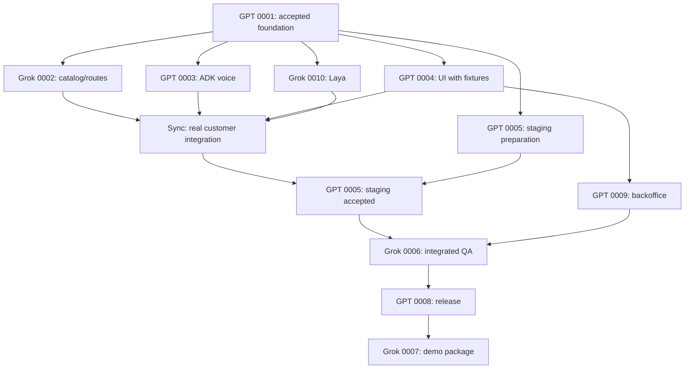

# GPT / Grok build allocation

Proposed allocation for the 16 October 2026 GCP release and 18 October submission. GPT and Grok are **development assistants**; the deployed solution still uses Gemini Live 3.8, Google ADK and Laya. No Grok client has been connected, no task has been dispatched to it, and no model version or account availability is assumed by this document.

GPT is the integration lead. GPT also owns the customer portal after the user’s 14 October reassignment. Grok owns bounded backend packages and evidence preparation. This split follows dependencies and exclusive file surfaces; it is not a benchmark claim that either model is better at a language or domain. Preserve existing task IDs, requirement scope, estimates and role accountability.

## Task assignment

| Task | Scope | Builder | Reviewer |
|---|---|---|---|
| [TASK-0001](sdlc/05-tasks/TASK-0001.md) | Foundation, schema, import and shared contracts | **GPT** | Grok |
| [TASK-0002](sdlc/05-tasks/TASK-0002.md) | Catalog lookup and walkable route API | **Grok** | GPT |
| [TASK-0003](sdlc/05-tasks/TASK-0003.md) | ADK + Gemini Live runtime and gateway | **GPT** | Grok |
| [TASK-0004](sdlc/05-tasks/TASK-0004.md) | Interactive customer portal and map | **GPT** | Grok |
| [TASK-0005](sdlc/05-tasks/TASK-0005.md) | Three-container GCP staging | **GPT** | Grok |
| [TASK-0006](sdlc/05-tasks/TASK-0006.md) | Integrated QA and hardening | **Grok** | GPT |
| [TASK-0007](sdlc/05-tasks/TASK-0007.md) | Demo rehearsal and submission package | **Grok** | GPT |
| [TASK-0008](sdlc/05-tasks/TASK-0008.md) | Final GCP release and rollback | **GPT** | Grok |
| [TASK-0009](sdlc/05-tasks/TASK-0009.md) | Protected backoffice backend and UI | **GPT** | Grok |
| [TASK-0010](sdlc/05-tasks/TASK-0010.md) | Laya classifier and ADK intent adapter | **Grok** | GPT |

TASK-0009 includes both backoffice API and its UI under GPT. The GPT frontend owner hands over the TASK-0004 shared portal shell first; do not have both builders modify the same route. The opposite-model reviewer reviews the diff and verification evidence, not merely the author's summary.

## File ownership and integration

| Surface | Writer | Handoff rule |
|---|---|---|
| `cmd/server/`, `cmd/import/`, `internal/config/`, `internal/platform/`, `migrations/`, `data/`, `api/openapi.yaml`, `go.mod`, `go.sum`, `compose.yaml` | GPT / TASK-0001 integration owner | Grok requests schema, dependency or registration changes; no concurrent edits |
| `internal/catalog/`, `internal/routing/` | Grok / TASK-0002 | Return constructors/handler registration and TEST-0007 evidence; GPT wires shared server |
| `internal/voice/`, `agent/` except classifier adapter and Dockerfile | GPT / TASK-0003 | Freeze gateway/ADK tool interfaces before Grok integration |
| `intent/` except Dockerfile; `agent/tools/intent.py` | Grok / TASK-0010 | Own classifier lock/model manifest; request ADK registry/lock changes from GPT |
| `web/` except backoffice route | GPT / TASK-0004 | Own customer components, shared layout/client/types and web lockfile; respond to GPT backoffice interface requests |
| `internal/backoffice/`, `web/src/routes/backoffice/` | GPT / TASK-0009 | Start after TASK-0004 shell handoff; shared web/layout changes go through the GPT frontend owner |
| Root, ADK and Laya Dockerfiles; `.dockerignore`, `deploy/`, `.github/workflows/` | GPT / TASK-0005 then TASK-0008 | Feature owners supply build inputs; GPT serializes image/manifest/release changes |
| `tests/` and acceptance evidence | Grok / TASK-0006 | Product fixes return to the assigned feature builder; GPT reviews results and acceptance coverage |
| `docs/demo/` | Grok / TASK-0007 | Use measured release evidence; GPT checks reproducibility and unsupported claims |
| Shared SDLC status, graph and contract changes | GPT integration coordinator | Apply reviewed handoffs through existing status workflow; no automatic approval/completion |

Tests inside a feature's exclusive directory follow its builder. Central integration tests belong to TASK-0006. A reviewer requests changes rather than editing the builder's live worktree. After handoff, any reassignment is recorded in the task before another writer takes over.

`owner:` remains the SDLC role. `implementation_model:` is GPT or Grok, `review_model:` is the other, and `assignment_status: proposed` records this planning state. Both backend roles span multiple tasks; the task ID and exclusive path define the work claim. GPT TASK-0003 and Grok TASK-0010 can run concurrently in separate sessions after their adapter contract is fixed, even though the same backend role remains accountable.

## Delivery sequence

1. **Foundation — GPT TASK-0001.** Freeze schema, API examples, private bridge/tool interfaces and fixture expectations. Grok reviews contracts and the existing frozen QA corpora. Preparatory source reading does not claim an implementation gate has passed.
2. **Highest-risk pair — GPT TASK-0003 + Grok TASK-0010.** Prove actual ADK/Gemini audio and real Laya CPU inference separately, then connect the narrow adapter. Mocked module fixtures help isolated development but cannot satisfy integrated acceptance.
3. **Customer vertical slice — Grok TASK-0002 and GPT TASK-0004.** GPT prepares TASK-0005 staging after its own voice work, or in a separate GPT session restricted to deployment files. Customer UI may start with agreed fixtures in the claimed GPT frontend session; do not assume extra concurrent sessions exist. Staging completion requires all real services.
4. **Backoffice and acceptance — GPT TASK-0009, then Grok TASK-0006.** Grok may prepare QA harnesses earlier, but final acceptance waits for all dependencies. GPT reviews the frozen cases and reruns selected catalog/UI/Laya checks independently, especially for Grok-authored features.
5. **Release — GPT TASK-0008 on 16 October.** Grok reviews candidate evidence and rollback results. Deployment uses the already-required cloud/access decisions; assigning a model does not supply credentials or approve publication.
6. **Submission pack — Grok TASK-0007 on 17 October.** GPT verifies the walkthrough against the deployed release; submission remains 18 October through the requested channel.

Default capacity assumption: one active GPT builder session and one active Grok builder session. More sessions may be used only on the exclusive paths above and with explicit task claims. Worktree separation does not remove contract dependencies or merge conflicts. The estimate remains **43–69 engineering hours**, not elapsed runtime divided by two. Qualify actual throughput before revising the deadline forecast.

## Synchronization and parallel work

A start prerequisite and an integration prerequisite are different. `blocked_by` lists the formal task-start dependencies; early feature work may use frozen fixtures, but integrated staging cannot pass with them. “Available in parallel” means separate active sessions/worktrees on disjoint files, not one GPT or Grok session doing several tasks at once.

| Task | Builder | Must wait before implementation starts | Work allowed in parallel / completion synchronization |
|---|---|---|---|
| TASK-0001 | GPT | Reviewed requirements/design and normal project execution gates | First shared foundation. Grok may review contracts and source; dependent feature implementation waits for accepted foundation output |
| TASK-0002 | Grok | TASK-0001 | Catalog/routes can run alongside 0003/0004/0005/0010; hand service constructors and TEST-0007 evidence to GPT for wiring |
| TASK-0003 | GPT | TASK-0001 and frozen private tool/intent interfaces | Voice runtime can use catalog/classifier fixtures for TEST-0008; real integration must synchronize with 0002 and 0010 |
| TASK-0004 | GPT | TASK-0001 and frozen API/event fixtures | Customer UI can run alongside backend work; TEST-0009 uses fixtures. Actual voice/card/map acceptance waits for 0002/0003/0010 |
| TASK-0005 | GPT | TASK-0001; actual cloud actions also need existing project/access prerequisites | Build/manifests/infra preparation can run alongside features. Complete staging only after 0002/0003/0004/0010 are integrated and TEST-0010 passes |
| TASK-0009 | GPT | TASK-0001 and accepted TASK-0004 customer-shell/fixture gate | Backoffice then uses its exclusive route/API paths; may run alongside remaining staging work. Shared web changes still go through the GPT frontend owner |
| TASK-0006 | Grok | TASK-0002/0003/0004/0005/0009/0010 | Final integrated acceptance waits for all six. Reading specs and preparing the frozen test plan can happen earlier; fixtures do not count as executed acceptance |
| TASK-0008 | GPT | TASK-0005 and TASK-0006 accepted | Release is sequential after the acceptance checkpoint; preserve TEST-0004 candidate checks, promotion, post-promotion smoke and rollback evidence |
| TASK-0007 | Grok | TASK-0008 accepted | Final demo recording/package uses the real release. Outline drafting may happen earlier, but cannot satisfy the task gate |
| TASK-0010 | Grok | TASK-0001 and frozen ADK adapter interface | Classifier can run alongside 0003 using an isolated ADK harness for TEST-0012; full voice integration waits for both modules |

### Required synchronization checkpoints

1. **Foundation checkpoint:** GPT hands off TASK-0001 schema, shared dependencies, interfaces and fixtures; Grok reviews them. Start 0002/0003/0004/0005/0010 only after that baseline is accepted.
2. **Voice-tool checkpoint:** GPT 0003 and Grok 0002/0010 agree on and integrate the actual catalog, classifier adapter, classification ACK and cancellation contracts. No concurrent edits to the ADK registry or root Go dependency/router files.
3. **Customer/staging checkpoint:** combine 0002/0003/0004/0010 into GPT 0005 and prove a real HTTPS voice-to-card/map flow. This checkpoint completes staging; it is not permission to begin frontend/backend work. TASK-0009 can begin after accepted 0004 without waiting for all staging evidence.
4. **Acceptance checkpoint:** after staging and backoffice, Grok 0006 runs the integrated gates and GPT reviews results. Fixes go back to the owning feature builder, followed by focused retesting. Failed evidence blocks release.
5. **Release checkpoint:** GPT 0008 releases on 16 October after the acceptance gate; Grok reviews the evidence. Grok 0007 packages the accepted release on 17 October.



The two TASK-0005 boxes show preparation and completion of the same task, not two task IDs. Early task-completion evidence remains phase-specific; the real integration checkpoint does not make 0003/0004 depend on each other cyclically.

### With one GPT session and one Grok session

Start GPT 0001 with Grok reviewing its contracts. Then pair GPT 0003 with Grok 0010. Grok continues 0002; GPT builds 0004 and prepares 0005 after its voice work, synchronizing shared integrations as they become ready. After 0004, GPT builds 0009 while Grok reviews delivered modules and prepares acceptance. Grok executes 0006 after all prerequisites, then GPT 0008, then Grok 0007. Additional sessions can shorten independent work only where the file ownership table permits it; they do not eliminate these checkpoints.

Any change to schema, API/event payload, private tool signature, model setup or shared lockfile triggers **resync of affected tasks**. The integration owner updates the contract, publishes the new baseline, and affected builders update/retest before continuing. Unrelated disjoint work need not stop. Reviewers pause their own builder work if using the same single session for a review handoff.

## Review and handoff

Each task returns its ID, base revision, changed files, implementation summary, exact verification commands/results, unresolved failures and required shared-file changes. Record the exact model/client version used at execution so the work can be traced; this plan intentionally selects model families only. Never claim a test passed because a model predicted that it would.

For GPT-built tasks, Grok checks the diff, linked requirements and evidence. For Grok-built tasks, GPT does the same and owns integration. TASK-0006 is not independent proof merely because Grok runs it: GPT reviews test expectations and failure accounting for Grok-built components. Final release needs real native voice, classification, UI, data and rollback evidence; two model opinions are not a substitute.

Use one task worktree and feature branch according to [GIT_WORKFLOW.md](../GIT_WORKFLOW.md); use `rtk` for local commands. Do not dispatch the same task to both builders. The repository contract takes precedence over a client default worktree directory. Official OpenAI documentation describes isolated worktrees for parallel work: [Git worktrees](https://learn.chatgpt.com/docs/environments/git-worktrees). Grok's official coding-client guide describes repository file/command workflows: [Grok Build guide](https://github.com/xai-org/grok-build/blob/main/crates/codegen/xai-grok-pager/docs/user-guide/01-getting-started.md). These references establish workflow options, not model-quality rankings or confirmed local availability.

## Ready-to-use handoffs

For the GPT foundation session, once implementation is requested:

```text
Work on TASK-0001 as the GPT builder for prompt-shop.
Read AGENTS.md, CONVENTIONS.md, GIT_WORKFLOW.md, docs/MODEL-ALLOCATION.md,
the task, its requirements, DES-0001 and ADR-0001. Follow current approvals
and task prerequisites; this prompt does not silently change artifact status.
Own only the TASK-0001 surfaces. Publish schema/API/private-tool fixtures and
registration interfaces for Grok TASK-0002/0010 and GPT TASK-0004. Preserve Gemini Live 3.8,
Google ADK, Laya, one portal and the 16 October GCP deadline.
Return the diff, TEST-0006 evidence and a concrete Grok review/handoff packet.
```

For the first Grok build session after the foundation/contract handoff:

```text
Work on TASK-0010 as the Grok builder for prompt-shop.
Read AGENTS.md, CONVENTIONS.md, GIT_WORKFLOW.md, docs/MODEL-ALLOCATION.md,
docs/REFERENCE-STUDY.md, TASK-0010, REQ-0006, DES-0001, ADR-0001 and TEST-0012.
Follow current approvals and prerequisites. Own intent/ except its Dockerfile,
and agent/tools/intent.py only. GPT owns ADK registry/locks and deployment files.
Implement real pinned English Laya inference and the fixed private classifier
contract. Preserve the frozen evaluation cases, bounded queue/deadline,
advisory-only labels, privacy and stale-turn behavior. Do not replace Gemini
Live native audio, bypass ADK, or count mocks as inference evidence.
Return changed files, exact TEST-0012 results, model/package provenance,
measured CPU/memory/latency and any shared-file requests for GPT review.
```

After each handoff, take the next assigned task only when its dependencies are satisfied. If Grok is available only through chat, return a reviewable patch and evidence instructions; do not label repository edits, local tests or deployment as executed without an actual tool run.


## Reassignment — 14 October 2026

At the user’s request, TASK-0004 changes from Grok builder/GPT reviewer to GPT builder/Grok reviewer. No other task is reassigned. Its frontend-dev owner, scope, estimate, dependency and acceptance gates remain unchanged. GPT owns the customer shell/shared web client through the TASK-0009 handoff. This update does not dispatch a Grok review or count as review evidence.
