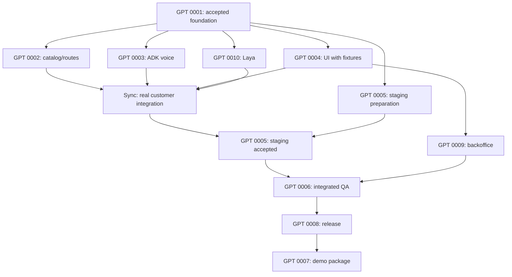

# GPT task allocation

At the user's request on 14 October 2026, **GPT builds and reviews all ten tasks**. This supersedes the previous GPT/Grok split and the earlier Task 4 reassignment. GPT is the integration coordinator; each task's SDLC role remains accountable. Gemini Live 3.8, Google ADK and Laya remain the application runtime.

Use a distinct GPT review pass or reviewer session to inspect the actual diff and verification evidence. Assignment does not constitute a review verdict, task completion or additional execution capacity. Existing review history remains attributed to the assistant that performed it.

## Task assignment

| Task | Scope | Builder | Reviewer |
|---|---|---|---|
| [TASK-0001](sdlc/05-tasks/TASK-0001.md) | Foundation, schema, import and shared contracts | **GPT** | GPT |
| [TASK-0002](sdlc/05-tasks/TASK-0002.md) | Catalog lookup and walkable route API | **GPT** | GPT |
| [TASK-0003](sdlc/05-tasks/TASK-0003.md) | ADK + Gemini Live runtime and gateway | **GPT** | GPT |
| [TASK-0004](sdlc/05-tasks/TASK-0004.md) | Interactive customer portal and map | **GPT** | GPT |
| [TASK-0005](sdlc/05-tasks/TASK-0005.md) | Three-container GCP staging | **GPT** | GPT |
| [TASK-0006](sdlc/05-tasks/TASK-0006.md) | Integrated QA and hardening | **GPT** | GPT |
| [TASK-0007](sdlc/05-tasks/TASK-0007.md) | Demo rehearsal and submission package | **GPT** | GPT |
| [TASK-0008](sdlc/05-tasks/TASK-0008.md) | Final GCP release and rollback | **GPT** | GPT |
| [TASK-0009](sdlc/05-tasks/TASK-0009.md) | Protected backoffice backend and UI | **GPT** | GPT |
| [TASK-0010](sdlc/05-tasks/TASK-0010.md) | Laya classifier and ADK intent adapter | **GPT** | GPT |

TASK-0009 includes both backoffice API and its UI under GPT. The TASK-0004 frontend owner hands over the shared portal shell first; serialize shared route/layout edits before TASK-0009. A separate GPT review pass checks the diff and verification evidence against the linked design and requirements.

## File ownership and integration

| Surface | Writer | Handoff rule |
|---|---|---|
| `cmd/server/`, `cmd/import/`, `internal/config/`, `internal/platform/`, `migrations/`, `data/`, `api/openapi.yaml`, `go.mod`, `go.sum`, `compose.yaml` | GPT / TASK-0001 integration owner | Feature owners request schema, dependency or registration changes from the integration owner; no concurrent edits |
| `internal/catalog/`, `internal/routing/` | GPT / TASK-0002 | Return constructors/handler registration and TEST-0007 evidence; GPT wires shared server |
| `internal/voice/`, `agent/` except classifier adapter and Dockerfile | GPT / TASK-0003 | Freeze gateway/ADK tool interfaces before classifier integration |
| `intent/` except Dockerfile; `agent/tools/intent.py` | GPT / TASK-0010 | Own classifier lock/model manifest; request ADK registry/lock changes from GPT |
| `web/` except backoffice route | GPT / TASK-0004 | Own customer components, shared layout/client/types and web lockfile; respond to TASK-0009 backoffice interface requests |
| `internal/backoffice/`, `web/src/routes/backoffice/` | GPT / TASK-0009 | Start after TASK-0004 shell handoff; shared web/layout changes go through the frontend owner |
| Root, ADK and Laya Dockerfiles; `.dockerignore`, `deploy/`, `.github/workflows/` | GPT / TASK-0005 then TASK-0008 | Feature owners supply build inputs; GPT serializes image/manifest/release changes |
| `tests/` and acceptance evidence | GPT / TASK-0006 | Product fixes return to the assigned feature builder; GPT reviews results and acceptance coverage |
| `docs/demo/` | GPT / TASK-0007 | Use measured release evidence; GPT checks reproducibility and unsupported claims |
| Shared SDLC status, graph and contract changes | GPT integration coordinator | Apply reviewed handoffs through existing status workflow; no automatic approval/completion |

Tests inside a feature's exclusive directory follow its builder. Central integration tests belong to TASK-0006. A reviewer requests changes rather than editing the builder's live worktree. After handoff, any reassignment is recorded in the task before another writer takes over.

`implementation_model: GPT` and `review_model: GPT` apply to TASK-0001 through TASK-0010. `owner:` remains the SDLC role, and `assignment_status` records the actual task claim/review state. The task ID, builder session and exclusive path define execution ownership. Reassignment preserves existing code and evidence; record a handoff before another session edits an active task.

## Delivery sequence

1. **TASK-0001 — foundation.** Freeze schema, API/private-tool fixtures and registration interfaces; complete a GPT review of contracts and evidence before integration.
2. **TASK-0003 and TASK-0010 — voice and classifier.** Qualify actual ADK/Gemini audio and Laya CPU inference, then integrate the narrow classifier adapter. Separate sessions may use disjoint paths after the interface is fixed.
3. **TASK-0002 and TASK-0004 — customer flow.** Build catalog/routing services and the customer UI against the frozen contracts. TASK-0005 may prepare staging on deployment-owned files; complete staging requires real integrated services.
4. **TASK-0009 and TASK-0006 — backoffice and acceptance.** Start protected backoffice after the customer-shell handoff. Prepare QA earlier where possible; final acceptance waits for all dependencies. A GPT reviewer checks test expectations and failure accounting.
5. **TASK-0008 — release.** Release on 16 October after acceptance; review source/image/revision, smoke and rollback evidence. Existing cloud/access and high-risk approval gates still apply.
6. **TASK-0007 — submission package.** Build the walkthrough from accepted release evidence on 17 October; submission remains 18 October through the requested channel.

Default capacity assumption: one active GPT builder session. Additional GPT sessions require explicit task claims and disjoint file ownership; assignment alone does not create or dispatch them. The estimate remains **43–69 engineering hours**. Verify actual throughput before revising the deadline forecast.

## Synchronization and parallel work

A start prerequisite and an integration prerequisite are different. `blocked_by` lists the formal task-start dependencies; early feature work may use frozen fixtures, but integrated staging cannot pass with them. “Available in parallel” means separate active sessions/worktrees on disjoint files, not one session doing several tasks at once.

| Task | Builder | Must wait before implementation starts | Work allowed in parallel / completion synchronization |
|---|---|---|---|
| TASK-0001 | GPT | Reviewed requirements/design and normal project execution gates | First shared foundation. GPT may review contracts and source; dependent feature implementation waits for accepted foundation output |
| TASK-0002 | GPT | TASK-0001 | Catalog/routes can run alongside 0003/0004/0005/0010; hand service constructors and TEST-0007 evidence to GPT for wiring |
| TASK-0003 | GPT | TASK-0001 and frozen private tool/intent interfaces | Voice runtime can use catalog/classifier fixtures for TEST-0008; real integration must synchronize with 0002 and 0010 |
| TASK-0004 | GPT | TASK-0001 and frozen API/event fixtures | Customer UI can run alongside backend work; TEST-0009 uses fixtures. Actual voice/card/map acceptance waits for 0002/0003/0010 |
| TASK-0005 | GPT | TASK-0001; actual cloud actions also need existing project/access prerequisites | Build/manifests/infra preparation can run alongside features. Complete staging only after 0002/0003/0004/0010 are integrated and TEST-0010 passes |
| TASK-0009 | GPT | TASK-0001 and accepted TASK-0004 customer-shell/fixture gate | Backoffice then uses its exclusive route/API paths; may run alongside remaining staging work. Shared web changes still go through GPT |
| TASK-0006 | GPT | TASK-0002/0003/0004/0005/0009/0010 | Final integrated acceptance waits for all six. Reading specs and preparing the frozen test plan can happen earlier; fixtures do not count as executed acceptance |
| TASK-0008 | GPT | TASK-0005 and TASK-0006 accepted | Release is sequential after the acceptance checkpoint; preserve TEST-0004 candidate checks, promotion, post-promotion smoke and rollback evidence |
| TASK-0007 | GPT | TASK-0008 accepted | Final demo recording/package uses the real release. Outline drafting may happen earlier, but cannot satisfy the task gate |
| TASK-0010 | GPT | TASK-0001 and frozen ADK adapter interface | Classifier can run alongside 0003 using an isolated ADK harness for TEST-0012; full voice integration waits for both modules |

### Required synchronization checkpoints

1. **Foundation checkpoint:** GPT hands off TASK-0001 schema, shared dependencies, interfaces and fixtures; GPT reviews them. Start 0002/0003/0004/0005/0010 only after that baseline is accepted.
2. **Voice-tool checkpoint:** The GPT owners of 0003 and 0002/0010 agree on and integrate the actual catalog, classifier adapter, classification ACK and cancellation contracts. No concurrent edits to the ADK registry or root Go dependency/router files.
3. **Customer/staging checkpoint:** combine 0002/0003/0004/0010 into GPT 0005 and prove a real HTTPS voice-to-card/map flow. This checkpoint completes staging; it is not permission to begin frontend/backend work. TASK-0009 can begin after accepted 0004 without waiting for all staging evidence.
4. **Acceptance checkpoint:** after staging and backoffice, GPT 0006 runs the integrated gates and GPT reviews results. Fixes go back to the owning feature builder, followed by focused retesting. Failed evidence blocks release.
5. **Release checkpoint:** GPT 0008 releases on 16 October after the acceptance gate; GPT reviews the evidence. GPT 0007 packages the accepted release on 17 October.



The two TASK-0005 boxes show preparation and completion of the same task, not two task IDs. Early task-completion evidence remains phase-specific; the real integration checkpoint does not make 0003/0004 depend on each other cyclically.

### With one GPT session

Build foundation first, then voice/classifier, catalog/customer UI and staging preparation according to the dependency gates. Continue with backoffice, integrated acceptance, release and submission. Run a distinct review pass after each handoff. Additional sessions can shorten independent work only where the ownership table permits it; they do not remove dependencies or review checkpoints.

Any change to schema, API/event payload, private tool signature, model setup or shared lockfile triggers **resync of affected tasks**. The integration owner updates the contract, publishes the new baseline, and affected builders update/retest before continuing. Unrelated disjoint work need not stop. Reviewers pause their own builder work if using the same single session for a review handoff.

## Review and handoff

Each task returns its ID, base revision, changed files, implementation summary, exact verification commands/results, unresolved failures and required shared-file changes. Record the exact model/client version used at execution so the work can be traced; this plan intentionally selects model families only. Never claim a test passed because a model predicted that it would.

For every task, GPT reviews the actual diff, linked requirements/design and executed evidence. A builder self-check alone does not count as the separate review pass. Final release requires real native voice, classification, UI, data and rollback evidence; review opinions do not replace executed tests.

Use one task worktree and feature branch according to [GIT_WORKFLOW.md](../GIT_WORKFLOW.md); prefix local commands with `rtk`. Keep one active builder per task, and route shared contract/wiring changes through the integration owner.

## Ready-to-use handoffs

For the GPT foundation session, once implementation is requested:

```text
Work on TASK-0001 as the GPT builder for prompt-shop.
Read AGENTS.md, CONVENTIONS.md, GIT_WORKFLOW.md, docs/MODEL-ALLOCATION.md,
the task, its requirements, DES-0001 and ADR-0001. Follow current approvals
and task prerequisites; this prompt does not silently change artifact status.
Own only the TASK-0001 surfaces. Publish schema/API/private-tool fixtures and
registration interfaces for GPT TASK-0002/0004/0010. Preserve Gemini Live 3.8,
Google ADK, Laya, one portal and the 16 October GCP deadline.
Return the diff, TEST-0006 evidence and a concrete GPT review/handoff packet.
```

For the classifier task after the foundation/contract handoff:

```text
Work on TASK-0010 as the GPT builder for prompt-shop.
Read AGENTS.md, CONVENTIONS.md, GIT_WORKFLOW.md, docs/MODEL-ALLOCATION.md,
docs/REFERENCE-STUDY.md, TASK-0010, REQ-0006, DES-0001, ADR-0001 and TEST-0012.
Follow current approvals and prerequisites. Own intent/ except its Dockerfile,
and agent/tools/intent.py only. GPT owns ADK registry/locks and deployment files.
Implement real pinned English Laya inference and the fixed private classifier
contract. Preserve the frozen evaluation cases, bounded queue/deadline,
advisory-only labels, privacy and stale-turn behavior. Do not replace Gemini
Live native audio, bypass ADK, or count mocks as inference evidence.
Return changed files, exact TEST-0012 results, model/package provenance,
measured CPU/memory/latency and any shared-file requests for GPT review.
```

After each handoff, take the next assigned task only when its dependencies are satisfied. Record repository edits, local tests and deployment only when the corresponding commands have actually run.
