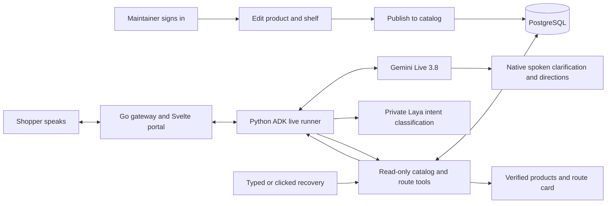

# Prompt Shop: prototype delivery plan

**Deploy to GCP on 16 October 2026. Submit on 18 October.** Use 17 October for rehearsal, fixes and the backup recording. All dates/times use Asia/Bangkok (UTC+7). Proposed deployment cutoff: 16 October at 17:00; the user specified the date, not an exact hour.

The MVP is one portal: a customer speaks an item request, confirms the product, and receives its stored aisle, shelf and walkable directions; a maintainer manages that catalog in the backoffice. Reuse the necessary Monti Jarvis code to reduce build time.

## Confirmed decisions

- One sample store first; add more database products after the main concept works.
- **Gemini Live 3.8 native voice-to-voice is required**, using exact model ID `gemini-3.8-live`; no provider/model substitution.
- **Google ADK and Laya intent classification are required.** ADK owns the Live conversation; Laya classifies four English intents through a private tool.
- English is required. Thai, Chinese and Japanese are time-permitting, in that order. Mandarin (`zh-CN`) is the initial Chinese locale assumption.
- Keep Svelte, Go Fiber, PostgreSQL, Docker and GCP from `config.yml`.
- Defer vector search until core lookup and directions work. The configured pg-vector technology is a later extension, not an MVP dependency.
- Customer and backoffice share one portal and hostname. Backoffice changes must be authorized on the server.
- Reuse selected code from the local `monti-jarvis` repository; do not import its entire commerce platform.

## Core scope

| Customer `/` | Backoffice `/backoffice` |
|---|---|
| Start an English Live voice conversation | Maintainer login/logout |
| Visible input/output transcripts and typed recovery | List and filter catalog products |
| Up to three choices; clarify/select by speaking or clicking | Create/edit product name, category and aliases |
| Highlighted product card, stored aisle and shelf | Assign an existing seeded shelf |
| Synchronized map and textual route from an explicit entrance | Draft, publish and archive |
| Native spoken directions; interruption, stop and mute | Reject stale edits and unauthorized writes |
| Clear not-found, permission and timeout recovery | Published changes appear in shopper search without redeploy |

Proposed dataset: 60 products across eight aisles, with one connected floor map. This is demonstration data, not a claim about stock in a real hypermarket. A repeatable JSON import supports larger datasets; a browser bulk-import screen and map editor are deferred.

No checkout, payments, orders, booking, subscriptions, KYC, multi-tenant console, live indoor positioning or real-time inventory. Recipe-to-shopping-list is a later product feature; up to five curated recipes are stretch work only after all core gates pass.

## User flow

The system measures time to useful directions and route validity. It cannot yet promise reduced real-store walking time or a fastest multi-stop shopping trip. Displayed shelf and route facts come only from validated database/tool results. Gemini speaks using those facts; zero fabricated spoken locations is an acceptance target checked by QA, not a guarantee provided by prompting.

## Delivery schedule

| Date | Delivery focus | Exit evidence |
|---|---|---|
| **13 Oct, evening** | Review contracts; selected source reuse; foundation; ADK/Gemini Live, Laya CPU and cloud-access spike | One actual ADK gemini-3.8-live audio/tool round trip plus real Laya inference, valid sample schema, project access and budget identified |
| **14 Oct** | Customer flow, product lookup, routes and voice in parallel after contract freeze; early GCP staging | One real English request uses ADK and Laya, highlights an item and shows a route over HTTPS using PostgreSQL |
| **15 Oct** | Finish protected backoffice; integrated tests and fixes; freeze by 18:00 | English flow and product edit→publish→search pass; no core auth/location defect |
| **16 Oct** | Release to GCP, verify from demo device, rehearse rollback | Final HTTPS URL, image/revision, test evidence and known-good rollback; target 17:00 |
| **17 Oct** | Rehearse, record backup video, package submission | Short demo video, screenshots, runbook, source/release details and checklist |
| **18 Oct** | Submit after final user review | Submission in the required format/channel; exact cutoff still to confirm |

Deployment work starts early on 14 October. A local app or a cloud hello-world page does not satisfy the release milestone.

## Work packages and capacity

| Task | Proposed lead | Builder | Scope | Estimate |
|---|---|---|---|---|
| [TASK-0001](sdlc/05-tasks/TASK-0001.md) | backend-dev-1 | **GPT** | Foundation, contracts, sample catalog/import | 3–5 h |
| [TASK-0002](sdlc/05-tasks/TASK-0002.md) | backend-dev-1 | **Grok** | Product lookup and walkable routes | 4–6 h |
| [TASK-0003](sdlc/05-tasks/TASK-0003.md) | backend-dev-2 | **GPT** | ADK native Live runtime and Go gateway | 8–14 h |
| [TASK-0010](sdlc/05-tasks/TASK-0010.md) | backend-dev-2 | **Grok** | Laya classifier and ADK intent tool | 4–7 h |
| [TASK-0004](sdlc/05-tasks/TASK-0004.md) | frontend-dev | **GPT** | Shared portal and Live audio customer flow | 6–9 h |
| [TASK-0005](sdlc/05-tasks/TASK-0005.md) | devops-agent | **GPT** | Three-container GCP staging and model startup | 5–8 h |
| [TASK-0009](sdlc/05-tasks/TASK-0009.md) | backend-dev-1 + frontend-dev | **GPT** | Minimal protected backoffice | 4–6 h |
| [TASK-0006](sdlc/05-tasks/TASK-0006.md) | qa-agent | **Grok** | Integrated ADK/Laya/UI acceptance and hardening | 5–8 h |
| [TASK-0008](sdlc/05-tasks/TASK-0008.md) | devops-agent | **GPT** | Final release/rollback | 2–3 h |
| [TASK-0007](sdlc/05-tasks/TASK-0007.md) | docs-agent | **Grok** | Demo and submission pack | 2–3 h |

Total estimate: **43–69 engineering hours**, including rehearsal work, not a delivery guarantee. There is no project velocity history. Five configured delivery-agent roles are not five confirmed human engineers. This deadline is aggressive: it relies on parallel work on separate modules, prompt access decisions and successful first-day ADK/Gemini and Laya CPU qualification. The shared schema/router/contracts stay under one owner; frontend shared layout work is serialized. Five proposed one-day sprint records cover 13–17 October. The increase from 34–53 hours covers ADK integration, required Laya inference, extra container deployment and verification. TASK-0003 (GPT) and TASK-0010 (Grok) remain under backend-dev-2 accountability but can run in separate sessions after the adapter contract is frozen. Their combined estimate remains 12–21 engineering hours; parallel execution does not guarantee that elapsed time halves. The 16 October deadline remains unchanged and is at higher risk if first-day model/runtime qualification fails.

## GPT and Grok allocation

[MODEL-ALLOCATION.md](MODEL-ALLOCATION.md) assigns a builder and opposite-model reviewer to every task, with exclusive file surfaces and ready-to-use handoffs. GPT leads TASK-0001/0003/0004/0005/0008/0009; Grok leads TASK-0002/0006/0007/0010. GPT owns shared integration and release; Grok does not independently change shared contracts or deploy. These are development tools, while Gemini Live 3.8, ADK and Laya remain the required runtime.

## Reuse already prepared

The [selective code snapshot](../references/monti-jarvis/README.md) contains 20 files/excerpts, their hashes and the original MIT license. Selected areas are static SvelteKit setup, microphone handling, browser Live PCM/playback and selected Gemini relay protocol fragments, interactive voice panel, atomic product presentation, visual tokens, catalog UI/request/validation patterns, static Go serving and credential redaction. The original repository is unchanged.

The source backend uses `net/http`; Prompt Shop retains the configured Fiber stack. Some UI code depends on Monti commerce types and must be adapted. The snapshot is **not a runnable or integrated portal**. Existing standalone tests for the copied Go serving/redaction helpers passed; no live voice, database or cloud acceptance has run.

## Architecture proposal

One Cloud Run service revision contains three matched images: Go Fiber serves the static Svelte portal, admission gateway and catalog/backoffice APIs; Python ADK owns `Runner.run_live()` and the server-only Gemini key; a private Laya container loads the pinned English intent checkpoint. Cloud SQL remains the authority for products and routes, accessed only by Go. ADK calls `classify_intent`, then validated catalog/route tools; typed lexical recovery remains independent.

The [reference study](REFERENCE-STUDY.md) maps Laya installation, ADK Live sessions and Monti's interactive UI to concrete tasks. Monti's validated tool-event presentation drives cards, highlighting and map updates; captions do not start a competing search. Mobile drawer closure ends microphone capture; all events are checked against the current session/turn.

Proposed classifier labels are `find_item`, `select_item`, `repeat_directions`, `out_of_scope`, with abstention on uncertainty/failure. Classifier results never grant permissions or create product/location IDs. Initial container resources total 4 vCPU/5 GiB per instance (Go 1 CPU/512 MiB, ADK 1 CPU/512 MiB, Laya 2 CPU/4 GiB); these need measured qualification and a budget. Pin dependencies/model files, preload/warm Laya before readiness, and qualify the 1,200 ms classification deadline on actual CPU. Native audio latency measurements include this work.

Browser input is PCM16LE mono16kHz; native output is PCM24kHz. A short-lived single-use cookie ticket protects `/ws/voice` without URL credentials, alongside exact Origin validation. Proposed session bounds are 30-second setup, 300-second conversation and 60-second idle expiry under a 360-second Cloud Run request timeout. Interruption flushes playback and invalidates obsolete tool results. [Google model documentation](https://ai.google.dev/gemini-api/docs/models/gemini-3.8-live) and [Live capabilities](https://ai.google.dev/gemini-api/docs/live-api/capabilities) are the integration references.

One protected maintainer session provides minimal catalog writes without importing Monti's tenant authentication platform. Exact API, session/CSRF, schema, UX and ownership contracts are in [DES-0001](sdlc/03-designs/DES-0001.md); trade-offs are in [ADR-0001](sdlc/04-adrs/ADR-0001.md). Both are proposed and unsigned.

GCP supports the proposed [Cloud Run container](https://docs.cloud.google.com/run/docs/container-contract) and [Cloud SQL connection](https://docs.cloud.google.com/sql/docs/postgres/connect-run) pattern. Actual account access, region/model availability, costs and latency must be verified before provisioning; the [deployment plan](sdlc/08-deployments/DEP-0001.md) records those gates.

## Release acceptance

- Real Python ADK Live execution and Laya checkpoint inference participate in accepted native voice turns; no bypassed or mocked component counts.
- Laya classifies **at least 36 of 40** frozen balanced English examples correctly; abstention/errors count as misses on that normal set. Verify its 1,200 ms total deadline, queue bounds and advisory-only result handling.
- At least **27 of 30** frozen supported English prompts return the expected item in the first three candidates.
- **Zero fabricated aisle/shelf values**; unknown products are clearly not found.
- Every seeded mapped destination has a valid walkable path from the entrance.
- Warm **p95 ≤5 seconds to first actionable native speech and ≤8 seconds to a verified product/route card** from the last voiced input sample across 30 trials; typed search and selection-to-route **p95 ≤2 seconds**, measured on the declared device/network. Exclude greetings/filler; measure session setup, cold starts and failed trials separately. These are targets, not results.
- A maintainer can create/edit/publish a product; shoppers see it from the same database. Anonymous/expired/forged writes fail; version conflicts preserve newer records.
- Real `gemini-3.8-live` audio, spoken clarification/selection, interruption and stale-result cancellation pass. Microphone denial, model/quota failure and disconnect recover visibly; typed recovery never replaces required voice acceptance.
- Final GCP HTTPS flow, persistent data, secret/log checks and rollback pass. A backup recording accompanies the demo.

Detailed cases: [TEST-0001 catalog](sdlc/07-tests/TEST-0001.md), [TEST-0002 voice](sdlc/07-tests/TEST-0002.md), [TEST-0003 routes](sdlc/07-tests/TEST-0003.md), [TEST-0004 release](sdlc/07-tests/TEST-0004.md), [TEST-0005 backoffice](sdlc/07-tests/TEST-0005.md). The Laya gate is [TEST-0012](sdlc/07-tests/TEST-0012.md). Other feature tasks first use bounded verification specs TEST-0006–TEST-0009; early staging uses TEST-0010. The separate 17 October demo/package gate is TEST-0011, so it cannot block the 16 October release. Test specifications are proposed; none represents an executed MVP test.

## Scope cuts and contingencies

1. If the core English flow is not green by 15 October noon, remove extra languages, recipes and visual polish from this release.
2. Keep backoffice to product names/aliases and existing shelf selection. Do not add map editing, dashboards, stock control or account administration.
3. If ADK/Gemini Live 3.8 or Laya qualification fails, resolve compatibility, model loading, resource and quota limits immediately and report deadline risk. ADK and Laya remain required; neither is silently removed. Another model or separate STT/TTS pipeline does not meet the user requirement; typed search remains recovery only.
4. If GCP access is unresolved on 14 October morning, escalate immediately and continue local integration. A local demo/recording is contingency evidence, not completion of the GCP deadline.
5. Freeze feature changes on 15 October at 18:00. Use 16 October for release blockers only; 17 October is buffer/rehearsal, not the planned first deployment.

## Questions for review

- GCP project ID, billing status, permissions, region constraints and prototype spending limit. User answer is pending; do not invent them.
- Exact demo device/browser and whether reviewers need a public link or restricted access. Backoffice protection is mandatory either way.
- Exact submission cutoff/time zone, format and required channel on 18 October.
- Confirm proposed 16 October 17:00 deployment cutoff and the 60-product/eight-aisle seed size. These are planning assumptions, not additional user commitments.

## Review status

The [SDLC review index](sdlc/REVIEW.md) links the complete proposed pack. All roadmap, requirements, design, ADR, tasks, sprints, tests and deployment artifacts remain proposed; no implementation work is marked started or complete. Source selection/copy and its limited helper tests are completed preparation only. The SDLC implementation lock remains unsigned until the user approves the plan; cloud deployment additionally needs concrete project/access/budget details.
