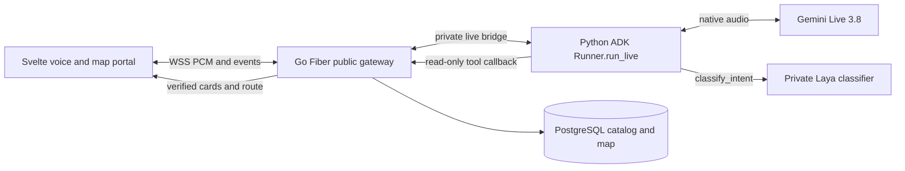

# Laya, ADK and Monti UI study

Reviewed 13 October 2026 for the 16 October GCP prototype. The user requires Gemini Live 3.8 native voice-to-voice, Google ADK and Laya intent classification, with interaction patterns learned from Monti shopping-web. This is an integration plan and source study; no package, model or cloud runtime has been installed or qualified by this work.

## Roles in the prototype

| Component | Responsibility | Authority |
|---|---|---|
| Gemini Live `gemini-3.8-live` | Native audio understanding and spoken conversation | Uses tool results; cannot establish a shelf location |
| Python Google ADK | Live session runner and declared function tools | Coordinates classification and catalog/route calls |
| Laya | Four-label English intent classification | Advisory label/confidence or abstention; no product IDs, routes or writes |
| Go Fiber + PostgreSQL | Admission, catalog search, selected-product validation, walkable route and protected backoffice | Authoritative product/location and access decisions |
| Svelte portal | Voice controls, captions, candidate spotlight and map | Renders validated events in predefined components |



## What the sources establish

Laya classifies text into typed decisions. Its installation instructions use an isolated Python environment; optional extras include an HTTP server. Initial checkpoint loading requires model files, while preloading moves that cost out of the request. The repository's advertised timings describe its own benchmark hardware, not this prototype. We will load only the English checkpoint rather than preload every language. [Laya installation and model-loading documentation](https://github.com/NandhaKishorM/laya#installation-details)

The inspected main-branch package metadata declares version 0.4.6, Python ≥3.10, and dependencies including PyTorch, Transformers and Hugging Face Hub. This is an observed source version, not an installed or qualified release. The implementation task must resolve and lock compatible CPU wheels, package hashes and a checkpoint revision; library and checkpoint licenses are recorded separately. [Package metadata](https://github.com/NandhaKishorM/laya/blob/main/pyproject.toml)

ADK's custom server pattern uses `Runner.run_live()` and a `LiveRequestQueue` per connection, with concurrent upstream and downstream tasks. The application owns authentication, transport and cleanup. This supports the proposed Python runtime while retaining Go for the existing portal services; we have not verified a corresponding Go Live interface. [ADK custom server](https://adk.dev/live/custom-server/)

`RunConfig` configures audio output, transcription and live-blob persistence. Merely choosing a streaming enum on a text runner is insufficient. Use the actual Live runner, `AUDIO`, and `save_live_blob=False`; application cleanup must also delete ephemeral session events and close both tasks/queues. The exact pinned ADK/GenAI versions must prove Gemini 3.8 setup and tool behavior in a real exchange. [ADK configuration](https://adk.dev/live/configuration/)

## Installation handoff

The upstream base installation is `python -m pip install laya`; it does not prove that a checkpoint loads or that inference meets a budget. At implementation, use an isolated environment, then replace loose versions with resolved locks before building images. A minimal local study sequence is below (documented only, not run here):

```sh
rtk proxy python3 -m venv .venv-laya
rtk proxy .venv-laya/bin/python -m pip install laya
rtk proxy .venv-laya/bin/python -I -c 'import laya; print(laya.__version__)'
```

Use the deployment platform's qualified CPU PyTorch build, not an incidental workstation GPU wheel. The ADK runtime has its own environment/lock and no Laya/PyTorch dependency; the private classifier image owns model dependencies. The custom classifier wrapper fixes schema/auth/bounds instead of exposing upstream generic inference endpoints.

## Bounded Laya feature

This is a project-specific design, not a claim that Laya ships this hypermarket workflow. ADK calls `classify_intent` for a completed shopper request before catalog actions. The native Live model supplies the text argument; no separate speech-recognition service is added. A server-owned question schema returns one of `find_item`, `select_item`, `repeat_directions`, `out_of_scope`, or an explicit abstention. Laya cannot select a provider, authorize a tool or choose a product ID.

Examples for development fixtures: “Where is milk?” → find_item; “The second one” → select_item; “Say those directions again” → repeat_directions; “Book me a hotel” → out_of_scope. These are expected labels, not observed predictions. Ambiguous text and failed inference produce abstention and a short clarification. Low-confidence output is never treated as a security verdict or proof that an item is missing.

Proposed evaluation: freeze 40 balanced English utterances before tuning; require ≥36 correct, counting unexpected abstention/error as misses. Report the confusion matrix, coverage and cold/warm latency on actual deployment hardware. The classifier's 1,200 ms deadline includes at most 200 ms queue wait; one inference worker and at most four queued requests bound contention. A late worker result cannot affect a newer turn. Native voice end-to-end timing includes classification; the existing audio/card targets are not reset at this tool call.

Laya runs in a third private container so CPU inference cannot block the ADK audio event loop. Download a fixed English checkpoint during build/provisioning, preload and warm it before classifier readiness. Start with a measured candidate of 2 vCPU/4 GiB for Laya; this is not a demonstrated memory or latency result. No GPU, model training, MCP, LangChain or vector database is required for this feature. Exact transport and admission details belong to [DES-0001](sdlc/03-designs/DES-0001.md).

## Monti interactive UI findings

Source root: `/Users/apaichon/Projects/libra/monti/monti-jarvis/apps/shopping-web`. Selected exact fragments and their hashes are in the [source manifest](../references/monti-jarvis/MANIFEST.json). The source repository remains unchanged.

| Inspected source | Useful behavior | Prompt Shop adaptation |
|---|---|---|
| `src/lib/components/MontiPanel.svelte` | Voice states/timer, transcript callbacks, tool-driven presentation, mobile drawer and focus handling | Explicit Start/End, microphone and speaker mute, captions and visible recovery; no automatic voice start or customer-login dependency |
| `src/routes/stores/[slug]/+page.svelte` | Checks request sequence before committing exact product results; spotlight state | Commit only current session/turn candidate and route events; highlight the selected item and matching shelf |
| `src/lib/components/ProductCard.svelte` | Deferred spotlight with stale-token check and reduced-motion scrolling | Three compact product choices with aisle/shelf and Show route; no price, stock or cart actions |
| `src/lib/montiVoice.ts` | PCM capture/playback, queued-audio cancellation and event callbacks | Adapt to the approved binary protocol and cookie admission; retain current generation checks |
| `src/lib/styles/tokens.css` | Small shared palette, spacing and focus tokens | Reuse as a starting point and verify contrast in the final customer/backoffice portal |

The critical source lesson is to avoid searching again when the final caption arrives: Monti already distinguishes catalog tool actions from transcript rendering. Prompt Shop will display candidates from validated tool events, avoiding competing searches that overwrite the current spoken result. Its frontend never executes arbitrary model HTML, JavaScript or component descriptions.

## Proposed interaction layout

```text
+------------------------------------------------------------+
| Prompt Shop                         Sample store | Backoffice|
+---------------------------+--------------------------------+
| Voice assistant           | Find an item                   |
| Listening / Speaking      | [Milk________________] [Search]|
| [Start / End] [Mic] [Sound]| Up to three catalog choices    |
| Session time remaining    | [Whole milk] [Oat milk] [...]  |
| User / assistant captions | Selected: Aisle 2 / Shelf 3     |
| Readable recovery message | Map path + ordered directions  |
+---------------------------+--------------------------------+
```

On a narrow screen, the voice panel becomes a drawer with an explicit launcher. Closing the drawer ends capture for this prototype, flushes playback and returns focus to the launcher. Desktop background updates announce a result without stealing keyboard focus; explicit Show route moves focus to the route heading. Reduced motion removes decorative pulsing and smooth scrolling. The backoffice stays a separate route on the same origin with server authorization.

| Validated event | UI action |
|---|---|
| ready / speech activity | Update visible voice state and session countdown |
| input/output transcript | Merge caption text for the current turn; never initiate a second search |
| candidates | Replace up to three cards atomically for the current search ID |
| route | Highlight the chosen card and shelf; update path and textual steps together |
| interrupted / new turn | Flush obsolete audio and invalidate pending updates |
| stop / expiry / disconnect | Release microphone, clear transient session state and offer explicit restart/typing |

These are planned behaviors. [TASK-0003](sdlc/05-tasks/TASK-0003.md) owns ADK/native audio, [TASK-0004](sdlc/05-tasks/TASK-0004.md) owns interaction, and [TASK-0010](sdlc/05-tasks/TASK-0010.md) owns Laya classification. [TEST-0009](sdlc/07-tests/TEST-0009.md) covers UI fixtures and [TEST-0012](sdlc/07-tests/TEST-0012.md) covers classifier qualification before integrated acceptance.
