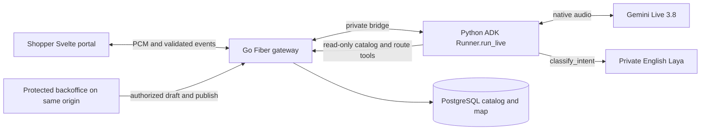

# Architecture and reuse provenance

## Proposed integrated flow

The diagram follows [DES-0001](../sdlc/03-designs/DES-0001.md) and [ADR-0001](../sdlc/04-adrs/ADR-0001.md). It describes the target integration. Current source has local foundation/customer/backoffice/voice modules, but routing/Laya/shared gateway integration and full deployed qualification remain incomplete. A UI label, readiness response or architecture picture cannot establish actual model execution.

Go owns published product/shelf/map truth and maintainer authorization. ADK owns the native Live session. Laya supplies an advisory English intent or abstention and cannot authorize writes or fabricate a location. Svelte renders validated current-turn results and accessible textual directions. Three containers share one Cloud Run service revision; Cloud SQL holds durable data. pgvector, recipes and extra languages follow the accepted core.

## Selected Monti source

The preserved [snapshot manifest](../../references/monti-jarvis/MANIFEST.json) records source version `2.38.0-rc.10`, 20 copied files/excerpts, source hashes, copied hashes and excerpt line spans, captured 13 October 2026. It does not claim a clean upstream Git commit. Preserve [the MIT notice](../../references/monti-jarvis/LICENSE), copyright 2026 Apaichon Punopas, and [the frontend adaptation notice](../../web/NOTICE.md). The source repository and reference snapshot remain unchanged.

| Reference behavior | Prompt Shop adaptation / evidence boundary |
|---|---|
| Microphone, PCM queue, transcript merge and interruption | Explicit user start/end, bounded PCM and turn cleanup. Actual device/model evidence still required. |
| Voice panel/mobile drawer, candidate spotlight and stale-result guard | Shopper item choices and synchronized shelf/map/text; no cart or commerce actions. |
| Catalog editor and draft/publish patterns | Same-store maintainer session/CSRF/version enforcement, existing shelf references and explicit publication. |
| Static serving and redaction helpers | Same-origin portal/API isolation and defense in depth; content-free logging remains required. |

No source `.env`, credentials, source database/customer records, payments, hotel booking or unrelated infrastructure enters this package. [Reference study](../REFERENCE-STUDY.md) explains design intent; feature README/NOTICE files describe actual adaptations. The old source Gemini relay is a protocol reference, while Prompt Shop's provider connection must use ADK. Historical source versions or benchmark claims do not qualify the required Gemini/Laya runtime.

## Release and package provenance

Current annotated source checkpoint: v0.1.0, commit `50054b23cfe3336d019fee8da0db474da27940e0`. Demo preparation branch starts from develop `36569ea939fc5991b556135150a169062a644445`, which has the same source tree. Record the actual accepted release source, all three OCI digests, ADK/GenAI lock identity, Gemini configuration, Laya checkpoint/license/model-file digests and schema/catalog/map versions before recording. Never present this source tag as deployed acceptance or rewrite it to include later fixes.

The user supplied the AI Builder Cup PDF in Downloads as the proposal template. It has 16 landscape pages, 720 x 405 points, black branded headers and white content areas. The proposal retains original supplied branding, editable section content and 16-page order. The instruction page and closing branding stay in place; the spare page carries rehearsal/release readiness. Source/template hashes and local validation scope are recorded in [preparation evidence](evidence/preparation.json). Competition logos indicate the supplied template, not endorsement of this project.
