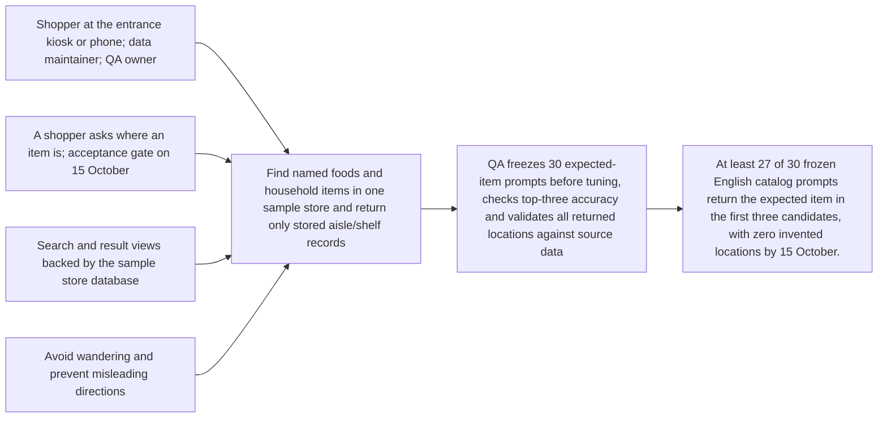
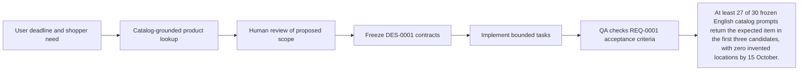

# Requirement: Catalog-grounded product lookup

## Outcome
At least 27 of 30 frozen English catalog prompts return the expected item in the first three candidates, with zero invented locations by 15 October.

Baseline: no implemented flow or measured benchmark yet. Measurement owner: backend-dev-1 with qa-agent. These are proposed acceptance targets, not measured results.

## 5W1H canvas
| Dimension | Answer |
|---|---|
| Who | Shopper at the entrance kiosk or phone; data maintainer; QA owner |
| What | Find named foods and household items in one sample store and return only stored aisle/shelf records |
| When | A shopper asks where an item is; acceptance gate on 15 October |
| Where | Search and result views backed by the sample store database |
| Why | Avoid wandering and prevent misleading directions |
| How | QA freezes 30 expected-item prompts before tuning, checks top-three accuracy and validates all returned locations against source data |

## 5W1H graph

## Requirement workflow

## Context and evidence
The prototype is for a hypermarket shopper locating food and items quickly. User confirmed sample store data, database expansion later, and vector search after the main concept works. English is required; Thai, Chinese and Japanese are time-permitting. Deployment date: 16 October 2026; submission: 18 October 2026, Bangkok time.

## Acceptance criteria
- [X] Given 60 seeded products across eight aisles, when the 30 frozen supported English queries run, then at least 27 include the correct product in the first three candidates.
- [X] Given an ambiguous request such as milk, when multiple products match, then at most three stored candidates are shown for explicit selection before routing.
- [X] Given an unknown item, when search finds no matching catalog entry, then the app reports not found and returns no generated aisle or shelf.
- [X] Given a new valid product/location import, when the same versioned import is rerun, then records are upserted without duplicates and the item is searchable without redeploying the frontend.
- [X] Given an invalid shelf or aisle reference, when importing a batch, then the batch is rejected with row errors and the existing valid catalog remains intact.

## Scope
- **In scope:** A versioned sample dataset with product IDs, display names, locale aliases, aisle/shelf labels and map-node references; a documented CSV or JSON import; exact/normalized alias search first.
- **Out of scope:** Live inventory/pricing, embeddings, admin UI and real store integration. Vector indexing is deferred until after concept validation.
- **Dependencies:** ROADMAP-0001, proposed DES-0001 contracts and corresponding planned test TEST-0001.

## Notes
All artifacts remain proposed. Implementation starts only after the review pack and relevant contracts are approved. Unresolved cloud project/budget and exact demo device details are recorded in the review overview.
