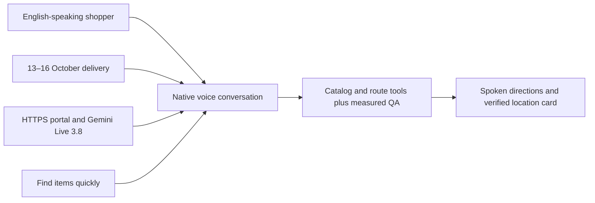
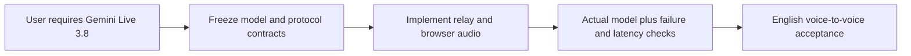

# Requirement: Gemini Live 3.8 native voice-to-voice

## User scope amendment — 16 October 2026

The user explicitly requires general conversation and AI selection of when to match
store items, suggest food menus and find shelves. Greetings and general questions
must receive spoken replies; an uncertain shopping-intent classification must not
silence them. Meal/recipe suggestions may use model knowledge, with ingredients
treated as suggestions rather than catalog availability. Requests to locate or
match an ingredient/product still use authoritative published catalog and route
tools. Keep the conversation alive across these modes in one voice session, with
one ingredient located at a time. This replaces the former item-only conversational
restriction and recipe-idea deferral for the authorized local implementation; it
does not add a recipe database, inventory feed or release acceptance.

Additional manual checks: greeting → general question → meal suggestion → product
lookup in one session; confirm natural answers for the first three and verified
product/route facts for the last. Existing native audio, privacy and latency gates
remain required. Historical artifact status and acceptance boxes are unchanged.

## Outcome
An English-speaking shopper finds an item and hears its directions through an actual `gemini-3.8-live` native audio session, including spoken clarification and selection. Warm p95 targets are ≤5 seconds to first actionable speech and ≤8 seconds to a verified product/route card from the last voiced input sample across 30 trials. Greetings and filler do not count; setup and cold starts are measured separately. Targets are proposed, not measured results.

## 5W1H canvas
| Dimension | Answer |
|---|---|
| Who | English-speaking shopper; backend-dev-2, frontend-dev and QA |
| What | A bounded, user-started native voice conversation with catalog search and route tools |
| When | Real model spike 13 October; integration 14 October; acceptance 15 October; GCP deployment 16 October |
| Where | Declared desktop/tablet Chrome over HTTPS; browser PCM through the Go gateway and private Python ADK runtime to Gemini Live |
| Why | Find products quickly and continue clarification without mandatory typing or clicks |
| How | Verify real model identity, audio playback, grounded tool results, interruption and recovery on the demo device/network |

## 5W1H graph

## Requirement workflow

## Context and evidence
The user requires Gemini Live 3.8 voice-to-voice and Google ADK. ADK manages the provider session and declared tools; Laya classification is required by REQ-0006. Google documents the exact model identifier as [`gemini-3.8-live`](https://ai.google.dev/gemini-api/docs/models/gemini-3.8-live). Use native AUDIO output and input/output transcription only as display side channels; a separate STT→text model→TTS pipeline does not meet this requirement. English is mandatory; Thai, Chinese and Japanese follow as time permits. One sample store and database expansion remain in scope; vector search follows the working concept.

## Acceptance criteria
- [ ] Given an allowed microphone and an actual gemini-3.8-live session managed by Google ADK Runner.run_live, when the shopper asks in English, then native audio flows in both directions and tool-backed results meet warm p95 at most 5 seconds to first actionable speech and 8 seconds to a verified product/route card across 30 trials, measured from the last voiced input sample.
- [ ] Given a shopper starts or stops voice, when microphone permission is allowed, denied or unsupported, then listening is clearly indicated, stopping releases microphone resources, and usable typed recovery remains available without reload.
- [ ] Given ambiguous products or a follow-up, when the shopper clarifies or selects by speaking, then catalog and route tools resolve the selected product without requiring a click; input/output transcripts are visible side channels and all displayed aisle/shelf values come from validated server results that also drive current-item highlighting and the map.
- [ ] Given an ongoing spoken reply, when the shopper interrupts, stops or starts a new request, then queued playback and obsolete tool/audio results are cancelled or rejected so stale directions cannot replace the current result.
- [ ] Given model unavailability, quota failure, disconnect, idle expiry or session expiry, when voice cannot continue, then the app shows a bounded error and explicit reconnect or typed recovery; another model or separate transcription/synthesis pipeline cannot satisfy this requirement.

## Scope
- **In scope:** explicit start/stop and mute; two-way PCM streaming; spoken clarification/selection; interruption/barge-in; visible transcripts and typed recovery; server-side read-only catalog/route tools; session and idle limits.
- **Out of scope:** wake words, background always-listening behavior, unrestricted chat, automatic language detection, separate speech providers and mandatory extra languages.
- **Dependencies:** ROADMAP-0001, DES-0001 and TEST-0002. DB-backed tools authorize displayed facts. Native speech follows tool results and grounding instructions; QA must detect fabricated speech because prompts alone cannot guarantee it.

## Notes
DES-0001 defines the short-lived session ticket, WebSocket protocol and bounds. Actual account entitlement, quota and a successful model exchange remain first-day gates. Unavailable Gemini Live 3.8 is a reported release blocker, never permission to silently substitute another model. All artifacts remain proposed; no runtime acceptance has executed.

## ADK and interactive UI integration

Use the actual native Live runner, a per-connection input queue and explicit session cleanup; direct provider bypass does not satisfy the ADK requirement. Catalog tool events drive predefined Svelte cards and route components; captions never launch a competing search. Mobile drawer closure ends microphone capture; stale session/turn events cannot overwrite the current map. See the [source study](../../REFERENCE-STUDY.md).
