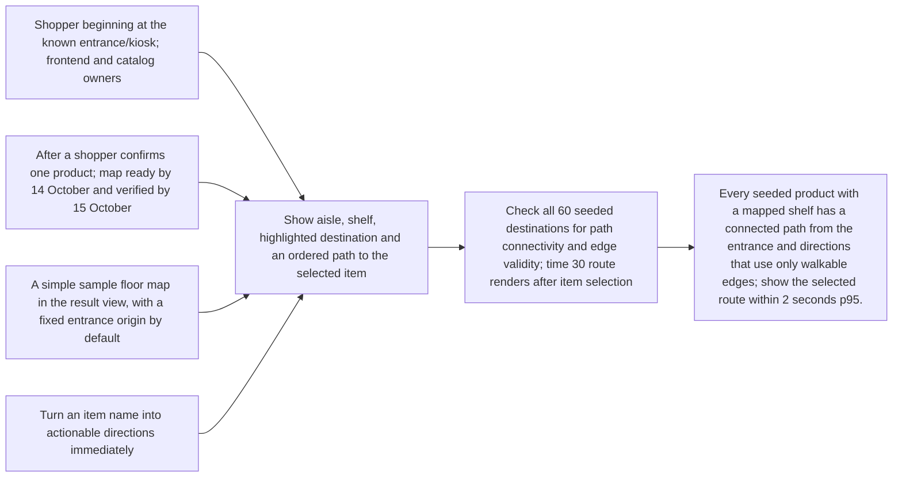
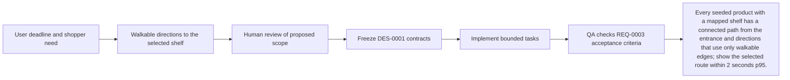

# Requirement: Walkable directions to the selected shelf

## Outcome
Every seeded product with a mapped shelf has a connected path from the entrance and directions that use only walkable edges; show the selected route within 2 seconds p95.

Baseline: no implemented flow or measured benchmark yet. Measurement owner: frontend-dev with qa-agent. These are proposed acceptance targets, not measured results.

## 5W1H canvas
| Dimension | Answer |
|---|---|
| Who | Shopper beginning at the known entrance/kiosk; frontend and catalog owners |
| What | Show aisle, shelf, highlighted destination and an ordered path to the selected item |
| When | After a shopper confirms one product; map ready by 14 October and verified by 15 October |
| Where | A simple sample floor map in the result view, with a fixed entrance origin by default |
| Why | Turn an item name into actionable directions immediately |
| How | Check all 60 seeded destinations for path connectivity and edge validity; time 30 route renders after item selection |

## 5W1H graph

## Requirement workflow

## Context and evidence
The prototype is for a hypermarket shopper locating food and items quickly. User confirmed sample store data, database expansion later, and vector search after the main concept works. English is required; Thai, Chinese and Japanese are time-permitting. Deployment date: 16 October 2026; submission: 18 October 2026, Bangkok time.

## Acceptance criteria
- [ ] Given a selected stored product, when directions load, then the result names the exact aisle and shelf and highlights the same destination on the map.
- [ ] Given the entrance origin and a mapped shelf, when a route is computed, then each segment follows a walkable graph edge and never crosses a shelf polygon.
- [ ] Given an unmapped or unreachable destination, when directions are requested, then the app retains truthful location labels and says route unavailable without inventing a path.
- [ ] Given the default starting point, when a map is shown, then it explicitly says From entrance and does not claim to track the shopper live.
- [ ] Given a keyboard or screen-reader user, when choosing an item, then textual directions and focusable controls provide the essential route information without relying on map color.

## Scope
- **In scope:** One store map; named entrance/kiosk; ordered walkable path; destination highlight; textual steps; optional explicit origin selection if already supported by fixtures.
- **Out of scope:** GPS/indoor positioning, dynamic aisle closures, multi-floor navigation, cart optimization and claimed fastest real-world route.
- **Dependencies:** ROADMAP-0001, proposed DES-0001 contracts and corresponding planned test TEST-0003.

## Notes
All artifacts remain proposed. Implementation starts only after the review pack and relevant contracts are approved. Unresolved cloud project/budget and exact demo device details are recorded in the review overview.
