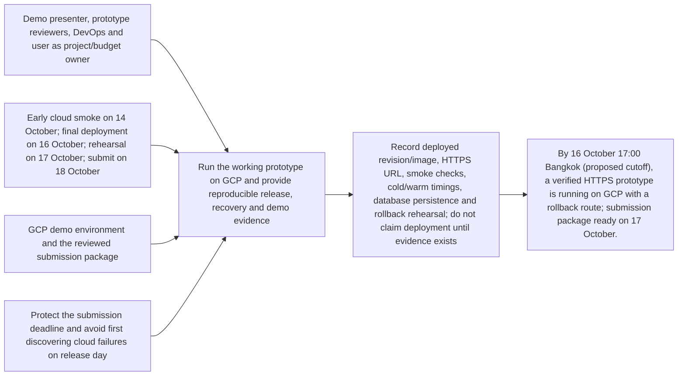
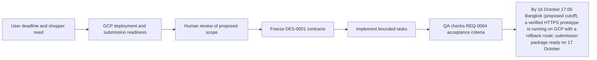

# Requirement: GCP deployment and submission readiness

## Outcome
By 16 October 17:00 Bangkok (proposed cutoff), a verified HTTPS prototype is running on GCP with a rollback route; submission package ready on 17 October.

Baseline: no implemented flow or measured benchmark yet. Measurement owner: devops-agent with qa-agent. These are proposed acceptance targets, not measured results.

## 5W1H canvas
| Dimension | Answer |
|---|---|
| Who | Demo presenter, prototype reviewers, DevOps and user as project/budget owner |
| What | Run the working prototype on GCP and provide reproducible release, recovery and demo evidence |
| When | Early cloud smoke on 14 October; final deployment on 16 October; rehearsal on 17 October; submit on 18 October |
| Where | GCP demo environment and the reviewed submission package |
| Why | Protect the submission deadline and avoid first discovering cloud failures on release day |
| How | Record deployed revision/image, HTTPS URL, smoke checks, cold/warm timings, database persistence and rollback rehearsal; do not claim deployment until evidence exists |

## 5W1H graph

## Requirement workflow

## Context and evidence
The prototype is for a hypermarket shopper locating food and items quickly. User confirmed sample store data, database expansion later, and vector search after the main concept works. English is required; Thai, Chinese and Japanese are time-permitting. Deployment date: 16 October 2026; submission: 18 October 2026, Bangkok time.

## Acceptance criteria
- [ ] Given a configured GCP project with billing and access, when the release is deployed by 16 October, then its HTTPS page and health/readiness endpoints respond and the complete English ADK-managed gemini-3.8-live native voice-to-voice lookup-to-route demo with actual Laya classification passes.
- [ ] Given a container restart or revision change, when the app reconnects, then PostgreSQL catalog data remains available independently of the container filesystem.
- [ ] Given provider credentials and database connection material, when browser assets and logs are inspected, then no secrets or raw shopper audio appear; app logs exclude transcript content.
- [ ] Given a failing new revision, when the documented rollback is rehearsed, then traffic returns to the last known good revision and the core smoke flow passes within a 15-minute target.
- [ ] Given the accepted deployed demo, when rehearsal finishes on 17 October, then a short walkthrough, backup video, setup/runbook, source revision and submission checklist exist.

## Scope
- **In scope:** Cloud Run container, managed PostgreSQL connection, Secret Manager, bounded scaling and request limits, monitoring, release evidence and rollback; early and final smoke runs.
- **Out of scope:** Production SLA, HA/multi-region, full retail integration, automatic external submission, unapproved cloud spend or deployment during this planning turn.
- **Dependencies:** ROADMAP-0001, proposed DES-0001 contracts and planned release test TEST-0004 and separate submission-package test TEST-0011.

## Notes
All artifacts remain proposed. Implementation starts only after the review pack and relevant contracts are approved. Unresolved cloud project/budget and exact demo device details are recorded in the review overview.
