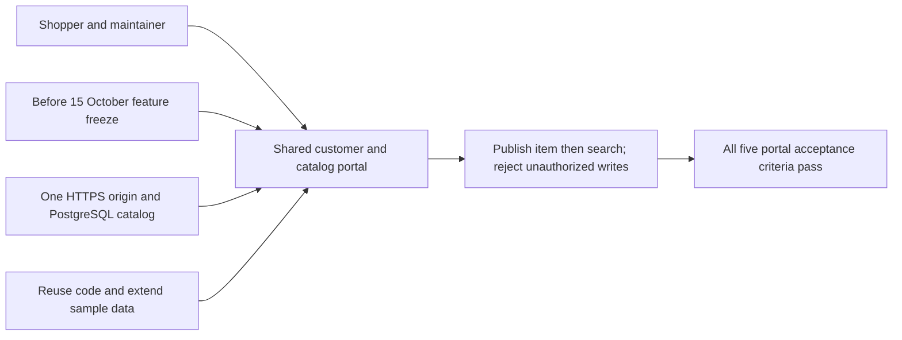
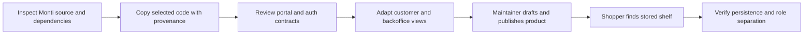

# Requirement: One portal for shoppers and maintainers

## Outcome
By the 15 October feature freeze, a maintainer can add or correct a product and its shelf in the same portal; the published record is immediately searchable by a shopper. Deployment remains due 16 October. Target: all five acceptance criteria pass. Baseline: no integrated portal yet. Owner: backend-dev-1 and frontend-dev; QA validates server authorization and persistence.

## 5W1H canvas
| Dimension | Answer |
|---|---|
| Who | Shopper reads; authenticated store maintainer changes catalog; QA verifies role boundaries. |
| What | A single Svelte portal with customer search and a minimal catalog backoffice, reusing selected Monti code. |
| When | Maintainer adds or corrects item data before and during the demo; feature freeze 15 October. |
| Where | / and /backoffice on one HTTPS origin, backed by the prompt-shop PostgreSQL database. |
| Why | Reduce prototype work through reuse and let the user grow sample data after proving the core concept. |
| How | Create draft, add aliases, select a known shelf, publish, search as a shopper, verify persistence and reject unauthorized writes. |

## 5W1H graph

## Requirement workflow

## Context and evidence
Source: `/Users/apaichon/Projects/libra/monti/monti-jarvis`. It contains SvelteKit shopping and tenant portals, browser voice helpers, and Go catalog/serving utilities. Inspection found that the source backend uses net/http and its Store pulls in Redis and MinIO; the large Live relay also uses workforce/RAG modules. None is a drop-in Fiber shelf-finder backend. Selected source code and exact excerpts are preserved in `references/monti-jarvis`, with hashes and the original MIT license. This is a reuse input, not evidence that the new portal runs.

## Acceptance criteria
- [ ] Given the same portal hostname, when a shopper opens / and a maintainer opens /backoffice, then both views use the same product records while all write operations require server-verified maintainer access.
- [ ] Given a signed-in maintainer, when a valid draft product with English name, aliases and an existing shelf is saved and published, then shopper search finds its correct aisle and shelf without redeploying the portal.
- [ ] Given an unauthenticated, expired or logged-out session, when a catalog mutation is attempted directly against the API, then it is rejected; cross-origin or missing-CSRF writes are also rejected.
- [ ] Given concurrent edits with an old expected_version, when a maintainer saves, then a 409 conflict preserves the newer record and prompts reload; drafts and archived products remain hidden from shopper search.
- [ ] Given the selected Monti source snapshot, when integration is reviewed, then source/license provenance is retained and no payment, booking, source credentials, source database connection or unrelated infrastructure is required.

## Scope
- **In scope:** one portal; maintainer login/logout; list/filter products; create/edit name, aliases and shelf; draft/publish/archive; optimistic version check; same-origin server authorization; source provenance. Existing shelf list is seeded; no map editor.
- **Out of scope:** checkout, payment, stock ordering, hotel booking, subscriptions, KYC, multi-tenant administration, source credentials/data, bulk source repository copying, drag-and-drop map design, customer accounts.
- **Dependencies:** REQ-0001 catalog, REQ-0004 deployment, DES-0001 access/session contract, TASK-0009 integration and TEST-0005 verification. CSV/JSON import remains a repeatable command; browser bulk-import UI is optional.

## Notes
Reuse must reduce dependencies, not import the entire original platform. The inherited customer no-auth behavior never authorizes backoffice mutations. All design and implementation work remains proposed; the source snapshot itself was explicitly requested and copied.
