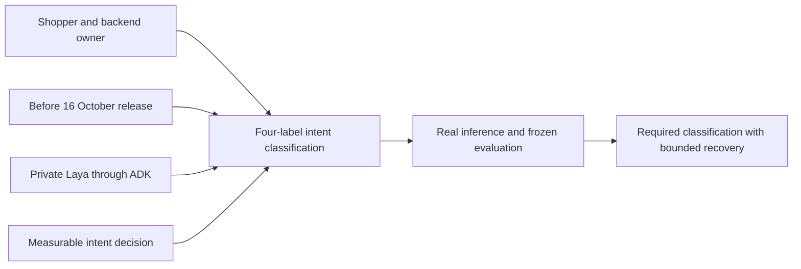
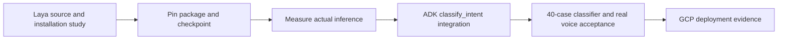

# Requirement: Laya intent classification through ADK

## Outcome
The deployed English voice flow includes real Laya inference coordinated by Google ADK, with ≥36/40 correct labels on a frozen balanced set and bounded classification latency. No classification or performance results have yet been measured.

## 5W1H canvas
| Dimension | Answer |
|---|---|
| Who | Shopper; backend-dev-2 implements; qa-agent validates |
| What | A small English intent classifier used by the native voice agent |
| When | Model and CPU qualification on 13 October; integration by 14–15 October; release 16 October |
| Where | Private Laya container beside the Go gateway and Python ADK runtime |
| Why | Give the conversational agent an explicit, measurable intent decision |
| How | Fixed labels/schema, actual pinned checkpoint, bounded HTTP tool and held-out classification/voice checks |

## 5W1H graph

## Requirement workflow

## Acceptance criteria
- [ ] Given a completed English shopper request in the required native Gemini Live conversation, when ADK coordinates its next action, then an actual Laya English checkpoint classifies the request through classify_intent before catalog actions; disabled, mocked or bypassed classification does not satisfy acceptance.
- [ ] Given 40 frozen balanced English utterances covering find_item, select_item, repeat_directions and out_of_scope, when the qualified Laya configuration is evaluated, then at least 36 labels are correct; errors and unexpected abstentions count as misses and per-class confusion and coverage are reported.
- [ ] Given normal inference, overload or a classifier failure, when classification runs, then its total deadline is 1200 ms including at most 200 ms queue wait with one worker and at most four queued requests; timeout, malformed output or low confidence produces abstention and bounded recovery without blocking live audio.
- [ ] Given any classifier label or malicious request, when ADK continues, then the label cannot supply product IDs, locations, authorization or writes; the private fixed endpoint validates inputs, raw text is not logged, and expired-turn results are discarded.

## Scope and dependencies
One English checkpoint and four fixed labels; no training, GPU requirement, language router or replacement of native audio. Ambiguous and failed cases can abstain. Confidence is a model score, not a calibrated probability of correctness or an authorization decision. Laya unavailability preserves recovery but does not waive required release evidence. Extra languages remain time-permitting.

The [reference study](../../REFERENCE-STUDY.md) records findings and source links. DES-0001 owns endpoint, budget, threshold and cleanup contracts. TASK-0010 and TEST-0012 provide the bounded feature gate; TEST-0002 proves use in the actual voice flow. All artifacts remain proposed.
