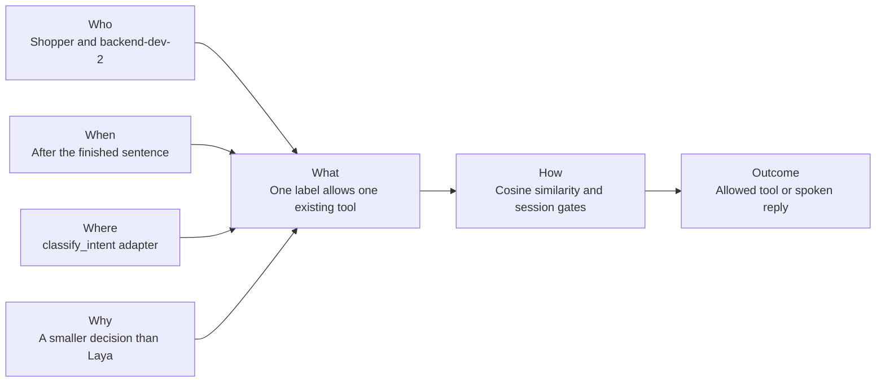
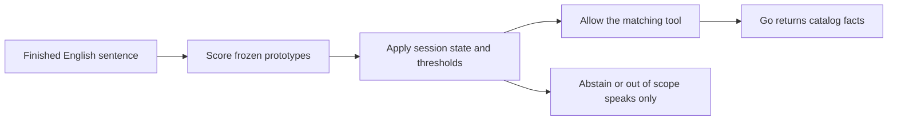

# Requirement: Gemini Embedding 2 chooses the voice tool

## Outcome

A finished English shopper sentence is matched with `gemini-embedding-2`. The winning label is what allows the existing catalog, route, or summary tool to run. Abstain and out of scope speak only. Go still returns the product, aisle, and shelf.

No 36-of-40 embedding score is claimed by this requirement's first build. That measurement stays a later gate. The failed Laya 19-of-40 result stays as it is.

## 5W1H canvas

| Dimension | Answer |
|---|---|
| Who | Shopper speaks; backend-dev-2 implements; qa-agent checks the router; Go remains the catalog authority |
| What | One label from a frozen English example set decides which existing tool may run |
| When | After the shopper sentence is finished and before any catalog, route, or summary call on that turn |
| Where | The ADK `classify_intent` adapter beside the current Laya path. No new public HTTP route and no portal change |
| Why | Laya holds about 1.9 GiB, uses two CPU threads, and accepted 19 of 40 frozen sentences. The decision is one short label |
| How | Cosine similarity, a 0.70 confidence floor, a 0.15 margin floor, and session-state gates. Success is the label, the tool that ran, and the absence of location text from the embedding |

## 5W1H graph

## Requirement workflow

## Context and evidence

ROADMAP-0002 is the brief. The checked model is the stable Gemini Developer API model `gemini-embedding-2`. Text uses the prefix `task: classification | query: {content}`. Recommended sizes include 768 dimensions. The `task_type` parameter is not supported. Vectors from `gemini-embedding-001` are a different space.

REQ-0006 stays in force for the 18 October submission. This requirement does not edit it.

## Acceptance criteria

- [ ] Given a finished English shopper sentence and `INTENT_BACKEND=embedding`, when the router scores the frozen prototypes, then the result is an intent-v1 object whose label is `find_item`, `select_item`, `repeat_directions`, `summarize`, or `out_of_scope`, or an abstention.
- [ ] Given confidence below 0.70 or a margin below 0.15, when the router finishes, then it abstains with `low_confidence` and reports the failing scores.
- [ ] Given `out_of_scope` or an abstention, when the voice turn continues, then catalog and route calls are zero and the shopper can still hear a spoken reply.
- [ ] Given no current results, when the sentence is scored, then `select_item` is not eligible. Given no current route, `repeat_directions` is not eligible.
- [ ] Given a winning `find_item`, `select_item`, `repeat_directions`, or `summarize` label, when the allowed tool runs, then Go remains the source of product and location facts. The embedding result has no aisle or shelf text.
- [ ] Given `INTENT_BACKEND` unset, when a turn is classified, then the Laya adapter is still the one that runs.

## Scope

- **In scope:** English text already produced for the voice turn. One embedding model call per scored text. A small frozen prototype list. Session state before similarity. The existing ADK tools and Go checks. A flag that defaults to Laya.
- **Out of scope:** Embedding microphone audio, images, or PDFs. Product search or pgvector. Aisle or shelf text from the model. Changing `gemini-3.8-live` or native audio. Training. Mixing `gemini-embedding-001`. Editing the Laya 19-of-40 evidence. Removing the Laya process before a later measured gate passes.
- **Dependencies:** ROADMAP-0002, REQ-0002 for catalog facts, REQ-0006 left unchanged, DES-0003, ADR-0002.

## Notes

The user authorized this build on 17 October 2026 by asking to start ROADMAP-0002. Approval here records that start. It does not approve a Laya replacement inside the 18 October submission.
