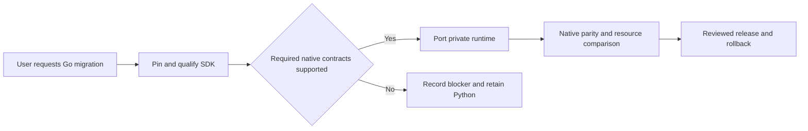

# Go ADK migration

## Authorization and outcome

The user authorized starting ROADMAP-0003 on 18 October 2026. This approves
local SDK qualification and staged implementation. It does not certify a Go
runtime as production ready or approve a cloud rollout. First prove the pinned
SDK supports Monti's native audio and tool contracts, then port behind the
existing private bridge without changing catalog authority or public UI behavior.

## 5W1H canvas

| Who | What | When | Where | Why | How |
|---|---|---|---|---|---|
| Shopper receives behavior; GPT/backend-dev-2 builds; QA checks | Native ADK runtime in Go with preserved authorization and voice behavior | Staged after SDK feasibility | Isolated Go module, then private bridge | Reduce runtime complexity while retaining working shopping flow | Pin SDK, wire-test, provider probe, parity matrix, matched measurements and rollback |

## Acceptance criteria

- Given a pinned Go ADK/GenAI build, when the actual SDK connects, its wire setup
  preserves the configured model/voice, native AUDIO, both transcript channels
  and disabled automatic activity detection. Manual ActivityStart/ActivityEnd and
  PCM input work through ADK, without a separate STT/TTS or direct provider bypass.
- Given a Live function call, when ADK dispatches it, bounded tool execution and
  response events work. Before cutover, current classification ACK, response_ready,
  capability, candidate and stale-turn checks must match the Python baseline.
- Given cancellation, timeout or provider failure, when a probe/runtime ends,
  resources close within a bounded lifetime and output does not expose keys,
  transcripts, audio, private tool IDs or raw provider error bodies.
- Given a required feature is unsupported, when qualification completes, evidence
  records the exact gap and the runtime remains Python. Fixtures are not native
  provider evidence and a passing compile is not permission for cutover.
- Given a complete Go candidate, when later native parity/load/rollback gates
  execute, apply ROADMAP-0003's thirty-turn and matched comparison gates. A separate
  release task owns deployment acceptance and any required high-risk human review.

DES-0004 locks only the first probe milestone. It explicitly replaces the Python
API spelling of Runner.run_live for this successor with Go Runner.RunLive, while
preserving REQ-0002's native-audio behavior. Full port design follows capability
qualification; existing tests and acceptance history are not rewritten.
