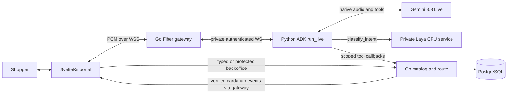
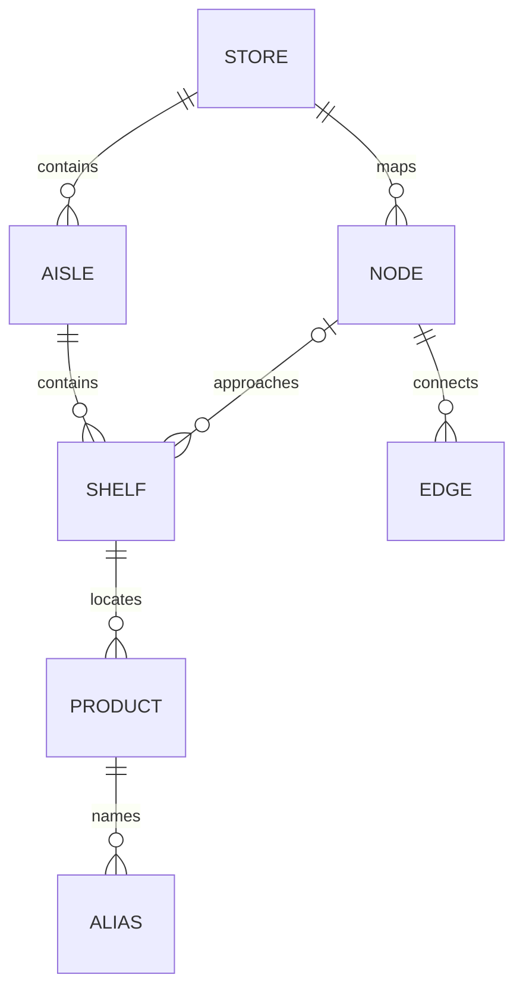

# Design: English voice-to-shelf prototype

A shopper speaks or types one item, confirms a stored product and receives its shelf and a walkable route from the entrance; a protected backoffice in the same portal maintains the small catalog. Deploy on 16 October 2026; submission is 18 October, Asia/Bangkok. English is mandatory; Thai, Mandarin Chinese and Japanese are stretch work, in that order. Mandarin is an assumption for the user's Chinese request.

## Pre-Implementation Specs

This is the reviewable draft contract, version `0.3-draft`. Requirements are proposed. The task list is planning decomposition only; no implementation task may start until requirements and this design are approved and the lock below is signed. No approval or deployment is claimed.

- [X] Data contracts: approve the PostgreSQL/import contract below; TASK-0001 transcribes it into migrations and import validation.
- [X] API contracts: approve the routes, examples and version behavior below; TASK-0001 emits `api/openapi.yaml` before integration.
- [X] Error model: approve the error table and UI recovery paths below.
- [X] Authentication and threats: approve the anonymous demo boundary, operator-only import and bounded provider access below.
- [X] Observability: approve the content-free metrics/logs and acceptance evidence below.
- [X] Feature flags: approve the Gemini Live model pin, voice kill switch and extra languages below.
- [X] Rollout/rollback: confirm cloud project, region, billing/budget and environment; approve revision rollback and migration constraints.
- [X] Performance: approve warm targets and demo-device/network measurement; targets are not measured performance.
- [X] Accessibility: approve keyboard, screen-reader, contrast and textual route criteria below.
- [X] Threat review: review streaming audio, session tickets, cost abuse, injection and secret controls below; assign remaining findings to TASK-0006.

```yaml
locked_at: null
locked_by: null
design_version: 0.3-draft
unblocks_tasks: []
planned_tasks: [TASK-0001, TASK-0002, TASK-0003, TASK-0004, TASK-0005, TASK-0006, TASK-0007, TASK-0008, TASK-0009, TASK-0010]
```

### TASK-0001 implementation record — 2026-10-13

The existing specification checkboxes above are preserved from the shared planning baseline. The user's “start build Task 1” instruction authorizes the foundation work under these contracts. TASK-0001 implements PostgreSQL/import, health/readiness and fixtures; provider qualification, UI, cloud deployment and release acceptance remain their assigned tasks and do not follow from a local foundation pass.

```yaml
foundation_locked_at: 2026-10-13
foundation_locked_by: user_instruction_start_build_task_1
foundation_contract_version: 0.3-task1
foundation_task: TASK-0001
peer_review: pending_grok
```

The foundation lock is recorded separately from whole-prototype release approval. Full readiness requires ADK/Laya; local foundation readiness is explicitly labelled and rejected in Cloud Run. TASK-0003 has separately started isolated work on the shared planning baseline; foundation review/integration remains its dependency.

## Solution architecture and workflow

The user requires **Gemini Live 3.8 voice-to-voice, Google ADK orchestration and Laya intent classification**. Native live audio dialogue is the primary path; transcripts are display/accessibility aids. Typing remains an independent recovery path. There is no separate transcription-then-search-then-TTS pipeline and no provider substitution without user approval.



```text
Browser PCM <-> Go public gateway <-> Python ADK <-> Gemini
                                             | classify_intent
                                             v
                                         Laya CPU
                                             | advisory intent
                                             v
Python ADK -> private Go tools -> PostgreSQL -> Go card/map events
Typed search / backoffice -----> Go services -> PostgreSQL
```

1. Shopper clicks Start voice once; browser requests microphone access and resumes its AudioContext. Go issues a short-lived ticket; Python ADK opens the Gemini Live audio session after authenticated gateway admission.
2. Stream microphone audio continuously while the visible session is active. Shopper asks for an item; ADK runs `classify_intent` through Laya, then Gemini calls `search_catalog` and asks spoken clarification when ambiguous. Show live input/output transcripts as provisional dialogue, separately from verified item cards.
3. Shopper selects naturally by speech (for example, “the whole milk”) or optionally clicks a returned candidate. The server accepts only a valid current candidate ID and resolves the route from PostgreSQL. Main-flow acceptance must work without a selection click.
4. Go returns the authoritative tool result through ADK to Gemini and the verified product/route event to the UI. Gemini speaks concise directions using those facts. Dijkstra routes only on the sample walkable graph from `entrance`; no live positioning claim.
5. Shopper can interrupt, ask another item or say “repeat that”; audio playback flushes on interruption. End voice closes browser, bridge and provider streams and the mic. Typed lookup and map remain usable during voice failure.

SvelteKit static adapter builds `/` and `/backoffice` into the Go ingress image; no Node runtime server. A single Cloud Run revision has three containers: Go gateway, Python ADK, and private Laya inference. Go serves SPA fallback only for non-API routes; missing APIs return JSON 404. Cloud SQL is durable outside revisions. Bind `0.0.0.0:$PORT` per the [Cloud Run container contract](https://docs.cloud.google.com/run/docs/container-contract). Proposed app/SQL region is `asia-southeast1`, subject to approval and measured browser-to-provider latency. Static backoffice files contain no prerendered protected data; use the documented [SPA fallback](https://svelte.dev/docs/kit/single-page-apps).

### ADK runtime and private service boundaries

Python ADK is mandatory runtime orchestration: one `Agent`, fresh per-connection `LiveRequestQueue`, and `Runner.run_live` with `AUDIO`; `run_async`/SSE or a `StreamingMode.BIDI` flag alone is not equivalent. Official live quickstarts cover Python/Java; Go live support is not assumed. See [ADK live configuration](https://adk.dev/live/configuration/) and [supported starters](https://adk.dev/live/get-started/). Go remains the application backend; there is no direct Go-to-Gemini bypass.

| Boundary | Fixed contract |
|---|---|
| Public ingress | Go `0.0.0.0:8080` (`$PORT`), existing ticket/API/WSS protocol; only this container is ingress |
| Go -> ADK | Private `ws://127.0.0.1:8001/live`, `Authorization: Bearer` shared bridge secret from Secret Manager; first trusted setup carries session/language/current epoch and ephemeral tool capability. Python binds `0.0.0.0:8001` for startup probe compatibility; it has no public ingress |
| ADK -> Go tools | `POST http://127.0.0.1:8002/internal/tools/search_catalog` or `/get_product_route`, `Authorization: Bearer` random session-scoped capability; JSON `{session_id,turn_id,call_id,classification_attempt_id,args}` ≤4 KiB. Go listener binds loopback only; these paths are never mounted on public ingress |
| ADK -> Laya | `POST http://127.0.0.1:8003/classify`, `X-Internal-Token` separate shared secret; fixed endpoint and classification schema below; no user-selected URL/model/schema |
| Health/startup | ADK `/healthz`: configuration/import ready, no Go/Gemini/Laya call. Laya `/healthz`: pinned model loaded and warm. Both private services expose no protected data in health responses; start Laya -> ADK -> Go using startup probes |

Go owns admission, turn epochs, tool budgets, candidate sets and UI truth. ADK receives only private capability/metadata in host context, never model-visible args or persisted `custom_metadata`. ADK activity/cancellation events update the gateway epoch before catalog callbacks; late callbacks fail. Trusted classifier-completed bridge events register `classification_attempt_id` for that epoch; Go returns `classification_registered {session_id,turn_id,classification_attempt_id}` only after registration. ADK must await that matching ACK before dispatching an HTTP catalog callback, preventing cross-transport ordering races. ACK timeout or epoch change cancels dispatch; catalog callbacks require the current acknowledged attempt. Classification is advisory, so a recorded timeout/abstention may recover safely but cannot be presented as successful classification. Go validates IDs and independently emits card/map events from service results; ADK never sends arbitrary UI actions. Block missing/expired/wrong capability and unknown routes/functions. Revocation follows socket end. In-container networking uses [Cloud Run sidecar support](https://docs.cloud.google.com/run/docs/deploying#sidecars); secret injection differs per container, but shared service identity is not IAM isolation.

Set `save_live_blob=false`, use only `InMemorySessionService`, no persistent artifact service, memory plugin, trace-content export or session resumption. ADK session events can still contain transcripts/tool content in memory; in `finally` close queue, cancel/await tasks, close provider stream, delete that session and revoke gateway capability on stop, error, timeout, disconnect and shutdown. Never reuse the session ID on reconnect. ADK's default request queue is unbounded: use a tested bounded adapter counting pending enqueue/dequeue PCM bytes (≤32,000 bytes, one second), not rate limiting alone; abort on backlog/stall. See [ADK session lifecycle](https://adk.dev/live/sessions/) and [custom server guidance](https://adk.dev/live/custom-server/). Session time/turn/tool caps remain application-enforced; do not rely on `max_llm_calls` as a Live-session cost limit.

Mandatory day-one compatibility gate: pin `google-adk` and `google-genai`, inspect actual serialized Gemini setup to prove model ID, `AUDIO`, captions, `BLOCKING` on all three tools and omission of obsolete options. Test all event parts, tool result round trip, barge-in and cleanup through `run_live`. A documented adapter/custom tool declaration may preserve `BLOCKING`; if the pinned SDK cannot propagate it, report a blocker instead of claiming sequential Python functions guarantee it or bypassing ADK. Avoid copying tutorial shortcuts that log content or process only `parts[0]`.

### Required Laya intent stage

Laya is a text decision model, not another voice provider. Use the English root checkpoint `convaiinnovations/laya`, with exact repository revision, weight hashes, package lock and model license recorded during TASK-0010; no invented revision pin is claimed now. Build/download weights before deployment, preload one CPU eager model and warm a fixed inference before readiness. The source documents Python installation and explicit English loading in [Laya installation/model guidance](https://github.com/NandhaKishorM/laya#installation-details). No multilingual weights or routing across checkpoints in the English release.

`classify_intent({text})` is an ADK `BLOCKING` tool called once for each completed semantic shopper voice turn, including out-of-scope requests, and before any catalog tool on that turn. Explicit candidate clicks and typed REST search remain independent of this voice classification stage. Text is a bounded representation supplied within the native Live tool call (cross-check any available input caption); there is no external STT stage or transcript-driven replacement for Live audio. ADK wrapper requires a current-turn classification attempt before permitting catalog callbacks. Async HTTP to Laya must not block the audio event loop. Tool result is an advisory intent, never a product ID, shelf, authorization, or executable command; Go alone validates selection/action. Typed lexical fallback remains independent.

Private input `{text:string}` is 1–300 Unicode characters, body ≤2 KiB. Wrapper owns schema `intent-v1` with `find_item`, `select_item`, `repeat_directions`, `out_of_scope`; unknown or unsupported inputs abstain. Return `{schema_version:"intent-v1",intent:string|null,confidence:number|null,margin:number|null,abstained:boolean,reason:string|null,model_revision}`. Confidence ≥0.70 and top-two margin ≥0.15 are provisional thresholds, frozen before holdout; they are not calibrated-certainty claims. Invalid input/auth gives 400/401; inference failure, timeout, overload or insufficient confidence returns an abstention reason (or transport error mapped by ADK to abstention). No raw text in logs or caches. Reject client/model-supplied schema/model/path options.

Budget: total 1,200 ms including queue wait ≤200 ms; one isolated inference worker, queue at most four, no retry. Run CPU inference outside the ASGI event loop; hard deadline kills/restarts a stuck worker and marks readiness false until warm again, rather than leaving timed-out work accumulating. Laya binds `0.0.0.0:8003` for private startup probes only. Proposed allocation 2 vCPU/4 GiB, measured before release; no GPU or advertised microsecond/benchmark latency claim. Timeout/unknown yields visible degraded state and Gemini clarification/validated search recovery, never fabricated intent success. Normal accepted voice flows must exercise real inference; disabled/mock/always-abstaining Laya does not satisfy the request. Evaluate 40 frozen balanced English cases (10/label), ≥36 correct; normal-set abstentions/errors count as misses. Report coverage, confusion by class, p95 and failure paths separately; no automatic scope cut of ADK, Laya or required Gemini.

### Required Gemini configuration

Pin model ID `gemini-3.8-live`, listed as stable. Use `AUDIO` response modality and enable input/output audio transcription; structured outputs are unsupported. Omit thinking configuration/level and affective dialogue settings. Do not set `proactive_audio:false`, which errors. Explicitly declare intent and catalog functions `behavior: BLOCKING`, because asynchronous calling is the model default. These compatibility requirements follow the [model and migration documentation](https://ai.google.dev/gemini-api/docs/models/gemini-3.8-live).

PCM format is signed 16-bit little-endian mono: input 16 kHz, output 24 kHz. Handle all server content parts and event fields independently, including audio, transcription, tool calls, cancellation, interruption and completion; do not use a mutually exclusive `else if` chain that drops co-occurring parts. See the [Live capabilities guide](https://ai.google.dev/gemini-api/docs/live-api/capabilities). Exact SDK version, voice and project access must pass the 13 October feasibility gate; model choice is fixed by the user.

### Selective reuse from Monti Jarvis

Preserve selected source, MIT license and hashes under `references/monti-jarvis`; snapshots are reference input, not runnable integration evidence. Reuse/adapt microphone/audio worklet, `montiVoice` PCM playback, live-relay cancellation/tool-dispatch patterns, UI tokens/cards and tenant form layout. Its older Gemini 2.5 defaults must be migrated to the setup above and verified with real 3.8 input/output audio plus a catalog tool call. Source backend uses `net/http`; adapt required relay handlers to Fiber without copying its entire Store or business stack. Its `FilterOffers` depends on stock/variants and is unsuitable unchanged for shelf lookup.

Exclude cart, checkout, price/stock, tenant accounts, Redis, MinIO, ClickHouse, unrelated migrations, secrets and customer data. No Redis, NATS, MongoDB, DuckDB, Next.js, Shadcn, Kubernetes or event bus in this design. Embeddings, recipes and extra languages follow the working English Live demo.

## Data contracts and import

PostgreSQL is authoritative. IDs are stable lowercase strings, 1–64 characters matching `[a-z0-9-]+`; timestamps are UTC. Single configured store `demo-store`; every database key includes `store_id`. Names and labels are plain text, never HTML. Coordinates are sample-map units, not meters.

| Table | Fields and constraints |
|---|---|
| stores | `id` PK, `name` text, `catalog_version` bigint, `map_version` bigint, `map_width`/`map_height` positive numbers, `entrance_node_id` FK |
| aisles | `(store_id,id)` PK, `label` text, `polygon` JSON array of x/y points; polygons define non-walkable fixtures |
| map_nodes | `(store_id,id)` PK, `x`,`y` numbers in map bounds, `label` text |
| map_edges | `(store_id,from_node_id,to_node_id)` PK, endpoints FK; undirected canonical ordering, positive `weight` in map units, no duplicate/reversed edge |
| shelves | `(store_id,id)` PK, `aisle_id` FK, `label` text, `map_node_id` nullable FK, `x`,`y` map coordinates; destination node is on the walkway beside the shelf |
| products | `(store_id,id)` PK, `name` text, `category` text, `shelf_id` FK, `state` enum draft/published/archived, `version` positive bigint, `updated_at` timestamp |
| product_aliases | `(store_id,product_id,language,normalized_alias)` PK, product FK, `alias` text; duplicate terms across products are valid ambiguity |
| import_batches | `(store_id,import_version)` PK, `content_sha256` text, `applied_at` timestamp, `product_count` integer |
| maintainer_sessions | `token_hash` PK, `csrf_token` random text, `expires_at` timestamp; no password or raw session token persisted; purge expired rows daily |
| voice_tickets | `token_hash` PK, `session_id` unique, `language`, `expires_at`, `consumed_at` nullable; atomically single-use, expire in 30 s, purge within one day; no audio/transcript |
| catalog_audit | `id` bigint PK, `product_id`, `action`, `product_version`, `created_at`, actor fixed `maintainer`; no passwords/session tokens; seven-day retention for prototype |



Indexes: aliases `(store_id,language,normalized_alias)` for exact/prefix search; products `(store_id,state,shelf_id)`; edges by each endpoint. Public queries/routes and Live tools see only published products. No vector extension or embedding columns required for the MVP. Normalize Unicode NFKC, trim/collapse whitespace and case-fold; explicit aliases handle plurals and synonyms. Rank exact name/alias, then prefix, then all query-token matches with deterministic product-ID tie-breaks. Unknown terms yield an empty result; do not guess a shelf.

`cmd/import` is an operator CLI, never an anonymous API. JSON schema version `1` accepts `store_id`, `import_version`, and arrays `aisles`, `nodes`, `edges`, `shelves`, `products`; graph arrays may be omitted when adding products to an existing map. Product form:

```json
{"id":"milk-whole-1l","name":"Whole milk 1 L","category":"Dairy","shelf_id":"a02-s03","state":"published","aliases":[{"language":"en-US","text":"whole milk"},{"language":"en-US","text":"milk"}]}
```

The import schema is `data/import.schema.json`; first seed is `data/demo-store.json` with 60 products, eight aisles, entrance, shelf-adjacent nodes and connected walkways. Arrays use the table fields above; store identity/dimensions are in a `store` object for initial seed. Unknown JSON fields are rejected. Text maximums: names/aliases 120, labels 80, category 80 characters; at most 20 aliases per product; input capped at 10 MiB and 10,000 products per batch.

Importer validates all rows and referenced existing/new IDs before writing, reports JSON `{errors:[{collection,index,field,code,message}]}` with nonzero exit on failure, and rolls the entire transaction back. Reject duplicate IDs within a batch, invalid coordinates, nonpositive edges, edges crossing fixture interiors, invalid shelf references and unreachable mapped shelves. An intentionally unmapped shelf uses `map_node_id:null`; initial demo seed must have zero unmapped shelves. Validate the merged map, including existing shelves, for map edits.

Transaction obtains a store-scoped advisory lock, upserts by stable IDs and replaces aliases for each included product. Omitted products remain; `state:"archived"` retires one. Same import version plus same hash is a no-op; changed content under an existing version is an error. Successful changed batches increment `catalog_version` and changed product versions; graph/shelf geometry changes also increment `map_version`. No frontend redeploy is needed. Public query DB principal is read-only; backoffice principal has narrowly scoped DML on products/aliases/store version/audit/session records, never DDL; voice admission principal may insert/consume only voice tickets. Migration/import credentials are operator-only. Migration version and store versions are separate.

## API contracts (draft v1)

Same-origin HTTPS JSON, UTF-8; customer APIs need no session, backoffice APIs require the session below. No client-controlled SQL, arbitrary provider prompt, voice name, URL, store selection or filesystem path. All JSON request fields are required unless stated; reject unknown fields. Return `X-Request-ID`; JSON examples omit it for clarity. Responses use `Cache-Control: no-store` except content-hashed static assets. Customer lookup is single-item with no pagination and at most three results.

| Route | Request | Success | Notable failures |
|---|---|---|---|
| `POST /api/search` | JSON `{query:string,language:string}`; query 1–200 trimmed characters, body ≤8 KiB | 200 `{query,language,catalog_version,candidates:Product[],ambiguous:boolean}`; empty candidates is normal 200 | 400 validation/language; 429 limit; 503 DB unavailable |
| `POST /api/voice/sessions` | JSON `{language:"en-US"}`; exact configured Origin; body ≤1 KiB | 201 `{session_id,ticket_expires_at,ws_path:"/ws/voice"}` plus secure single-use ticket cookie | 400 language; 403 origin; 429 admission; 503 voice disabled/DB |
| `GET /ws/voice` (WebSocket upgrade) | Exact Origin + cookie ticket; protocol `prompt-shop.voice.v1`; no query credentials | 101 then normalized live protocol below; provider-ready event after setup | 401 missing/expired/reused ticket; 403 origin; 429 capacity; 503 unavailable |
| `POST /api/routes` | JSON `{product_id:string,origin_node_id:"entrance"}` | 200 `{product:Product,catalog_version,map_version,origin_node_id,node_ids:string[],points:Point[],steps:string[],distance_units:number}` | 400 origin; 404 inactive/unknown product; 422 route unavailable; 503 DB |
| `GET /api/store-map` | None | 200 `{store_id,name,map_version,width,height,origin_node_id,aisles:[{id,label,polygon:Point[]}],nodes:[{id,label,x,y}],edges:[{from,to}],enabled_languages:string[]}` | 503 DB |
| `GET /healthz` | None | 200 `{status:"ok"}` for live process; never depends on speech/DB | Process failure is detected by probe failure |
| `GET /readyz` | None | 200 `{status:"ready"}` after migration version, DB ping, seed/entrance and private ADK/Laya health checks (250 ms each; no provider call) | 503 `{status:"not_ready"}`; disclose no connection details |

`Point={x:number,y:number}`. `Product={id,name,category,aisle:{id,label},shelf:{id,label},route_available:boolean}` is formed only by joining stored product/shelf/aisle data. Search and routes use a coherent database snapshot per request. The route response refreshes product location rather than trusting an old search card. If route `map_version` differs from loaded map, reload map and retry route once; repeated mismatch shows “Map updated; try again” without overlaying mismatched geometry.

```json
{"query":"where is whole milk","language":"en-US"}
```
```json
{"query":"where is whole milk","language":"en-US","catalog_version":1,"candidates":[{"id":"milk-whole-1l","name":"Whole milk 1 L","category":"Dairy","aisle":{"id":"a02","label":"Aisle 2"},"shelf":{"id":"a02-s03","label":"Shelf 3"},"route_available":true}],"ambiguous":false}
```

### Live session, transport and tool contract

`POST /api/voice/sessions` creates a random 32-byte ticket, persists only its SHA-256 hash and sets `__Host-voice-ticket; Secure; HttpOnly; SameSite=Strict; Path=/; Max-Age=30`. Browser credentials never enter URL/query parameters, localStorage or an exposed provider key. Ticket creation and upgrade both require exact configured Origin. WSS upgrade atomically marks a valid unexpired ticket consumed in PostgreSQL before provider connection; replay fails even on another instance. Clear the cookie on upgrade where supported; DB consumption is authoritative. Ticket/session IDs and cookie headers are excluded from logs. No dependency on sticky routing. Starting a new session invalidates an unconsumed ticket in that browser; UI keeps one active socket. This is anonymous demo admission, not shopper identity authentication.

Python ADK owns the Gemini connection, fixed instructions, tools and model configuration behind Go admission. Only the ADK container receives the Gemini API key via Secret Manager and uses it on the provider connection. It is not a Cloud STT/TTS credential and is never forwarded to the browser. Clients cannot supply provider setup, function responses, arbitrary role messages, URLs or tool schemas. Provider reconnect uses a fresh ticket/session; no raw transcript/audio replay or ADK session resumption in this MVP.

Every JSON WebSocket event uses a common `{type,session_id,...eventFields}` envelope; relevant events additionally include `turn_id` and `generation_id`. Browser and gateway reject an envelope for another session. The table abbreviates that common envelope. Binary PCM frames are the exception: microphone input belongs to the active socket/session; server output additionally inherits the most recent `audio_start` generation. Playback discards invalidated-generation output after interruption and all output after Stop.

| Wire event | Contract |
|---|---|
| Browser binary | PCM16LE mono16kHz, normally 3,200 bytes per 100 ms; even length, max 6,400 bytes/frame; no WAV/WebM header |
| Browser JSON | `{type:"text",text}` ≤200 chars; `{type:"select",search_id,product_id}`; `{type:"stop"}`; `{type:"ping"}` only. Text interrupts prior response and is a new user turn; no client-generated model/tool roles |
| Server JSON | `ready {session_id,expires_at,input_rate:16000,output_rate:24000}`; `input_transcript` / `output_transcript {turn_id,text,final}`; `candidates {turn_id,search_id,catalog_version,candidates}`; `route {turn_id,search_id,product,catalog_version,map_version,...routeFields}` |
| Server audio | `audio_start {turn_id,generation_id}` precedes PCM16LE mono24kHz binary chunks; `audio_end` closes that generation. A WebSocket's ordered frames bind audio to its generation |
| Server control | `interrupted {turn_id,generation_id}` immediately flushes playback; `turn_complete`, `error {code,message,retryable}`, `session_ending {reason}` and `pong`. No raw provider packet passthrough |

Treat transcripts as provisional captions, never as an authoritative product/location record. Client controls max 4 KiB/frame and 10 messages/s; microphone stream max 40 KiB/s with a 64 KiB burst and 10 MiB/session. Output audio is chunked to ≤16 KiB/frame. Output playback/relay buffers hold at most one second (48,000 bytes) of PCM; if a slow client overflows, abort that response, flush and report recovery rather than growing memory or speaking stale directions. Application setup deadline 30 s; session lifetime 300 s from `ready`; end after 60 s without meaningful user activity (silence, ping and provider chatter do not reset idle). Use local VAD/activity timestamps for UX and server audio activity detection for enforcement; continuous silence cannot keep an idle session alive. Ping every 20 s; dead transport closes after a 10 s pong grace. End/close cancels tool/provider work, flushes queues and releases microphone/session capacity.

- `search_catalog({query:string})`: server validates 1–200 chars, binds configured store/language, and invokes existing catalog service. Returns `{search_id,catalog_version,candidates:Product[],ambiguous}` with at most three published products. `search_id` is server-generated and bound to connection/turn; candidate set expires after 60 s or the next search. Empty means not found, never invent a substitute shelf.
- `get_product_route({product_id:string,search_id:string})`: only an ID in the current connection's unexpired candidate set; reread publication/location from DB. For an ambiguous result, require a subsequent user speech/text turn or explicit candidate click before accepting a route request; model infers spoken selection but may not route during the initial ambiguous turn. A single unambiguous result may proceed directly. Click validates the same candidate set, computes route and sends a server-owned user-selection update to Gemini. Route result is the same authoritative DTO as REST.
- All three declarations, including `classify_intent`, are `BLOCKING`; no admin/write/inventory/web-search tools. Max one classification, two search calls and one route call per user turn; catalog/route deadline 1.5 s, DB 750 ms; classification deadline 1.2 s inclusive. Reject unknown functions/fields, invalid IDs, stale `search_id` or unselected ambiguity as a structured tool error; no exception details. The server generates every tool response and verifies cancellation/current turn before forwarding it.
- Advance a server turn/generation epoch on interruption, new user turn or click selection; cancel old jobs and discard stale results/audio. Process all function calls and cancellation IDs in every provider event, not only the first. Map the validated tool result into UI events directly; never parse model prose into a factual card.
- System instructions require clarification for ambiguity and a successful route tool result before stating a shelf/location; returned names/labels are data, not instructions. For every completed semantic shopper voice turn, gate answer audio until its classification attempt completes; an item-finding turn also requires `search_catalog` completion; an ambiguous result permits clarification audio, while an unambiguous result requires a successful route tool before answer audio. A missing required tool result times out after eight seconds and aborts that response. Greetings before an item request can stream. This gate is based on tool state, not a claimed semantic classifier for audio. **This gating plus prompt is not a semantic guarantee against spoken hallucinations**: native audio may still invent facts. QA must compare spoken/output-transcript locations with tool records and meet zero-fabricated-location acceptance. A failure blocks release; it does not justify silently substituting another voice provider or fabricated path.

### Backoffice API and authorization

One demo maintainer, no signup, customer accounts, tenant roles or password-reset workflow. Secret Manager holds a bcrypt password hash (cost 12); configure a strong password of 16–72 UTF-8 bytes, reject longer input rather than truncate, and rate-limit before comparison. Exact configured HTTPS `Origin` is required for login and all mutations. Successful login creates a cryptographically random 32-byte opaque token; only its SHA-256 hash is stored in PostgreSQL. Set `__Host-maintainer` cookie with `Secure; HttpOnly; SameSite=Strict; Path=/`, absolute expiry eight hours. Session lives across replicas/revisions. Rotate password and revoke all sessions together during credential rotation.

| Route | Request / response |
|---|---|
| `POST /api/backoffice/session` | `{password}` -> 200 `{expires_at,csrf_token}` plus cookie; invalid credentials 401; 5 attempts/min/IP, burst 2; no credential detail in errors |
| `GET /api/backoffice/session` | Authenticated cookie -> 200 `{expires_at,csrf_token}`; otherwise 401 |
| `DELETE /api/backoffice/session` | Auth + CSRF -> revoke DB session, clear cookie, 204 |
| `GET /api/backoffice/products?q=&state=&cursor=` | Auth; q ≤200 chars, optional state enum, opaque cursor last ID; 200 `{items:AdminProduct[],next_cursor:string|null}` sorted ID, fixed page size 50 |
| `GET /api/backoffice/shelves` | Auth -> 200 `{items:[{id,label,aisle:{id,label},mapped:boolean}]}`; existing shelves only |
| `POST /api/backoffice/products` | Auth + CSRF; `{id,name,category,shelf_id,aliases}` -> 201 `AdminProduct`, always draft/version 1; duplicate ID 409 |
| `PUT /api/backoffice/products/{id}` | Auth + CSRF; `{name,category,shelf_id,aliases,expected_version}` -> 200 `AdminProduct`; stale version 409; published edits become draft immediately |
| `POST /api/backoffice/products/{id}/publish` | Auth + CSRF; `{expected_version}` -> 200 `AdminProduct`; require valid mapped shelf and English name/alias coverage; invalid data 422 |
| `POST /api/backoffice/products/{id}/archive` | Auth + CSRF; `{expected_version}` -> 200 `AdminProduct`; remove from public search, retain record |

`AdminProduct={id,name,category,shelf_id,aliases:[{language,text}],state,version,updated_at}`. State changes and content saves run in one transaction with the same store lock as import, increment product/catalog versions and record audit action. Unknown/extra fields or invalid FK fail without partial save. Frontend explicitly warns that editing a published item hides it until Publish is clicked again; no revision-history editor. Cursor is validated against query/state and IDs, never interpolated into SQL. Limit admin body to 16 KiB, write requests to 20/min/session and DB work to the 1.5 s handler budget. No file upload, bulk editor, map editor or hard delete in backoffice.

Every authenticated mutation requires `X-CSRF-Token` matching the session's random token using constant-time comparison, plus exact Origin; missing/expired auth is `AUTH_REQUIRED` 401, origin/CSRF failure `FORBIDDEN` 403, stale save `VERSION_CONFLICT` 409, invalid shelf/data `VALIDATION_FAILED` 422. Login rotates any prior session; logout and expiry revoke access. Static HTML may be publicly downloadable, but every admin read/write handler verifies authorization; hiding a menu is not authorization. Optional access protection for the whole shopper demo is a separate environment decision, not required to implement maintainer protection.

## Error model and bounded execution

HTTP errors use `{error:{code,message,retryable},request_id}`. WSS errors use normalized `error` events, never provider payloads. No SQL, credential, audio or full transcript in errors. A route-unavailable response may retain authoritative `details.product`; do not draw an invented path.

| Code / transport | Recovery |
|---|---|
| `INVALID_REQUEST` / 400; `LANGUAGE_DISABLED` / 400 | Correct input or select enabled locale |
| `SESSION_TICKET_INVALID` / 401; `FORBIDDEN` / 403 | New ticket for expired/reused token; origin failure is not retried |
| `INVALID_AUDIO` / WS close 1003; `MESSAGE_TOO_LARGE` / 1009 | Stop audio/socket, explain format/limit and offer restart or typing |
| `RATE_LIMITED` / HTTP 429; `SESSION_LIMIT` / WS error then 1008 | Respect HTTP `Retry-After`; fresh Start voice after wait; typed path has independent quota |
| `PRODUCT_NOT_FOUND` / 404; `ROUTE_UNAVAILABLE` / 422 | Repeat search or retain truthful shelf labels without route |
| `STALE_SELECTION` / tool error | Ask for fresh selection; do not update card/audio with stale result |
| `DEPENDENCY_UNAVAILABLE` / 503 or WS error+1011 | Preserve visible result; fresh voice session or typed recovery |
| `SETUP_TIMEOUT` / WS error+1011; `SESSION_EXPIRED` / 1000 | End spinner/capture; user can start a fresh session |
| `IDLE_TIMEOUT` / 1000; `CLIENT_TOO_SLOW` / WS error | Stop capture/playback and present restart; never keep hidden listening active |

Search/routes/map and backoffice handler deadlines remain 1.5 s (DB 750 ms). No automatic reconnect or replay of captured speech; an explicit restart creates a new session. A transient DB connection can retry once within budget. Use request/turn sequence checks so late work cannot replace newer results. Backoffice 401 preserves unsaved input in memory for explicit re-login/resubmit; 409 never silently overwrites. Logout clears admin state; no credentials or session/CSRF tokens in localStorage.

## UX and accessibility contract

```text
+------------------------------------------------------------+
| Store Helper                 Language [English v] [Mute]   |
| Sample store • Directions start at the entrance             |
| What are you looking for?                                  |
| [Where is whole milk?                         ] [Search]    |
| [Start voice] [End voice] [Mic mute]  Session 04:32         |
| Live captions: You: where is milk?  Agent: which type?     |
| Say an item name to choose, or use a button:               |
| [Whole milk 1 L       Aisle 2 / Shelf 3    Show route]       |
| [Low-fat milk 1 L     Aisle 2 / Shelf 4    Show route]       |
+------------------------------------------------------------+
| Whole milk 1 L   Aisle 2, Shelf 3    Say "repeat that"      |
| From entrance • Sample map                                 |
| [Entrance]---+   [A1] [A2*] [A3] [A4]                      |
|              +----------*  (path follows walkway)           |
| 1. From entrance, follow the main walkway.                  |
| 2. Follow the highlighted walkway to Aisle 2, Shelf 3.       |
| [Find another item]                                        |
+------------------------------------------------------------+
```

This wireframe is illustrative, not the seed's geometric map. Actual SVG uses database polygons/nodes. At narrow widths, search, cards, map and directions stack; no horizontal page scrolling at 320 CSS pixels. The map can scale while essential directions stay textual. Language selector lists enabled locales from `/api/store-map`; initially only English is enabled. Do not offer a language whose aliases, provider configuration, UI messages and test set are missing.

```text
+------------------------------------------------------------+
| Store Helper [Find items] [Backoffice]           [Log out]  |
| Catalog     [Search........] [State v]       [New item]     |
| Whole milk 1 L | Aisle 2 / Shelf 3 | Published | [Edit]      |
| Item ID [milk-whole-1l]   Name [Whole milk 1 L]             |
| Category [Dairy]   Shelf [Aisle 2 / Shelf 3 v]               |
| English aliases [whole milk, milk]                         |
| [Save draft] [Publish] [Archive]  Status: Draft             |
| Save hides a published item until you publish it again.    |
+------------------------------------------------------------+
```

Interactive customer UI adapts Monti `MontiPanel.svelte` desktop assistant panel/mobile drawer, `ProductCard` highlights and `ProductActionCard` confirmation pattern into item selection and Show route only. Remove cart, prices, identity/preferences, auto-start and commerce actions. `ready` -> listening controls; captions -> conversation panel; Go `candidates` -> at most three cards; Go `route` -> selected card/highlight + shelf/map + directions; `interrupted` -> audio flush; `error` -> inline recovery. Every event carries `session_id` plus relevant `turn_id/generation_id`; maintain an active-session/turn gate like Monti's presentation-request guard. Stop clears active token before closing transports; delayed ADK/Laya/tool events cannot reopen the panel, speak, select or move the map. Model text/ADK suggested actions never execute arbitrary UI commands. Mobile drawer Close performs End voice: clear active session/generation, close transports, stop microphone tracks/playback, then return focus to the launcher. Preserve reduced-motion behavior; background voice updates never steal keyboard focus.

Unauthenticated `/backoffice` shows a password form with labelled field and inline error. Authenticated flow: list -> create/edit -> validated Save draft -> explicit Publish -> verify through shopper search in the same portal. Archive asks a local confirmation identifying the item. English alias entry is required for the demo; locale-aware array supports later languages. Show server validation at each field and a live success message; do not promise success before response. Shared portal header/root layout belongs to frontend owner; backoffice owner adds only its route and components.

State transitions: `idle -> connecting -> listening <-> speaking/tool_pending -> result`; interruption returns to listening and flushes output; End/expiry returns idle. Listening persists visibly during a session, including spoken clarification. Request permission only after Start voice; display mic-live status, session countdown, separate mic-mute and speaker-mute controls. Mic mute stops sending audio; End stops tracks and closes sockets/audio worklets. A local activity detector immediately clears queued playback when the shopper interrupts; provider interruption confirms epoch change. Input/output captions render without triggering search requests. Shopper may copy/correct text in the independent search field. Empty results, denied mic, unsupported AudioWorklet/secure context and network failures keep typing usable. Start voice supplies the gesture that resumes browser audio playback.

Use native buttons/inputs/select, visible keyboard focus, ≥44px primary targets, WCAG 2.2 AA contrast targets, `aria-live="polite"` for final status and a labelled transcript. Keyboard users can start/end voice, mic/speaker mute, type, search and choose. Spoken clarification/selection must also complete the flow without clicks. Only explicit typed search moves focus to the results heading, and explicit candidate clicks move it to the route heading. Background voice/transcript/tool updates preserve current focus and announce status through the live region; errors are announced. Map path has labels/markers and accompanying ordered directions; color is never the only signal. Reduced-motion preference disables nonessential animation. Automated accessibility checks plus keyboard/screen-reader walkthrough are required.

## Security, privacy, observability and flags

- Public sample catalog is read-only; session admission enables cost-bounded anonymous voice, not maintainer rights. Backoffice session/CSRF controls remain unchanged. Separate Go DB principals limit public reads, voice ticket admission and backoffice writes; ADK/Laya have no DB credentials, and no Live tool can mutate data. Cloud Run identity accesses Secret Manager and Cloud SQL; Gemini API credentials remain backend-only.
- Parameterized SQL, validated tool arguments, escaped Svelte text and numeric SVG geometry. Reject unsolicited client tool responses or provider configuration. Exact Origin plus single-use secure cookie prevents browser cross-origin ticket/socket use; it does not prevent a determined nonbrowser anonymous client. Transcript/catalog prompt injection cannot add tools or bypass server ID validation; spoken factual accuracy still requires evidence.
- Ticket issuance limit 5/min/IP burst 2; search/routes 60/min/IP burst 10. At most four active Live provider sessions per instance; max two instances and concurrency ten. Per-instance limits and intended scaling are not a guaranteed global quota or spending cutoff, particularly during revision overlap. Configure provider quota and an agreed budget before exposure; no distributed active-session lease in this prototype. Trust only known platform proxy headers for IP limiting; do not log IP.
- App persists no raw audio or transcripts. Both directions are bounded in-memory streams; discard on end. Transient ADK event history is explicitly deleted at session end; Laya drops request text after inference/cancellation. Captions live in browser state until reset/reload, not localStorage. Ticket/session operational rows contain no conversation content. Configure app/APM/proxy logs to exclude bodies, cookie headers, WS frames, query contents and provider payloads. App operational log target seven days; GCP audit-log retention is recorded separately. Gemini provider data handling follows the selected account/service terms and settings; verify them before the demo and do not claim zero provider retention. Show a notice that live voice is processed by Gemini before first start.
- Content-free metrics: `voice_setup_ms`, `voice_end_to_actionable_audio_ms`, `voice_end_to_verified_card_ms`, `tool_ms`, `search_ms`, `route_ms`, interruption-to-flush time, session duration, active sessions, stream bytes, error/close code, revision and model ID. Log no transcript, product/query text, raw provider error, cookie, key or ticket. Captured acceptance audio is a separate intentional QA artifact with reviewer-controlled access, never automatic production logging.
- Server flags: `VOICE_ENABLED=true`, `GEMINI_LIVE_MODEL=gemini-3.8-live`, `ADK_REQUIRED=true`, `LAYA_REQUIRED=true`, `ENABLED_LANGUAGES=en-US`; provider config and voice selection server-owned. Kill switch stops new sessions and terminates existing ones with a visible error; flag changes never waive voice acceptance. Model/provider fallback is prohibited without user approval. Gemini key, private bridge/classifier secrets, maintainer hash and DB credentials are Secret Manager references, never browser environment variables.

## Performance, rollout and verification

Targets, not measured results: across 30 warm supported English turns, p95 ≤5 s from **end of the user's utterance** to first actionable spoken response, and p95 ≤8 s to the verified product/route card. First actionable audio excludes silence, greeting and filler; a relevant clarification counts for an ambiguous turn, while final answer latency is separately measured from the end of the clarifying reply. Use client monotonic timestamps at the last voiced microphone sample (QA-annotated speech end, with local VAD marker), first audible meaningful output and verified-card render; do not reset the timer at transcription or tool invocation. Connection/setup and cold starts are separate. Typed query and click-to-route p95 ≤2 s over 30 trials. Report p50/p95/max, errors and device/network/model; nearest-rank p95 is observation 29 of 30. These targets require measured tuning and do not follow from marketing latency claims.

Cloud Run request timeout **360 s**, setup deadline 30 s, app session 300 s from ready and idle timeout 60 s. Browser shows impending expiry and offers a fresh Start voice after close. Concurrency 10/max instances 2; Go DB pools combined max 5/instance. Provisional allocations: Go 1 vCPU/512 MiB, ADK 1 vCPU/512 MiB, Laya 2 vCPU/4 GiB (total 4 vCPU/5 GiB per instance), subject to actual load and budget qualification. Min instances 0 off-demo, optionally 1 at rehearsal with budget approval. Five-user test must exercise real simultaneous Live sessions plus typed/admin requests; resource failure blocks acceptance. Release DB connections between tool calls; do not hold one throughout a five-minute socket.

Cloud Run WebSockets remain subject to request timeout and reconnects can land on another instance; session affinity is best-effort. Ticket state is in PostgreSQL, while each active gateway/ADK connection owns transient provider/turn state. After disconnect, start fresh rather than pretending in-memory conversation survived. Do not enable end-to-end HTTP/2 for this WebSocket service. These deployment constraints follow [Cloud Run WebSockets guidance](https://docs.cloud.google.com/run/docs/triggering/websockets). Long-lived sockets affect cost and capacity; scaling is not proof of an approved budget.

13 October: prove required ADK model access, actual Laya intent inference, private callback security, browser PCM capture, audible Gemini response, interruption flush, all-event-part handling and one classified and grounded tool round trip; verify project/billing/IAM/SQL. 14 October: cloud skeleton and one real voice-to-route flow. 15 October: English freeze after QA. 16 October: final release, proposed 17:00 Bangkok cutoff. 17 October: rehearsal/backup recording. If required 3.8 access fails, report the blocker immediately; do not silently replace it with separate STT/TTS or another model.

Build three pinned non-root images with static portal/Go gateway, Python ADK, and preloaded Laya; no ffmpeg/STT/TTS container dependency is required for PCM streaming. Migrations run once as operator job before traffic, remain additive. Release evidence records source/all-three-image-digests/revision, ADK/GenAI locks, Gemini model/config and Laya checkpoint/schema, schema/catalog/map versions, URL, stream/tool smoke and latency. Rollback traffic to compatible known-good revision and repeat Live plus typed/admin checks, target ≤15 minutes. Existing sockets may stay on old revision; gracefully end them with restart notice during release/rollback and verify new sessions reach target revision. DB changes need separate recovery; traffic rollback does not undo writes.

QA gates: ≥27/30 supported English prompts include expected top-three product; zero fabricated spoken/displayed location against tool truth; spoken ambiguity/selection, native voice reply and interruption; all seeded graph destinations; repeatable atomic import; ticket replay/expiry/cross-origin rejection; malformed/oversize/rate-limited frames, backpressure, silence/idle/lifetime, provider/tool timeout/quota, disconnected browser and late tool response; no provider/key/body leakage; revision reconnect and persistence; keyboard/screen-reader; warm/cold/setup measurements and rollback. TEST-0001–0004 cover these gates; TEST-0005 retains admin auth/CSRF/version/draft/publish/archive checks. TEST-0012 covers mandatory real Laya, 40-case accuracy, abstention/security/timeout and cleanup. Extra languages/recipes are cut before weakening required ADK/Laya/Live voice or truthful location gates.

## System dependencies and task ownership

| Task / owner | Builder / reviewer | Exclusive file surface | Depends on / integration rule |
|---|---|---|---|
| TASK-0001 / backend-dev-1 | GPT / Grok | `cmd/server/`, `cmd/import/`, `internal/config/`, `internal/platform/`, `migrations/`, `data/`, `api/openapi.yaml`, `go.mod`, `go.sum`, `compose.yaml` | First sync task: foundation, import and contracts; owns shared router/dependency changes thereafter |
| TASK-0002 / backend-dev-1 | Grok / GPT | `internal/catalog/`, `internal/routing/` | Approved contracts and TASK-0001; SQL read model; publishes handler-registration function |
| TASK-0003 / backend-dev-2 | GPT / Grok | `internal/voice/` (admission, Fiber WSS/private callbacks), `agent/` except `agent/tools/intent.py` and deployment-owned `agent/Dockerfile` (ADK runtime/tools/locks) | Approved contracts and TASK-0001; early isolated provider spike may use disposable scratch only after approval; shares DB read interface, no schema edits |
| TASK-0004 / frontend-dev | GPT / Grok | `web/` except `web/src/routes/backoffice/` (SvelteKit shared layout, customer components, API client, styles/tests) | Source reference adaptation; fixtures allow parallel build; real integration waits for TASK-0002/0003 |
| TASK-0005 / devops-agent | GPT / Grok | `Dockerfile`, `agent/Dockerfile`, `intent/Dockerfile`, `.dockerignore`, `deploy/`, `.github/workflows/` | Early cloud staging on 14 October; WebSocket timeout/runtime changes coordinated with TASK-0003 |
| TASK-0006 / qa-agent | Grok / GPT | `tests/` (integration, E2E, security and timing fixtures/reports) | Freeze 30 prompts before tuning; final execution after integrated deployment |
| TASK-0007 / docs-agent | Grok / GPT | `docs/demo/` | Verified release evidence; no external submission from this task without explicit instruction |
| TASK-0008 / devops-agent | GPT / Grok | Release evidence and deployment operations using TASK-0005 surfaces, serialized | Final release/rollback verification on 16 October after QA gate |
| TASK-0009 / backend-dev-1 + frontend-dev | GPT / Grok | `internal/backoffice/`, `web/src/routes/backoffice/` | TASK-0001 schema/contracts and TASK-0004 shared portal layout; migrations/DTOs/root wiring through foundation owner; constrained 14–15 October scope |
| TASK-0010 / backend-dev-2 | Grok / GPT | `intent/` except deployment-owned `intent/Dockerfile`, plus `agent/tools/intent.py` | Mandatory Laya wrapper/model manifest/locks; coordinate ADK registry changes through TASK-0003 owner, API/contracts through TASK-0001 |

Feature packages expose constructors and registration methods; only TASK-0001 owner edits `cmd/server` wiring. Feature owners request Go dependency additions from that owner, serializing `go.mod/go.sum`. OpenAPI changes return to architect and trigger resync of frontend/backend/QA. Migration changes are serialized; no parallel imports against shared acceptance data. Parent sprint controls exact task scheduling; this allocation is a proposed contract, not permission to start.

Code conventions: Svelte components `PascalCase.svelte`, TS modules kebab-case, strict TS and runtime boundary validation; Go packages lowercase, files snake_case, context-first services, constructor-injected dependencies, typed/wrapped errors and parameterized queries. Pin actual package versions/lockfiles at implementation; no invented version claims. Validate Svelte typecheck/build and relevant component tests; Go formatting, vet, race-enabled meaningful unit/integration tests; Python ADK lifecycle/tool and Laya inference tests, three-container build/private-boundary checks, API contract checks and deployed E2E acceptance. Purely cosmetic edits do not need mirrored tests.

Extension seams: `CatalogSearcher` can later combine lexical retrieval with pgvector while returning authoritative product IDs; `LiveSession` isolates provider transport without authorizing provider substitution; localized aliases/instructions keep languages opt-in; graph service can later accept explicitly selected origins and curated multi-item recipes. Real stock, live indoor location and global route optimization require separate requirements. See [ADR-0001](../04-adrs/ADR-0001.md) for trade-offs.

Development assistants are assigned in [MODEL-ALLOCATION.md](../../MODEL-ALLOCATION.md). GPT is the integration coordinator; assistant assignment does not change the required Gemini/ADK/Laya runtime or approve this design.
