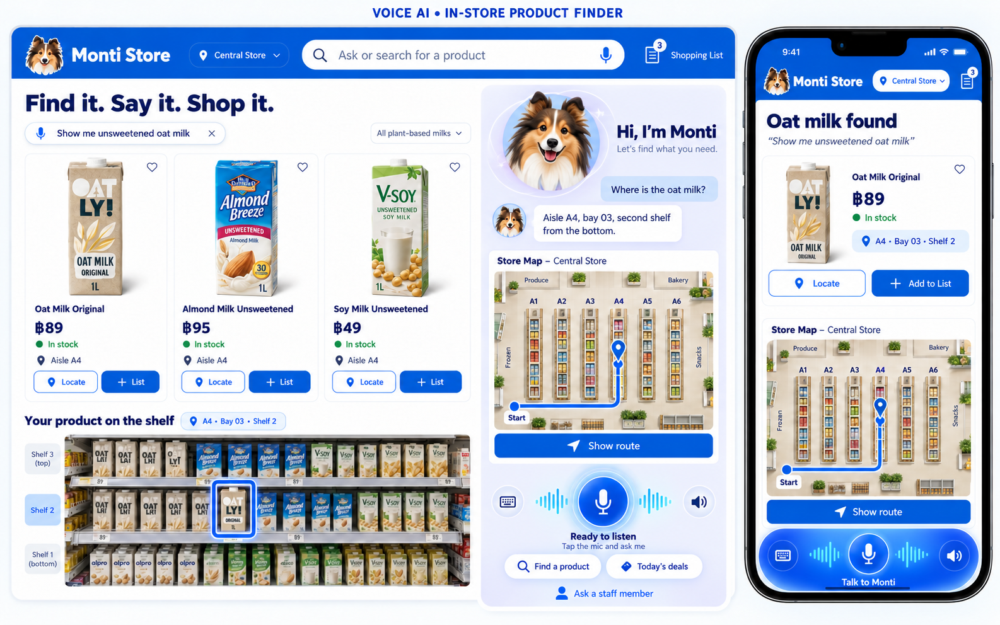

# Monti-inspired shopper UX and voice avatar

## Intent and baseline

The user requested a version checkpoint followed by a UX/UI redesign plan using
their desktop/mobile reference, explicitly including an avatar. The starting point
is **v0.2.0**, recorded in [DEP-0002](../08-deployments/DEP-0002.md). This document is
a design with a user-authorized local implementation recorded below. Formal
artifact approval and the existing full task/release acceptance remain separate.

Use the reference's bright blue retail identity, compact product cards, friendly
dog assistant, visible route and prominent voice controls. Carry forward the working
general conversation → meal idea → product/ingredient → shelf flow. Monti is the
proposed assistant name and collie-dog direction from the reference; store display
name/logo remain separate configuration, without renaming the repository or services.



Reference asset: user supplied on 16 October 2026. It is visual direction, not a
source of prices, inventory, product matches, map geometry or physical shelf facts.

## What changes on screen

| Surface | Proposed experience |
|---|---|
| Header | Blue bar, compact store identity and dog mark, real store label, large search field with microphone entry, discreet Backoffice link. |
| Shopper introduction | Compact “Find it. Say it. Shop it.” headline; suggested prompts for conversation, meal ideas and product finding. Remove the oversized editorial hero. |
| Product results | Up to three equal cards with verified product name/category, image or clear fallback, aisle/shelf and Locate action. Selected card and map destination share one highlight. |
| Assistant rail | Monti avatar, brief greeting/status, provisional conversation captions, store map and voice controls. Keep conversation usable when there are no results. |
| Destination detail | Selected product, stored aisle/shelf, entrance-based route and ordered text steps. Add physical shelf photography only when its mapping is verified. |
| Mobile | One-column results and map, compact avatar/status and a persistent bottom voice dock. Expand conversation without hiding the active-microphone indicator or End control. |
| Recovery | Specific retry or typed-search action within the affected area; preserve known product/shelf facts when a route or image fails. |

## Desktop and mobile composition

At **1200 px and wider**, use a two-column workspace: flexible results/detail area
and a 360–400 px assistant rail, with a 24 px gap and a maximum page width around
1440 px. Keep Start/End, microphone state and current destination visible in the
initial 1280×900 view. The rail may be sticky within the viewport; it must scroll
when content is taller rather than clipping controls.

```text
+------------------------------------------------------------+
| Dog / Store   [ Ask or search for a product       Mic ]     |
+-------------------------------------+----------------------+
| Find it. Say it. Shop it.            | Avatar: Hi, I'm Monti |
| [Conversation] [Meal idea] [Find]    | State + brief captions|
|                                     |                      |
| [Product] [Product] [Product]        | Store map + route    |
| [Locate ] [Locate ] [Locate ]       | From entrance        |
|                                     |                      |
| Selected product + aisle/shelf      | Start / End voice    |
| Location detail + walking steps     | Mic / sound / timer  |
+-------------------------------------+----------------------+
```

At **768–1199 px**, use two result columns and a full-width map/detail section;
the assistant uses the compact dock and expandable panel. Below **768 px**, stack
cards vertically with the selected product first, followed by route/map and text
directions. Do not depend on horizontal card swiping to reach a result.

```text
+------------------------------+
| Dog / Store        Backoffice|
| [ Ask or search          Mic]|
+------------------------------+
| Selected product / results   |
| [Image] Name                 |
| Aisle / Shelf    [ Locate ]  |
|                              |
| Store map / verified path    |
| From entrance / text steps   |
+------------------------------+
| Avatar  Listening  Mic on    |
| [Mic mute] [Start/End] [Sound]|
+------------------------------+
```

Reserve bottom space for the dock plus device safe-area insets, including while
the virtual keyboard is open. Use the existing single Portal/VoiceClient instance;
desktop and mobile views must not open separate microphones or sockets.

## Visual system

Proposed tokens: primary blue `#0057D9`, dark navy text `#0B1B54`, pale blue surface
`#F3F7FF`, white cards and border `#DCE6F7`. Verify final text/button contrast during
implementation. Use the existing Inter/system sans stack, strong compact headings,
an 8 px spacing scale, 16 px card radii and subtle shadows. Avoid heavy glows outside
the active microphone/avatar affordance. Keep illustrations separate from factual
map overlays. Scope new shopper tokens so Backoffice remains legible and usable.

## Avatar: Monti the store companion

Create an original transparent collie-head asset pack in the reference's friendly
style. Use a 48 px mark in the header, a 120–160 px desktop assistant portrait and
a 40–56 px mobile dock portrait. Keep character appearance consistent across states.

| Actual voice state | Avatar behavior | Visible text/action |
|---|---|---|
| Idle | Neutral smile; optional occasional blink. | Ready when you are / Start voice. |
| Connecting | Gentle waiting pose; no speaking mouth. | Connecting / Cancel. |
| Listening | Attentive pose and restrained ring. | Listening / Microphone on / End. |
| Thinking | Subtle head tilt or breathing; no fake waveform. | Thinking; retain the last user caption. |
| Speaking | Mouth/open-close shapes driven by actual rendered output level. | Speaking, output captions, Mic mute and Sound controls. |
| Interrupted | Stop mouth motion immediately when playback flushes. | Listening; discard old response animation. |
| Error/expired | Calm neutral portrait; stop all activity cues. | Clear retry/Start voice and typed search. |

The avatar is presentation of `VoiceState`, never an independent conversational
agent. Use Gemini's existing native audio and selected server-side voice. Do not add
a TTS provider, avatar-video service, recording upload or transcript persistence.
Mouth movement follows local playback amplitude, not arriving network chunks or
microphone input; muted/flushed/drained playback must stop it. Describe this as
audio-reactive animation, not phoneme-accurate lip sync.

Start with layered 2D images/CSS; add a small playback-level callback to the existing
AudioEngine only if needed. This callback must not schedule, delay or buffer audio.
Use `requestAnimationFrame` only while visible/active and cancel it on End/unmount.
Reduced-motion mode uses a static pose and text status. A missing asset falls back
to the microphone icon with full controls and status.

Asset deliverables: transparent master, neutral/listening/thinking/speaking/error
poses or mouth layers, optimized WebP/PNG variants and a small typed manifest.
Load only the neutral portrait initially (target ≤80 KB); lazy-load the remaining
pack (target total ≤400 KB). Give dimensions/aspect ratios to prevent layout shifts.
Avatar/name configuration is public presentation configuration; provider key,
Gemini model and Gemini voice retain their existing private server configuration.

## Conversation and task flow

1. Shopper starts voice explicitly. Monti responds to Hello and general questions;
   no product cards need to appear for a casual conversation.
2. Shopper asks for a meal idea. Monti suggests a short menu/recipe and ingredients,
   then offers to find an ingredient. Suggestions do not claim store availability.
3. On a store matching/location request, existing ADK tools search the published
   catalog. Ambiguous results show up to three cards and a spoken clarification.
4. A spoken selection or Locate action resolves the current product and verified
   route. Product, aisle/shelf, highlighted destination and text directions agree.
5. Interruption or a new request clears obsolete speech/selection updates. End
   releases capture, playback, sockets and avatar animation. Typed search stays
   available throughout network, permission, classifier or provider failures.

The mode/attempt/ACK and catalog grounding behavior introduced before v0.2.0 remains
the source of truth. Captions are provisional dialogue; they never trigger REST
search or create authoritative location cards. Background voice events preserve
keyboard focus. Avatar and animation must not alter the one-second playback bounds.

## Reference features and real data

| Reference feature | Plan against current implementation |
|---|---|
| Product photo | Support approved SKU image mappings with an explicit category/image-unavailable fallback. Do not invent packaging or map unrelated photos to a SKU. |
| Prices / In stock | Current public product DTO has no price or stock fields. Keep these absent until a real source, update policy and API contract are added. Published means searchable, not in stock. |
| Aisle / Bay / vertical shelf | Show actual stored aisle and shelf labels. Current schema does not establish bay or vertical tier; do not reinterpret Shelf 3 as “second from bottom.” |
| Photo of product on shelf | Later enhancement requiring verified shelf/photo mapping and placement metadata. Initially use truthful location detail and the stored route/map. |
| Store selector | Display the real single demo store. Add selection only when multi-store routing/data exists. |
| Add to List / favorites | Optional later shopper-list scope using product IDs and quantities. No cart/payment/checkout is included in this redesign baseline. |
| Today's deals / staff assistance | Do not expose working-looking actions without the corresponding service and UX/error contract. Keep as future additions. |
| Decorative map / blue path | Restyle the existing SVG and path from stored graph geometry. Keep “From entrance” and sample-map/not-live-location disclosure. |

A first image mapping can be a reviewed local asset manifest keyed by product ID,
without modifying the public API. Persistent image URLs, prices, stock, bay/tier or
shelf-photo metadata require a separate backend/import/backoffice contract change
and coordinated ownership. Those features are not prerequisites for the blue shell,
avatar and grounded route experience.

## Components and file ownership

Extend Svelte and the existing stores; do not introduce another frontend framework.

- `web/src/routes/+layout.svelte`, `+page.svelte`, `app.css`: compact header, scoped
  shopper theme, responsive workspace and selected-result composition.
- `web/src/lib/components/`: planned `AssistantAvatar.svelte`, `ProductCard.svelte`,
  `AssistantPanel.svelte`, `VoiceDock.svelte` and `LocationDetail.svelte`; adapt
  `VoicePanel.svelte` and `StoreMap.svelte` rather than duplicate their controllers.
- `web/src/lib/voice/audio.ts`: optional playback-level notification, preserving
  PCM pacing/bounds, cancellation and cleanup; serialize with TASK-0003 ownership.
- `web/src/lib/portal.ts`, `voice/client.ts`, `contracts.ts`: reuse factual/session
  state. Any new presentation selector must not create another transport instance.
- `web/static/avatar/monti/` and a typed public avatar manifest: optimized artwork,
  fallback and state mapping. `web/static/products/` only for verified SKU assets.
- TASK-0004 owns shopper UI; TASK-0003 reviews any audio hook; TASK-0009 owns the
  protected Backoffice route. Shared token/header changes need Backoffice regression.

## Delivery sequence

| Phase | Concrete deliverable | Verification before moving on |
|---|---|---|
| 1. Direction and assets | Desktop/mobile wireframes, blue tokens, original avatar sheet and asset manifest proposal; inventory verified SKU imagery. | Reference match, readable controls, missing-data decisions documented. |
| 2. Shopper shell | Compact header/search, responsive workspace and product cards using current DTOs. | 320/390/768/1280/1440 px layouts; no overflow; typed search and Locate still work. |
| 3. Route and mobile voice | Restyled stored map/location detail, desktop rail and mobile dock/panel. | Matching cards/routes/text, stale-event rejection, visible mic state and controls. |
| 4. Avatar integration | Actual voice-state poses and audio-reactive mouth, reduced motion and asset fallback. | Start/End/mute/drain/interruption/unmount stop the correct animation and resources. |
| 5. Regression and local rollout | Screenshot comparisons, keyboard/accessibility checks, native voice flow and rollback reference. | Existing tests and new behavior checks pass; real conversation → menu → shelf works. |

Use one active TASK-0004 builder worktree in sync mode. A distinct GPT review pass
inspects implementation and executed evidence. Draft follow-up work items after
contracts/assets are settled; this plan does not mark the existing task done or
automatically start a build. Verified shelf photos, commerce-like list features,
inventory and multi-store controls are separate later work packages.

## Acceptance and verification plan

- Compare desktop/tablet/mobile screenshots against the reference's hierarchy,
  including idle, listening, thinking, speaking, ambiguous result, selected route,
  no match, unavailable map and microphone denial.
- Keep Start/End and mute controls reachable with ≥44 px targets, visible focus,
  WCAG 2.2 AA contrast, readable status and no color-only direction cues. Exercise
  keyboard and a declared screen reader; avoid announcing each mouth frame.
- On mobile, expanding/minimizing the conversation must retain the visible dock
  while voice is active. A Close/End action stops capture. If a modal is used, trap
  focus only while open and restore it to its launcher on close.
- Run Svelte check, frontend unit/browser tests and static production build. Add
  meaningful regressions for one controller across breakpoints, actual state-to-
  avatar cleanup and card/map synchronization. Re-run backend/ADK checks only if
  their contracts or audio hooks change.
- Repeat Hello → general question → meal suggestion → product/shelf lookup against
  the real local stack. Listen to the complete reply; verify spoken/captioned
  locations against tool data. Include interruption and explicit fresh reconnect.
- Avatar assets/animation must not enlarge audio queues, delay playback, block
  microphone processing or steal focus. Preserve existing voice latency targets;
  measure the redesigned build rather than infer performance from visual tests.
- A successful UI redesign does not fix Laya's existing 19/40 frozen benchmark or
  qualify the separate full cloud/release acceptance gates.

## Local implementation contract — 16 October 2026

The user explicitly requested “start to build” this design. GPT settled the routine
choices below for that authorized implementation, in the existing TASK-0004 worktree
and sync coordination. These decisions do not claim formal design approval or full
acceptance; no additional approval was needed to implement the requested scope.

- [x] **Identity/layout:** Monti Store and Monti in the public `ui-config.ts` manifest;
  blue shopper-only theme, desktop assistant rail, one-column mobile results/dock.
- [x] **Images:** no verified SKU photos available; use clearly labelled category
  illustrations. Original transparent six-pose dog atlas and master are in the repo.
- [x] **Contracts:** current product/map/route DTOs and voice protocol are unchanged.
  No price/stock/bay/tier/list fields or catalog writes are introduced.
- [x] **Lifecycle:** visible microphone status, countdown and 44 px session controls;
  Minimize retains the visible active dock, Close/End/Escape stop capture, resize
  transfers to desktop without another session. Error/retry and reduced motion
  behavior are defined and covered by automated checks.
- [x] **Playback hook:** optional fourth `AudioEngine.open` callback `onLevel(0 | .5
  | 1)`, observed only from speaker output through an analyser. No new audio queue
  or scheduling change. Flush/mute/drain/close reset level and cancel sampling;
  stale callbacks are rejected by the existing session nonce.
- [x] **Budgets/preview:** shared atlas 74,240 bytes (all poses within the 80 KB
  initial budget); scoped shopper CSS about 5.6 KB gzip. Responsive screenshots,
  axe/keyboard/44 px checks and the normal localhost server form the local preview
  gate. Manual VoiceOver/Safari and 30-trial voice latency remain separate pending
  acceptance; v0.2.0 is the immutable rollback comparison.

See [avatar artwork and exact prompt](../../design/assets/monti-avatar.md),
[implementation verification](../../design/evidence/DES-0002/README.md) and the
TASK-0004 execution record. Component boundaries may remain within VoicePanel/page
where they share the single controller; they do not require duplicate transports.

## Alternatives, rollout and recovery

A simple blue retheme is cheaper but does not achieve the reference's compact
product-first layout or companion experience. A 3D/video avatar adds runtime/network
cost without helping the current finding flow. Choose a layered 2D avatar and reuse
the native Gemini audio controller.

Build in the isolated TASK-0004 worktree, expose a reviewable local preview, then
merge the validated presentation. Keep v0.2.0 as the immutable pre-redesign baseline.
Use reviewed revert commits to undo a merged redesign; do not reset shared history,
move the tag or reset catalog data. Cloud promotion still follows DEP-0001 and its
own acceptance gate. Planning does not restart or replace the running local portal.


## TASK-0011 implementation amendment — 16 October 2026

The user's direct implementation request authorizes this scoped contract extension.
One GPT integration builder serializes catalog/API, voice and UI surfaces.

- `GET /api/products` reads one published-only, readonly snapshot. Exact `category`
  (80 characters) and `shelf_id` filters; `page` 1–10000; `page_size` 1–24 (default
  12). Stable name/ID ordering. Response: catalog_version, products, total, page,
  page_size, categories with global published counts. Invalid filters/pages return
  400 INVALID_REQUEST; normal shared rate/dependency errors apply. OpenAPI is updated.
- `catalog-expansion-v2.json` adds 60 unique published products to the immutable
  base batch (120 published total). Existing edits/maps remain intact. Both batches
  run on local startup; repeated batches are unchanged, with no database reset.
- Native capture uses 20ms frames and the same RMS 500 onset detector in browser
  and Go; both end activity after 350ms silence. Python schedules output against an
  absolute clock with 120ms lead; browser adds 60ms only at new playout. Existing
  frame limits, 48KB/one-second backlog, cancellation and authority gates remain.
- Product-first gallery provides category/pagination controls and explicit Locate
  actions. A browse click starts a typed route using its parsed published product;
  it never reuses a voice search identity. Shelf reads have independent abort/epoch
  guards and show only returned products from the selected stored shelf.
- Five generated 6×4 atlases map 120 IDs to original sample packshots. Missing
  artwork falls back to category illustration. Product and shelf imagery is visibly
  disclosed as sample illustration, with no fabricated price, stock, bay or tier.
- Comparison, source provenance, tests and measurement limits are recorded in
  TASK-0011 evidence. Full physical-device/cloud/classifier acceptance remains open.


## TASK-0012 follow-up — 16 October 2026

User requests English-only default speech and investigation of stopped/disconnected
replies, including a Go/Python comparison. Native-audio language_code remains unset
because the provider does not support it; system instructions explicitly require
English and quiet waiting during silence. Model/voice remain configurable.

Go/browser onset now requires 80ms sustained RMS500 PCM; both count PCM duration
rather than network/callback wall time. End remains 350ms silent PCM. The server
buffers onset (at most 80ms plus one bounded input frame), sends activity_start
before replaying it, and forwards active frames including the ending silence. Idle
silence and isolated impulses are not forwarded to ADK/Gemini. Real barge-in, frame
limits, audio queue bounds, classification and catalog grounding remain unchanged.
Allowlisted failure reasons exclude raw error strings, text, audio and credentials.

[Runtime assessment](../../../agent/RUNTIME-ASSESSMENT.md) corrects outdated Go Live
support assumptions. Current Go ADK has RunLive; no Go/Python A/B advantage or full
resolution of physical-device disconnects is claimed. Keep the qualified Python
runtime while repairing this concrete activity-control issue.

Native text/click turns must not create an empty audio activity: reader defers
activity_start until first PCM, and ends only an active audio input before sending
text. This corrects a reproduced native provider disconnect without changing private
protocol fields or switching providers/runtimes. The retained intermediate spoken
TURN_TIMEOUT remains outside the scoped resolved-defect claim.


## Repeated conversation follow-up — TASK-0013

The user reports repeated shelf requests and slower replies after successive item
lookups. Shelf preview loads depend on the scalar stored shelf ID, not the product
object or unrelated portal invalidations. Keep in-flight requests when that ID is
unchanged; changed shelves and unmount still abort, epoch-check and reject stale
responses. Explicit Retry remains available; no polling or cross-session cache.

For a model response withheld because the current turn's required tools are missing,
start the existing one-per-turn continuation immediately after a completed response (including a silent completion), provided input has ended, a current request exists, and no host tool
is pending. Keep the eight-second watchdog for a stalled response. Never replay
withheld audio, bypass classification/ACK/catalog/route gates, or extend the retry
budget. Assemble delta/cumulative input transcription (bounded to 1,000 characters)
so continuation includes the request rather than just the last transcript chunk.
New turns reset all recovery state. Genuine transport failures and the existing
five-minute session/one-minute idle limits retain their explicit restart behavior.

Validate both repeated public text-control turns and a synthetic spoken-microphone
session; distinguish received audio from browser scheduled playout, and retain failed
runs. These checks do not replace physical-device/network or 30-turn qualification.

The model-visible classification tool result adds `response_mode` and a fixed
`next_action` instruction after the existing classification ACK. The private Laya
result/event schema is unchanged. New/repeated item directions use a fresh search;
a pending ambiguous selection uses its exact existing search/product IDs. Tool
budgets and Go authority remain unchanged. Private tool HTTP failures log only the
allowlisted tool name and numeric status, never request/response bodies.
