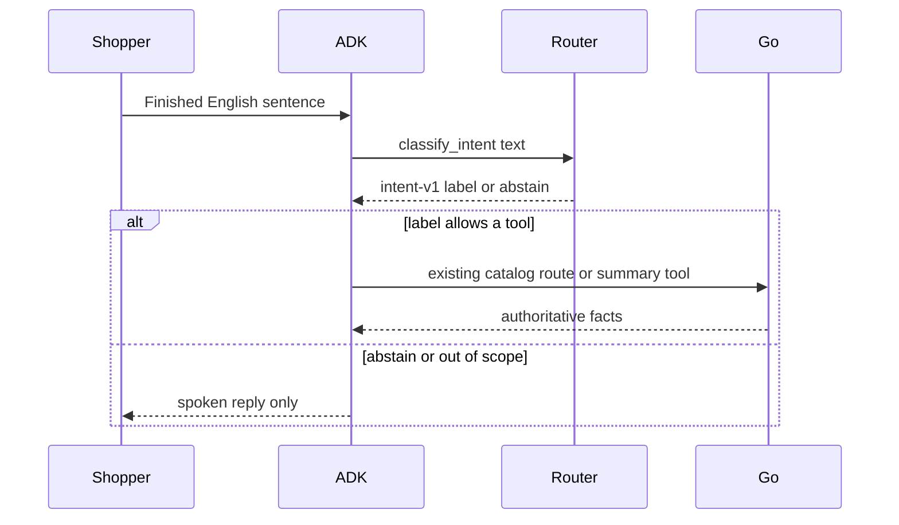

# Design: Embedding router behind classify_intent

## Pre-Implementation Specs

Purpose: Lock the router contract before TASK-0021 edits the ADK adapter. Stores this design does not use are marked unused.

### Lock Checklist

- [x] **Data contracts** — No MongoDB, Redis, DuckDB, or NATS. The router reads `agent/tools/prototypes/embedding-v1.json` and `agent/tools/prototypes/embedding-eval-v1.json`. The tool result keeps the seven intent-v1 fields. Success labels add `summarize` only for a `gemini-embedding-2` revision. Session memory is in-process: current result ids plus search id, and the current route's product id plus search id. It is not a new table.
- [x] **API contracts** — No new public HTTP route and no portal change. The embedding client calls `models/gemini-embedding-2:batchEmbedContents` on the Gemini Developer API with `outputDimensionality` 768 and no `task_type`. Catalog tools stay on `http://127.0.0.1:8002/internal/tools/{name}`.
- [x] **Error model** — Abstain reasons are `low_confidence`, `timeout`, and `error`. A disallowed tool returns `TOOL_NOT_ALLOWED` and does not call Go. Timeout and transport failure abstain without scores. Low confidence reports both scores.
- [x] **Auth model** — No new shopper auth. The Gemini key stays in `GOOGLE_API_KEY` and is sent as a header, not a query string. Laya keeps `LAYA_INTERNAL_TOKEN` on the default path. The router does not grant authorization.
- [x] **Observability hooks** — One log line per embedding decision: status, latency milliseconds, and token count when the API provides it. No shopper text, prototype text, key, or vector values.
- [x] **Feature-flag plan** — `INTENT_BACKEND` defaults to `laya`. The value `embedding` selects the router. Unset is the kill switch.
- [x] **Rollout / rollback plan** — Ship the router dark. Rollback is unsetting the flag and restarting the ADK process. Laya code and the 18 October gates stay. No deployment in this design.
- [x] **Performance budget** — The planning target for a warm decision is 500 ms p95. This design does not record a measurement. The host still wraps classification in 1.2 seconds. Prototype vectors are cached after the first successful embed. `warm()` prepares that cache outside a shopper turn.
- [x] **Accessibility budget** — No UI change. Not applicable.
- [x] **Security threat model link** — The sentence is untrusted input bounded to 1–300 characters with no null. It cannot choose a URL, a product id, or a shelf. Go still checks candidate membership. Logs exclude the sentence. Mitigations are part of TASK-0021.

### Sign-off

```yaml
locked_at: 2026-10-17
locked_by: architect-agent
design_version: v1
unblocks_tasks: [TASK-0021]
```

The user started the ROADMAP-0002 build on 17 October 2026. That start is the approval to implement this locked design. It is not approval to remove Laya.

## Solution Architecture

```text
Shopper sentence
      |
      v
ShopperTool ---- classify_intent ----+--> Laya adapter (default)
                                      |
                                      +--> EmbeddingRouter
                                              |  cosine + session gate
                                              v
                                         intent-v1 label
                                              |
                                              v
                         allowed tool only: search, route, or summary
                                              |
                                              v
                                    Go catalog authority
```

- **Laya adapter** — Default. Unchanged pin, four labels, private loopback. Owner: backend-dev-2.
- **EmbeddingRouter** — Flagged path. Owner: backend-dev-2. Scaling axis: one request per scored text plus a cached prototype matrix.
- **ToolHost** — Remembers results and route across turns. Enforces the label only when the revision starts with `gemini-embedding-2`.
- **Go** — Unchanged catalog, route, and summary tools.

## Business workflow

- **Primary actor:** Shopper.
- **Entry point:** A finished English sentence inside the existing voice turn.
- **Success outcome:** The matching tool runs, or the assistant speaks without a catalog call.
- **Out of scope:** Native audio changes, backoffice, and the Laya qualification gate.

### Steps

1. **Shopper** finishes a sentence. **Outcome:** ADK has bounded English text.
2. **Router** embeds that text and the frozen prototypes with the same prefix. **Outcome:** one label or an abstention.
3. **Session gate** drops selection when nothing is on screen and drops repeat when no route is stored. **Outcome:** those labels cannot win.
4. **Tool host** runs only the allowed existing tool. **Outcome:** Go returns facts, or no catalog call is made.
5. **Shopper** hears a reply grounded in Go when a tool ran. **Outcome:** the embedding itself did not speak an aisle or shelf.

### Sequence



## System workflow

1. `classify_intent` reads `INTENT_BACKEND`. Unset or `laya` calls the current adapter.
2. `embedding` loads the prototype file, embeds with the classification prefix, and caches prototype vectors on the router.
3. The host sets session flags `has_results` and `has_route` for that call.
4. The best cosine wins when confidence is at least 0.70 and the margin is at least 0.15. Otherwise the result abstains.
5. `ShopperTool` dispatches from the label when the revision is `gemini-embedding-2`. The host rejects any other tool before HTTP.
6. Successful search remembers ids. Successful route remembers the route. `begin()` clears the turn and keeps that session memory.

### Reliability

- **Sync timeout:** host classification budget 1200 ms. The embedding HTTP client uses a 1.0 second timeout.
- **Retries:** none inside the turn. Failure abstains.
- **Idempotency:** prototype cache is keyed by the file hash in `model_revision`.
- **Failure modes:** missing key, timeout, bad vector count, and low margin all abstain or refuse the tool. They do not invent a product.

## Tool permission

| Label | Allowed call | Session check |
|---|---|---|
| find_item | `search_catalog`, then `get_product_route` for the unique id from that same search | Query is the flow query or the sentence trimmed to 200 characters |
| select_item | `get_product_route` | Product id is in the remembered results and the search id matches |
| repeat_directions | `get_product_route` | Arguments match the remembered route. No new search |
| summarize | `get_conversation_summary` | No model-supplied products |
| out_of_scope or abstain | none | Spoken acknowledgement only |

`model_revision` is `gemini-embedding-2@768:` plus the first 16 hex characters of the prototype file's SHA-256. The Laya checker still rejects that revision.

## Folder and code style

- New modules live in `agent/tools/`. Host and shopper-tool edits stay in `agent/prompt_shop_live/`.
- Match the surrounding Python. No new dependency. The Gemini call uses the existing `httpx` client.
- Tests live in `agent/tests/test_embedding_router.py` and use a fake embedder. They do not call the live API.

## Evaluation set

`embedding-eval-v1.json` freezes 40 English sentences, eight for each label, disjoint from the prototypes. TEST-0018 checks the file. It does not score those sentences against the live model and it does not change the Laya 19-of-40 record.
