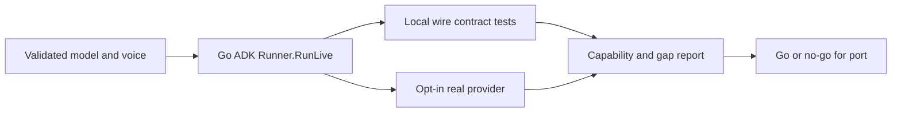

# Go ADK compatibility gate

## Pre-Implementation Specs

- [x] **Data:** no database/schema change. Safe probe report contains SDK/model
  identity, booleans, elapsed times and counts only. No keys, transcript, tool
  arguments, session IDs or raw audio are retained in evidence.
- [x] **API:** use real Go ADK Runner.RunLive, agent.LiveRequest, session service
  and function tools at v2.6.0, GenAI v1.74.0. A local ephemeral WebSocket fixture
  captures setup and server events. No app HTTP or public WebSocket contract changes.
- [x] **Errors:** CLI emits fixed status codes and returns nonzero when a required
  check fails. Discard raw SDK/provider logs/errors. Missing configuration fails
  before a provider request. Bound overall native probe to 60 seconds.
- [x] **Auth:** private environment supplies GOOGLE_API_KEY and current model/voice.
  Real calls require explicit opt-in. Test endpoint override is dependency-injected
  and cannot be set through public app input. No catalog callback capability exists
  in this spike, so its tool returns acknowledgment only, never shelf information.
- [x] **Observability:** counts for function calls, input/output transcription,
  PCM bytes/nonzero samples, completion, interruption and cleanup. Classify results
  as fixture versus real-provider evidence and include exact dependency sums.
- [x] **Flags:** no runtime feature flag or app cutover. Native CLI requires
  GO_ADK_LIVE_TEST=1. Existing Python launcher remains the rollback/default.
- [x] **Rollout:** no deployment/startup wiring; retain pinned Python v0.5.0. SDK
  setup omissions are failed feasibility gates for the stock SDK. Explicit,
  versioned compatibility patches may be evaluated in isolated SDK copies as
  described below. No unrecorded patch or production cutover is allowed.
- [x] **Performance:** no resource-saving claim. Probe completion/cancellation is
  bounded; native latency sample is diagnostic only. Full comparison follows a port.
- [x] **Accessibility:** UI unchanged. Test both native transcript channels because
  captions are an existing accessibility surface.
- [x] **Threat review:** untrusted tool text is not printed; test tool cannot read
  catalog or files. Temporary synthetic PCM is input only. Avoid SDK default logs
  because raw connection errors may include credential-bearing request URLs.

```yaml
locked_at: 2026-10-18
locked_by: GPT integration architect pass
design_version: go-adk-probe-v1
unblocks_tasks: [TASK-0023]
```

## Decision and workflow

Keep `agent-go/` as an independent Go module to isolate SDK dependencies from the
production Go API. Build the real llmagent, in-memory session and Runner. Use the
same AUDIO, voice, input/output transcription and manual-activity settings as
Python. Wire tests run a local Gemini-compatible WebSocket server and inspect the
setup generated by the actual SDK, not a hand-built replacement request.



Sources: pinned SDK under google.golang.org/adk/v2@v2.6.0 and
google.golang.org/genai@v1.74.0. Upstream examples establish API usage, not application
parity. Consult the actual pinned source for settings and event behavior.

## Folder and code style

`agent-go/internal/liveprobe/` owns settings, runner construction and probe logic;
`agent-go/cmd/live-probe/` owns opt-in and sanitized JSON output. Standard Go
contexts first, no mutable production globals, dependency injection for test
model/endpoint, table-driven failure cases, gofmt, go test -race and go vet.
SDK subprocess output is private and sanitized before recording evidence.

## Dependencies and alternatives

No PostgreSQL, portal, gateway or running Python edit is required. Using the raw
GenAI Live client instead of ADK would not qualify the requested migration.
Unpinned SDK main and a silent SDK fork are rejected. If a missing configuration
field blocks parity, record the field and expected/actual setup in TEST-0020.

## Compatibility amendment — observed SDK defects

Actual wire tests prove ADK v2.6.0 omits RealtimeInputConfig from LiveConnectConfig.
The race detector also observes concurrent GenAI v1.74.0 socket writes from ADK's
input and tool-response goroutines. The real unpatched manual-PCM probe timed out
without audio. Retain these failures; a stock SDK is not qualified for cutover.

Evaluate three minimal source patches in this task only: forward that config field, extend Gemini 3 Live input routing,
and serialize GenAI Session content/realtime/tool-response writes with one mutex.
`cmd/prepare-sdk` verifies module version/sum and exact patched-file base hashes,
copies SDK source to ignored `.sdk/` directories, applies checked-in patches with
zero fuzz, and writes a private workspace manifest. The global module cache and
the production module remain unchanged. Repeat preparation refuses a changed
patch/source identity rather than silently reusing a stale overlay.

Use an explicit local Go workspace and sdkcompat build tag. Wire tests must prove
the setting is present, and race tests must pass against the overlay. Native JSON
reports name all three compatibility patches. Stock results remain separate. Neither
a green patched probe nor this amendment approves the full runtime port, SDK
redistribution policy, app cutover or release. Review the patch footprint and
licensing/source provenance before any future deployment candidate.

The third recorded patch extends the modern Gemini 3 Live audio/text path to the configured 3.8 model, matching Python ADK. Wire tests assert realtime audio/text fields rather than legacy media/client-content fields. A two-patch native attempt failed with provider close 1007 and remains separate evidence. Keep initial stock, intermediate and final results distinct.
