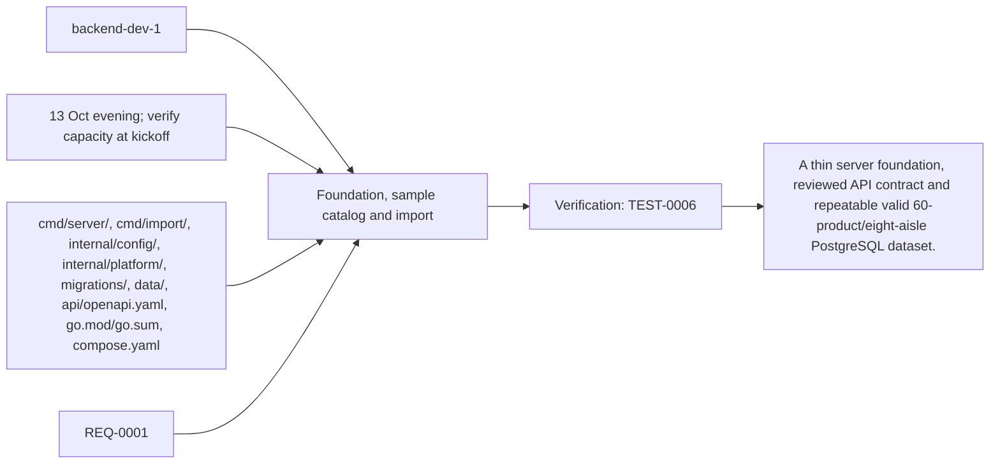
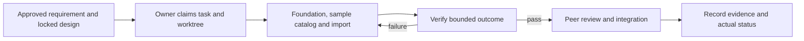

# Task: Foundation, sample catalog and import

## Outcome
A thin server foundation, reviewed API contract and repeatable valid 60-product/eight-aisle PostgreSQL dataset.

## 5W1H execution canvas
| Dimension | Answer |
|---|---|
| Who | Proposed lead backend-dev-1; peer owner reviews; qa-agent verifies. Role assignment is a plan, not an acquired task lock. |
| What | A thin server foundation, reviewed API contract and repeatable valid 60-product/eight-aisle PostgreSQL dataset. |
| When | 13 Oct evening; verify capacity at kickoff; start only after review/contract lock and prerequisites. |
| Where | cmd/server/, cmd/import/, internal/config/, internal/platform/, migrations/, data/, api/openapi.yaml, go.mod/go.sum, compose.yaml |
| Why | Advances REQ-0001 and protects the 16 October deployment. |
| How | Follow the steps below and record evidence in TEST-0006. |

## 5W1H graph

## Execution workflow

## Inputs and dependencies
- Requirements: REQ-0001.
- Design: DES-0001, currently proposed and unsigned. No implementation is started by this document.
- Start prerequisites: human approval, locked contracts and development access.
- Due window: 13 Oct evening; verify capacity at kickoff, Asia/Bangkok. Estimate: 3–5 engineering hours, provisional; not elapsed time or historical velocity.
- Shared code/schema/router changes are serialized through the owner identified by DES-0001. TASK-0005 can prepare infra while feature tasks run, but its completed evidence requires their real integrated flow.

## Implementation plan
1. Pin minimal dependencies and create service, DB connector, health/readiness and one shared router from approved DES-0001.
2. Transcribe schema and seed validated products, aliases, aisle/shelf/node/edge data; include published sample products and draft/archive test records.
3. Implement transactional JSON import, idempotent import versions and row validation; retain original source license/provenance for reused portions.
4. Publish request/response fixtures for backend, ADK bridge, private catalog callbacks, Laya classifier, frontend and backoffice; hand off shared router/dependency changes through this owner.

## Definition of done
- [ ] Import succeeds twice without duplicate data; invalid references roll back all batch writes.
- [ ] All 60 published demo products have valid connected destinations; data persists outside container disk.
- [ ] Health, readiness and draft API fixtures are available to downstream tasks.
- [ ] Relevant test evidence and peer review are recorded; no claim of pass/completion is inferred from this plan.
- [ ] Documentation and integration handoff reflect the actual final behavior.

## Notes
The selected code snapshot in references/monti-jarvis is a reuse input. Imported source does not prove this task is implemented or its dependencies are satisfied. No feature branches, runtime app or deployment are created by this planning record.

## GPT / Grok assignment

**Builder: GPT. Reviewer: Grok.** Keep one integrator responsible for contracts, migrations and shared wiring. The existing `owner` remains the accountable SDLC role; this assignment selects the coding assistant. [The allocation plan](../../MODEL-ALLOCATION.md) defines file boundaries, shared-file handoffs and review evidence. The assignment is proposed and does not mark implementation started.
