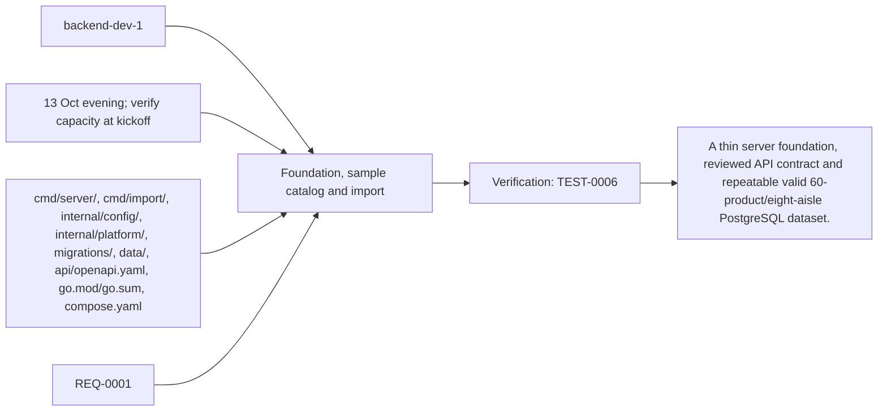
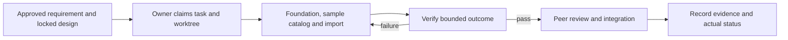

# Task: Foundation, sample catalog and import

## Outcome
A thin server foundation, reviewed API contract and repeatable valid 60-product/eight-aisle PostgreSQL dataset.

## 5W1H execution canvas
| Dimension | Answer |
|---|---|
| Who | GPT/backend-dev-1 holds the task lock; Grok peer review is pending. |
| What | A thin server foundation, reviewed API contract and repeatable valid 60-product/eight-aisle PostgreSQL dataset. |
| When | 13 Oct evening; verify capacity at kickoff; start only after review/contract lock and prerequisites. |
| Where | cmd/server/, cmd/import/, internal/config/, internal/platform/, migrations/, data/, api/openapi.yaml, go.mod/go.sum, compose.yaml |
| Why | Advances REQ-0001 and protects the 16 October deployment. |
| How | Follow the steps below and record evidence in TEST-0006. |

## 5W1H graph

## Execution workflow

## Inputs and dependencies
- Requirements: REQ-0001.
- Design: DES-0001 has the scoped TASK-0001 foundation lock authorized on 2026-10-13.
- Start prerequisites satisfied for local TASK-0001 by user instruction, scoped contract lock and verified local development access.
- Due window: 13 Oct evening; verify capacity at kickoff, Asia/Bangkok. Estimate: 3–5 engineering hours, provisional; not elapsed time or historical velocity.
- Shared code/schema/router changes are serialized through the owner identified by DES-0001. TASK-0005 can prepare infra while feature tasks run, but its completed evidence requires their real integrated flow.

## Implementation plan
1. Pin minimal dependencies and create service, DB connector, health/readiness and one shared router from approved DES-0001.
2. Transcribe schema and seed validated products, aliases, aisle/shelf/node/edge data; include published sample products and draft/archive test records.
3. Implement transactional JSON import, idempotent import versions and row validation; retain original source license/provenance for reused portions.
4. Publish request/response fixtures for backend, ADK bridge, private catalog callbacks, Laya classifier, frontend and backoffice; hand off shared router/dependency changes through this owner.

## Definition of done
- [x] Import succeeds twice without duplicate data; invalid references roll back all batch writes.
- [x] All 60 published demo products have valid connected destinations; data persists outside container disk.
- [x] Health, readiness and draft API fixtures are available to downstream tasks.
- [ ] Relevant test evidence and peer review are recorded; no claim of pass/completion is inferred from this plan.
- [x] Documentation and integration handoff reflect the actual final behavior.

## Notes
Monti source snapshots retain their original provenance and licenses. New foundation code is implemented on the feature branch; no cloud deployment or live provider integration is claimed.

## GPT / Grok assignment

**Builder: GPT. Reviewer: Grok.** Keep one integrator responsible for contracts, migrations and shared wiring. The existing `owner` remains the accountable SDLC role; this assignment selects the coding assistant. [The allocation plan](../../MODEL-ALLOCATION.md) defines file boundaries, shared-file handoffs and review evidence. GPT implementation is active in the task worktree. Grok review is pending.

## Implementation authorization — 2026-10-13

User instruction “start build Task 1” authorizes GPT/backend-dev-1 to implement the foundation contracts in DES-0001 in `.worktrees/TASK-0001`, branch `feature/TASK-0001-foundation`. Coordination: sync until this foundation is accepted. The existing untracked planning scaffold was preserved in an initial feature-branch commit; develop was bootstrapped at origin/main without modifying main. Cloud account/budget, provider access, subsequent feature implementation and release approval are outside this authorization. Required Grok review remains pending.

> Verification checkpoint: initial dependency scan found vulnerable Go/dependency versions. Remediation and rerun in progress; no feature or release pass claimed.

## Implementation outcome — 2026-10-13

Implemented the thin Fiber server, PostgreSQL schema/migrations/roles, strict atomic operator importer, 60 published sample products plus draft/archive fixtures, and public/private API examples. [Handoff and local commands](../../TASK-0001-HANDOFF.md). Full readiness requires ADK/Laya; local foundation mode is explicitly labelled and forbidden in Cloud Run.

TEST-0006 records passing race-enabled integration tests, safe health/readiness, all 60 reachable destinations, complete snapshot comparisons on rejected imports (including SQL failure after earlier writes), concurrent/idempotent version behavior, DB privilege tests, app/DB restarts and real CLI errors. Go vet and final vulnerability scan pass. The earlier dependency-scan blocker was resolved with Go 1.26.9 and updated pinned libraries before final verification.

## Review — PASS

**Reviewer: GPT implementation self-review only; not the assigned Grok peer review.** Reviewed the task diff against the scoped DES-0001 contract and ADR-0001. Foundation surfaces and test evidence match the task; private handlers, provider calls, customer UI and cloud provisioning are not implemented by this branch. Inspection caught and corrected readiness that would have failed after a legitimate catalog archive. Dependency vulnerabilities were resolved and rechecked.

Required **Grok peer review, CI and high-risk human sign-off remain pending**. Keep this task in_progress and the PR draft until those gates are satisfied; this self-review PASS does not authorize merge or unlock dependent integration.

> Coordination: another builder published the shared planning baseline as origin/develop and started isolated TASK-0003. TASK-0001 rebases onto that baseline, preserves its existing approved design checklist, and retains its own scoped implementation record. No TASK-0003 code or worktree is modified.
