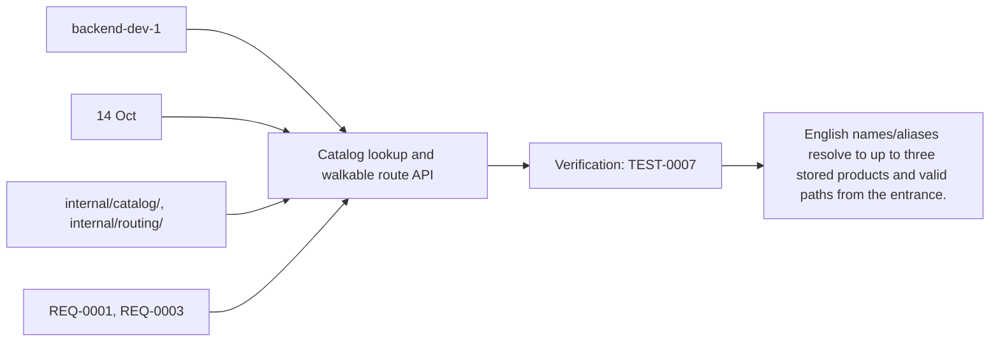
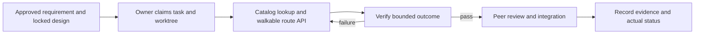

# Task: Catalog lookup and walkable route API

## Outcome
English names/aliases resolve to up to three stored products and valid paths from the entrance.

## 5W1H execution canvas
| Dimension | Answer |
|---|---|
| Who | Proposed lead backend-dev-1; peer owner reviews; qa-agent verifies. Role assignment is a plan, not an acquired task lock. |
| What | English names/aliases resolve to up to three stored products and valid paths from the entrance. |
| When | 14 Oct; start only after review/contract lock and prerequisites. |
| Where | internal/catalog/, internal/routing/ |
| Why | Advances REQ-0001, REQ-0003 and protects the 16 October deployment. |
| How | Follow the steps below and record evidence in TEST-0007. |

## 5W1H graph

## Execution workflow

## Inputs and dependencies
- Requirements: REQ-0001, REQ-0003.
- Design: DES-0001, currently proposed and unsigned. No implementation is started by this document.
- Start prerequisites: TASK-0001.
- Due window: 14 Oct, Asia/Bangkok. Estimate: 4–6 engineering hours, provisional; not elapsed time or historical velocity.
- Shared code/schema/router changes are serialized through the owner identified by DES-0001. TASK-0005 can prepare infra while feature tasks run, but its completed evidence requires their real integrated flow.

## Implementation plan
1. Implement bounded normalized name/alias ranking and public published-only filtering with stable IDs.
2. Resolve current shelf data server-side; generate graph paths and textual steps; reject unknown origins and unreachable nodes.
3. Handle catalog/map version drift and invalid/archived product IDs without fabricated locations.
4. Run meaningful query/route cases and hand handler registrations to TASK-0001 owner.

## Definition of done
- [ ] All route edges are walkable; unknown or unreachable requests produce documented errors.
- [ ] Typed query fixtures and all destination-connectivity checks pass.
- [ ] Returned aisle/shelf values come only from PostgreSQL joins.
- [ ] Relevant test evidence and peer review are recorded; no claim of pass/completion is inferred from this plan.
- [ ] Documentation and integration handoff reflect the actual final behavior.

## Notes
The selected code snapshot in references/monti-jarvis is a reuse input. Imported source does not prove this task is implemented or its dependencies are satisfied. No feature branches, runtime app or deployment are created by this planning record.

## GPT / Grok assignment

**Builder: Grok. Reviewer: GPT.** Bounded Go packages can be built against frozen contracts independently of the voice runtime. The existing `owner` remains the accountable SDLC role; this assignment selects the coding assistant. [The allocation plan](../../MODEL-ALLOCATION.md) defines file boundaries, shared-file handoffs and review evidence. The assignment is proposed and does not mark implementation started.
