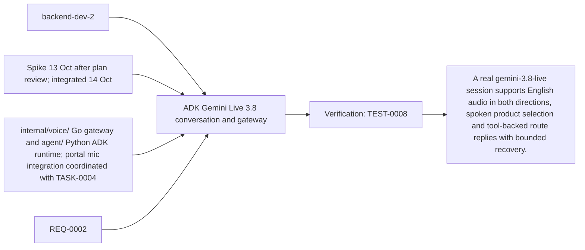
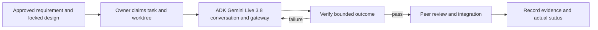

# Task: ADK Gemini Live 3.8 conversation and gateway

## Outcome
A real gemini-3.8-live session supports English audio in both directions, spoken product selection and tool-backed route replies with bounded recovery.

## 5W1H execution canvas
| Dimension | Answer |
|---|---|
| Who | Proposed lead backend-dev-2; peer owner reviews; qa-agent verifies. Role assignment is a plan, not an acquired task lock. |
| What | A real gemini-3.8-live session supports English audio in both directions, spoken product selection and tool-backed route replies with bounded recovery. |
| When | Spike 13 Oct after plan review; integrated 14 Oct; start only after review/contract lock and prerequisites. |
| Where | internal/voice/ Go gateway and agent/ Python ADK runtime; portal mic integration coordinated with TASK-0004 |
| Why | Advances REQ-0002 and protects the 16 October deployment. |
| How | Follow the steps below and record evidence in TEST-0008. |

## 5W1H graph

## Execution workflow

## Inputs and dependencies
- Requirements: REQ-0002.
- Design: DES-0001, currently proposed and unsigned. No implementation is started by this document.
- Start prerequisites: TASK-0001.
- Due window: Spike 13 Oct after plan review; integrated 14 Oct, Asia/Bangkok. Estimate: 8–14 engineering hours, provisional; not elapsed time or historical velocity.
- Shared code/schema/router changes are serialized through the owner identified by DES-0001. TASK-0005 can prepare infra while feature tasks run, but its completed evidence requires their real integrated flow.

## Implementation plan
1. Qualify the actual demo microphone/browser and Gemini Developer API account with `gemini-3.8-live`; record model setup and real two-way audio evidence. Do not inherit Monti's old 2.5 model default.
2. Implement the DES-0001 single-use cookie ticket and origin-checked `/ws/voice` Go gateway, bridged to private Python ADK `Runner.run_live()` through one bounded `LiveRequestQueue` per session. Receive PCM16LE mono16kHz and stream native PCM24kHz output; process every content part and transcript event. Inject the Gemini key only into the ADK container from Secret Manager; the Go gateway has no provider key.
3. Implement ADK `classify_intent`, `search_catalog` and `get_product_route` tools with explicit BLOCKING behavior. TASK-0010 owns the classifier adapter; catalog callbacks use only the private fixed Go endpoints and scoped session capability. Go validates current candidate/turn identifiers and emits factual UI events. Use fixtures for the isolated gate; TASK-0002 and TASK-0010 integration is required before staging acceptance.
4. Set AUDIO response modality; omit unsupported thinking/affective settings and `proactive_audio:false`. Adapt browser audio/protocol patterns; ADK owns the provider connection instead of porting the old Go Gemini implementation. Qualify pinned ADK/GenAI serialization with Gemini 3.8 and confirm BLOCKING actually reaches the provider.
5. Enforce setup30s, live300s, idle60s, per-instance4 sessions and frame/queue bounds from DES-0001; close browser, private bridge and provider sockets, bound ADK queues, delete ephemeral ADK session/events and release resources on stop/expiry/error. Cancel obsolete tools and flush stale audio on interruptions.
6. Keep save_live_blob false and persistent session/artifact storage disabled; cleanup must run on failure as well as normal close.
7. Verify spoken clarification/selection, silence, microphone denial, malformed/oversized input, quota/model errors, disconnect and explicit fresh-session reconnect with the frontend owner.

## Definition of done
- [ ] Actual gemini-3.8-live microphone-to-native-audio conversation works on the target browser, including read-only tools and interruption; fixture-only evidence or bypassing ADK is insufficient.
- [ ] API secrets remain server-side and raw audio/transcripts are not persisted by app logging.
- [ ] Voice failure exposes typed recovery; required voice acceptance is not waived by fallback.
- [ ] Relevant test evidence and peer review are recorded; no claim of pass/completion is inferred from this plan.
- [ ] Documentation and integration handoff reflect the actual final behavior.

## Notes
The selected code snapshot in references/monti-jarvis is a reuse input. Imported source does not prove this task is implemented or its dependencies are satisfied. No feature branches, runtime app or deployment are created by this planning record.

## GPT assignment

**Builder: GPT. Reviewer: GPT (separate review pass).** Keep session lifecycle, provider setup and integration boundaries with the integrator. The existing `owner` remains the accountable SDLC role; this assignment selects the coding assistant. [The allocation plan](../../MODEL-ALLOCATION.md) defines file boundaries, shared-file handoffs and review evidence. The assignment is proposed and does not mark implementation started.

## Allocation update — 2026-10-14

User assigned all tasks to GPT for implementation and a separate review pass. Current assignment supersedes the previous split; dated builder/reviewer execution evidence remains attributed to its original author. Task status and acceptance evidence are unchanged by this reassignment.
