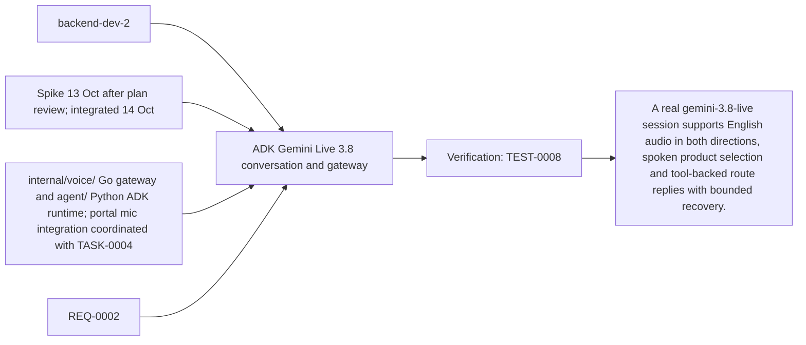
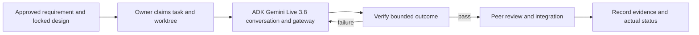

# Task: ADK Gemini Live 3.8 conversation and gateway

## Outcome
A real gemini-3.8-live session supports English audio in both directions, spoken product selection and tool-backed route replies with bounded recovery.

## 5W1H execution canvas
| Dimension | Answer |
|---|---|
| Who | Proposed lead backend-dev-2; peer owner reviews; qa-agent verifies. Role assignment is a plan, not an acquired task lock. |
| What | A real gemini-3.8-live session supports English audio in both directions, spoken product selection and tool-backed route replies with bounded recovery. |
| When | Spike 13 Oct after plan review; integrated 14 Oct; start only after review/contract lock and prerequisites. |
| Where | internal/voice/ Go gateway and agent/ Python ADK runtime; portal mic integration coordinated with TASK-0004 |
| Why | Advances REQ-0002 and protects the 16 October deployment. |
| How | Follow the steps below and record evidence in TEST-0008. |

## 5W1H graph

## Execution workflow

## Inputs and dependencies
- Requirements: REQ-0002.
- Design: DES-0001, currently proposed and unsigned. No implementation is started by this document.
- Start prerequisites: TASK-0001.
- Due window: Spike 13 Oct after plan review; integrated 14 Oct, Asia/Bangkok. Estimate: 8–14 engineering hours, provisional; not elapsed time or historical velocity.
- Shared code/schema/router changes are serialized through the owner identified by DES-0001. TASK-0005 can prepare infra while feature tasks run, but its completed evidence requires their real integrated flow.

## Implementation plan
1. Qualify the actual demo microphone/browser and Gemini Developer API account with `gemini-3.8-live`; record model setup and real two-way audio evidence. Do not inherit Monti's old 2.5 model default.
2. Implement the DES-0001 single-use cookie ticket and origin-checked `/ws/voice` Go gateway, bridged to private Python ADK `Runner.run_live()` through one bounded `LiveRequestQueue` per session. Receive PCM16LE mono16kHz and stream native PCM24kHz output; process every content part and transcript event. Inject the Gemini key only into the ADK container from Secret Manager; the Go gateway has no provider key.
3. Implement ADK `classify_intent`, `search_catalog` and `get_product_route` tools with explicit BLOCKING behavior. TASK-0010 owns the classifier adapter; catalog callbacks use only the private fixed Go endpoints and scoped session capability. Go validates current candidate/turn identifiers and emits factual UI events. Use fixtures for the isolated gate; TASK-0002 and TASK-0010 integration is required before staging acceptance.
4. Set AUDIO response modality; omit unsupported thinking/affective settings and `proactive_audio:false`. Adapt browser audio/protocol patterns; ADK owns the provider connection instead of porting the old Go Gemini implementation. Qualify pinned ADK/GenAI serialization with Gemini 3.8 and confirm BLOCKING actually reaches the provider.
5. Enforce setup30s, live300s, idle60s, per-instance4 sessions and frame/queue bounds from DES-0001; close browser, private bridge and provider sockets, bound ADK queues, delete ephemeral ADK session/events and release resources on stop/expiry/error. Cancel obsolete tools and flush stale audio on interruptions.
6. Keep save_live_blob false and persistent session/artifact storage disabled; cleanup must run on failure as well as normal close.
7. Verify spoken clarification/selection, silence, microphone denial, malformed/oversized input, quota/model errors, disconnect and explicit fresh-session reconnect with the frontend owner.

## Definition of done
- [ ] Actual gemini-3.8-live microphone-to-native-audio conversation works on the target browser, including read-only tools and interruption; fixture-only evidence or bypassing ADK is insufficient.
- [ ] API secrets remain server-side and raw audio/transcripts are not persisted by app logging.
- [ ] Voice failure exposes typed recovery; required voice acceptance is not waived by fallback.
- [ ] Relevant test evidence and peer review are recorded; no claim of pass/completion is inferred from this plan.
- [ ] Documentation and integration handoff reflect the actual final behavior.

## Notes
The selected code snapshot in references/monti-jarvis is a reuse input. Imported source does not prove this task is implemented or its dependencies are satisfied. No feature branches, runtime app or deployment are created by this planning record.

## GPT assignment

**Builder: GPT. Reviewer: GPT (separate review pass).** Keep session lifecycle, provider setup and integration boundaries with the integrator. The existing `owner` remains the accountable SDLC role; this assignment selects the coding assistant. [The allocation plan](../../MODEL-ALLOCATION.md) defines file boundaries, shared-file handoffs and review evidence. The assignment is proposed and does not mark implementation started.

## Build authorization and coordination — 2026-10-13

User requested “build task 3” after the active TASK-0001 builder was identified. GPT/Codex (exact client/model revision not exposed) starts isolated implementation in `.worktrees/TASK-0003`, branch `feature/TASK-0003-adk-live`, from origin/develop c57cd6f. This is an early-build exception using DES-0001 v0.3 draft contracts; TASK-0001 acceptance remains an integration prerequisite, not a completed dependency. No other builder files are edited. Shared Go dependency/router changes are delivered as a handoff, and TASK-0010 retains agent/tools/intent.py. Grok review, real-model audio evidence, foundation acceptance and release approval remain open.

## Implementation and evidence — 2026-10-13

Built the isolated Go Fiber admission/relay/private-tool package and pinned Python ADK runtime. Foundation fixtures became available during implementation; aligned turn/generation wire IDs and tool_capability with their schemas. Root server/dependency integration remains a handoff so the active foundation writer retains exclusive ownership.

- Go: nine tests passed with race detection, including actual PostgreSQL atomic consumption (one winner from 20 concurrent upgrades), public WebSocket/private bridge, classification ACK ordering, tools/candidate/epoch validation and invalid PCM close. Vet passed. Disposable task-owned database container was removed after the run.
- Python: nine tests passed against ADK 2.11.0 / GenAI 2.30.1. Actual Runner/SDK serialization with simulated network proves AUDIO/BLOCKING configuration, native PCM event handling, isolated concurrent sessions, cleanup, queue bounds and foundation JSON-schema compatibility. Two dependency deprecation warnings remain.
- Native provider smoke NOT RUN: GOOGLE_API_KEY is still empty in the gitignored, mode-0600 agent/.env file requested by the user. No provider access, audible grounding, browser microphone, spoken selection or latency acceptance is claimed.
- TEST-0008 remains blocked overall. The recorded last_run passes only the explicitly scoped offline suite. Foundation acceptance, real provider/device evidence, Grok review and shared integration remain open.

Run/handoff: [agent README](../../../agent/README.md), [gateway integration](../../../internal/voice/README.md). Evidence: [TEST-0008](../07-tests/TEST-0008.md). Model/client identity: GPT-family Codex; exact runtime revision not exposed by this session.

## Review — CHANGES_REQUESTED

GPT implementation self-review completed against REQ-0002/REQ-0006, DES-0001, ADR-0001 and the TASK-0001 contract snapshots. No failing offline check remains. This is not the assigned Grok review or a merge approval.

Required before acceptance/merge:
1. Run and record actual gemini-3.8-live native audio/tool/selection/interruption evidence with the supplied key and declared demo browser/device; fixtures alone do not pass TEST-0008.
2. Accept and integrate TASK-0001, wire shared Go dependencies/server and TASK-0002 Catalog adapter through the foundation owner, and provide TASK-0010's real intent adapter for integrated acceptance.
3. Complete assigned Grok review, CI and high-risk human review. Whole-prototype design lock is not claimed by the user-authorized isolated build exception.

The branch can be reviewed as a draft; do not merge or mark done from the offline results.

## Allocation synchronization — 2026-10-14

The user assigned all tasks to GPT for implementation and separate review. Current model metadata supersedes historical model assignments; actual implementation/review records and incomplete acceptance status are preserved. Source consolidation into main was explicitly requested; merging does not qualify release acceptance.

## Configurable model and voice — 2026-10-16

The user explicitly requested model-version and voice configuration, superseding the immutable runtime model pin for this scoped change. GPT/backend-dev-2 reused the clean TASK-0003 worktree after fast-forwarding it to the integrated main source. Coordination is sync; the same GPT integration session serializes the deployment/QA configuration handoffs. Full TASK-0003 remains blocked for its existing native/integration acceptance gaps; this change does not mark it complete or obtain cloud authorization.

Added startup-captured, validated `GEMINI_MODEL` and `GEMINI_VOICE` settings to ADK, replacing the protocol model constant. Default model stays `gemini-3.8-live`; unset/empty voice keeps the provider default. Configured prebuilt voice reaches `RunConfig.speech_config`; model-request validation and smoke identity use the selected startup settings. Templates/runtime docs explain restart/fresh-session behavior. Cloud render/capture pins these settings only in ADK; known-good revision configuration is independent so rollback can restore a different model/voice. QA compares model evidence against the operator-selected expected model, supplied from reviewed deployment configuration, and records that expectation. Historical source/evidence is preserved; new release smoke uses `native_gemini_adk` instead of the version-specific fact name.

Executed verification: `rtk proxy agent/.venv/bin/python -m pytest -q agent/tests intent/adapter_tests` — 28 passed, two existing dependency deprecation warnings; `rtk proxy python3 -m unittest discover -s deploy/tests -q` — 47 passed; `rtk proxy python3 -m unittest discover -s tests/unit -q` — 36 passed. Tests run actual ADK/GenAI serialization over a simulated socket, covering default/alternate/prefixed model IDs and two named voices, frozen startup settings, audio/tools/session cleanup, invalid settings, ADK-only manifest injection, model-evidence mismatch, environment drift and separately pinned rollback configuration/execution. Synthetic model IDs do not establish provider availability. No actual Gemini call, key read or deployed acceptance was performed. `git diff --check` passed. Exact client build remains unavailable; execution model is GPT-6 through Codex.

## Review — PASS

**Reviewer: GPT, separate diff/evidence review pass, 2026-10-16; scope: model/voice configuration.** Reviewed the final diff against the user's configuration amendment, DES-0001 and ADR-0001, including runtime settings propagation, private server ownership, SDK setup serialization, template migration, QA provenance and matched rollback configuration. Model changes need no application-source edit; selection does not claim SDK/provider support or bypass acceptance. No configuration findings remain. Existing native voice, integration, classifier and release blockers remain unchanged; this scoped pass is not full TEST-0008 acceptance.

## Native playback repair — 2026-10-16

User reported that voice could not start and authorized repairs and source integration into main for local MVP testing. GPT reused the clean TASK-0003 worktree, fast-forwarded to integrated main `e0d4ffe`, in sync mode with exclusive ownership of the ADK runtime/tests. After PR #17 repaired registration and provider setup, a complete browser probe reproduced playback overflow: provider audio arrived in bursts faster than the browser's one-second queue could drain. The runtime now paces existing PCM chunks at their native playback duration and checks the turn/generation after waits. It suppresses separately yielded old completion events while a new turn has no validated tool result. Input handling remains independent; stop cancels pacing waits and barge-in discards remaining old chunks. No queue limit, provider model/voice, classifier threshold or grounding rule was relaxed.

Executed `rtk proxy env PYTHONPATH=agent agent/.venv/bin/python -m pytest -q agent/tests intent/adapter_tests`: 30 passed with two existing dependency warnings. Actual ADK/GenAI serialization over a simulated provider now verifies a two-second audio burst, paced complete delivery, multipart interruption, stale-completion rejection and session cleanup for three model/voice configurations. A real provider/browser synthetic microphone flow against the candidate also completed with 158,400 bytes of native PCM, stored whole-milk route and matching aisle/shelf captions, without error, buffer recovery or socket close. See the [diagnosis ledger](../../VOICE-START-FIX-2026-10-16.md) for failed hypotheses and source attribution. Exact client build is unavailable; execution model is GPT-6 through Codex. Full TEST-0008 and task acceptance remain blocked; this is the user's authorized local source repair.

## Review — PASS

**Reviewer: GPT, separate final diff/evidence pass, 2026-10-16; scope: native output pacing repair.** Paused implementation and reviewed the actual runtime/test diff against REQ-0002, DES-0001's PCM/one-second buffer/interruption constraints and ADR-0001's native ADK and transient-session decisions. Verified that pacing applies only to validated output, the input reader and cancellation remain independent, current generation is checked after waits, pre-tool/stale completions do not reset the new turn, and existing frame/relay/browser bounds remain enforced. Inspected the executed SDK regression and real browser evidence. No scoped findings remain. This source-level pass does not claim the wider frozen fixture, 30-turn latency, physical-device listening, cloud or release gates have passed.
