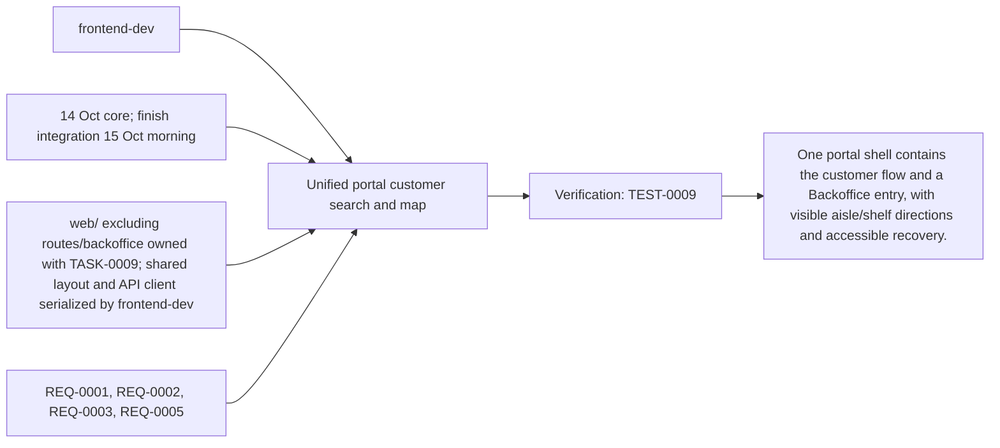
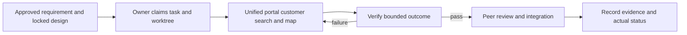

# Task: Unified portal customer search and map

## Outcome
One portal shell contains the customer flow and a Backoffice entry, with visible aisle/shelf directions and accessible recovery.

## 5W1H execution canvas
| Dimension | Answer |
|---|---|
| Who | Proposed lead frontend-dev; peer owner reviews; qa-agent verifies. Role assignment is a plan, not an acquired task lock. |
| What | One portal shell contains the customer flow and a Backoffice entry, with visible aisle/shelf directions and accessible recovery. |
| When | 14 Oct core; finish integration 15 Oct morning; start only after review/contract lock and prerequisites. |
| Where | web/ excluding routes/backoffice owned with TASK-0009; shared layout and API client serialized by frontend-dev |
| Why | Advances REQ-0001, REQ-0002, REQ-0003, REQ-0005 and protects the 16 October deployment. |
| How | Follow the steps below and record evidence in TEST-0009. |

## 5W1H graph

## Execution workflow

## Inputs and dependencies
- Requirements: REQ-0001, REQ-0002, REQ-0003, REQ-0005.
- Design: DES-0001, currently proposed and unsigned. No implementation is started by this document.
- Start prerequisites: TASK-0001.
- Due window: 14 Oct core; finish integration 15 Oct morning, Asia/Bangkok. Estimate: 6–9 engineering hours, provisional; not elapsed time or historical velocity.
- Shared code/schema/router changes are serialized through the owner identified by DES-0001. TASK-0005 can prepare infra while feature tasks run, but its completed evidence requires their real integrated flow.

## Implementation plan
1. Start a single SvelteKit static portal from selected source configuration and adapt brand-neutral card/microphone patterns.
2. Implement Live connecting/listening/thinking/speaking/interrupted/recoverable-error states, PCM capture/playback, visible transcripts, spoken or clicked selection, stop/mute and typed recovery against approved fixtures. Flush queued playback on interruption and release microphone on stop.
3. Render map, destination, path and equivalent text directions; start at explicit entrance and handle stale maps.
4. Add /backoffice navigation and shared fetch/error utilities without exposing write credentials; wire real APIs after TASK-0002/0003.

## Definition of done
- [x] Desktop/tablet customer flow passes automated keyboard and responsive checks (320/768/1280px); manual screen-reader acceptance remains pending.
- [x] No payment, booking or multi-tenant controls leak into the prototype UI.
- [x] Static preview serves / and /backoffice deep links on one origin; API calls are relative. Production gateway integration remains pending.
- [ ] Relevant test evidence and peer review are recorded; no claim of pass/completion is inferred from this plan.
- [x] Documentation and integration handoff reflect the actual final behavior.

## Notes
The selected code snapshot in references/monti-jarvis is a reuse input. Imported source does not prove this task is implemented or its dependencies are satisfied. No feature branches, runtime app or deployment are created by this planning record.

## Interactive UI source mapping

Read [REFERENCE-STUDY.md](../../REFERENCE-STUDY.md) and the selected Monti panel/presentation/token excerpts. Build a desktop voice panel and responsive mobile drawer with visible state, countdown and transcripts; explicit Start/End and separate microphone/speaker mute remain available. Closing the mobile drawer ends the live session and restores launcher focus. Adapt the focus trap only while the mobile modal is open.

Current-session `candidates` events replace up to three product cards atomically. Validated `route` events highlight the selected product/shelf and update path/text together. Show route is the sole product action; omit cart, price and stock controls. Use sequence/session/turn identifiers to reject stale events after new requests, interruption or stop. Do not re-run search on caption completion. Escape content and render predefined Svelte components, never model-supplied HTML or executable UI. Preserve reduced-motion and keyboard alternatives; check transient speech updates do not steal focus.

## GPT assignment

**Builder: GPT. Reviewer: GPT (separate review pass).** Give one builder the customer UI, Monti adaptation, audio controls and event rendering. The existing `owner` remains the accountable SDLC role; this assignment selects the coding assistant. [The allocation plan](../../MODEL-ALLOCATION.md) defines file boundaries, shared-file handoffs and review evidence. The user reassigned and started this task on 14 October 2026; execution evidence follows.

## Execution claim — 2026-10-14

User explicitly reassigned TASK-0004 from Grok to GPT and requested implementation plus allocation updates. GPT/Codex claims frontend-dev in `feature/TASK-0004-customer-portal`; no pre-existing TASK-0004 worktree or active claim was found. The separate Grok review remains unexecuted. This authorizes fixture-backed UI implementation while source integration/design signatures remain pending; it does not mark real model/cloud acceptance passed. Customer files remain under web/, with a shell placeholder for /backoffice and protected features reserved for TASK-0009.

## Implementation evidence — 2026-10-14

GPT/Codex implemented the customer portal in `web/` on `feature/TASK-0004-customer-portal`, based on `origin/develop` c57cd6f. [Web README](../../../web/README.md) contains run commands and the TASK-0002/0003/0005/0009 handoff; [NOTICE](../../../web/NOTICE.md) preserves source provenance and MIT attribution. No exact assistant model version was exposed for this run.

Typed search, up-to-three cards, selected aisle/shelf map and text directions share one controlled state. Explicit native-PCM voice has countdown, captions, mute controls, manual restart, stale session/turn/generation rejection and bounded playback. Mobile close/Escape releases capture before closing and restores launcher focus. Invalid geometry, missing route, stale map, no-match and service/classifier failures retain truthful recovery. `/backoffice` is a placeholder only.

Validation: strict Svelte check zero errors/warnings, production static build, 22 unit tests and 9 Chromium browser tests passed. Browser coverage includes three widths, axe scans, keyboard focus, spoken/click selection fixtures, escaped captions, barge-in, late events, denial and a real AudioWorklet with a simulated microphone. Initial contrast/focus failures were reproduced and fixed; final automated run is green. [TEST-0009](../07-tests/TEST-0009.md) records limits and remaining manual acceptance. Screenshots are retained under `web/tests/evidence/`.

## Review — CHANGES_REQUESTED

Builder self-review used the code-reviewer skill against DES-0001/ADR-0001 and the complete task diff. All draft pre-implementation checklist boxes are checked; no unresolved implementation defect remains from automated validation. This is not an opposite-model review or merge approval.

- Obtain the allocated Grok diff/evidence review; no Grok review was dispatched or fabricated.
- Complete TEST-0009 with a declared screen-reader/browser pair and record announcement usability. Automated axe and keyboard checks do not prove screen-reader behavior.
- Resolve unsigned requirement/design lock and accept the TASK-0001 baseline before merge. The user authorized this build but no formal design signature is fabricated.
- Integrate the public endpoints and gateway with TASK-0002/0003/0010 and run real voice acceptance separately. Distinct classifier recovery currently has frontend fixture coverage; backend normalized error-code mapping needs coordination. TASK-0005 owns integrated CI/static image wiring.

Task remains `blocked` for these acceptance/review gates; the implementation and local automated evidence are ready for review. Draft PR preserves the work without merging or claiming deployed acceptance.

## Allocation update — 2026-10-14

User assigned all tasks to GPT for implementation and a separate review pass. Current assignment supersedes the previous split; dated builder/reviewer execution evidence remains attributed to its original author. Task status and acceptance evidence are unchanged by this reassignment.

## Redesign planning handoff — 16 October 2026

After the v0.2.0 source checkpoint, the user requested a redesign plan from their
Monti Store desktop/mobile reference and explicitly included an avatar. GPT reused
the clean TASK-0004 worktree, fast-forwarded to the checkpoint, in sync mode for
documentation only. [DES-0002](../03-designs/DES-0002.md) records the proposed blue
retail workspace, responsive voice dock, original Monti dog avatar and actual
voice-state/playback mapping. The supplied image is stored with the plan.

Current catalog/route facts, one Portal/VoiceClient and configurable native Gemini
voice are retained as the behavioral baseline. The plan distinguishes available
DTO fields from reference-only prices, stock, bay/tier and shelf photography, and
defines staged delivery and meaningful native/audio/accessibility verification.
No shopper UI, avatar asset pack, runtime contract, task status or acceptance box
was changed by this planning work. Proposed pre-implementation decisions remain
explicitly unlocked; implementation is a later activity.

## DES-0002 implementation — 16 October 2026

The user explicitly requested implementation of DES-0002. GPT/Codex resumed this
worktree at main b0d0c54 in sync mode, with no other active builder. The blue Monti
shopper workspace, desktop assistant rail, mobile selected-product/map composition,
voice dock/dialog and original transparent six-pose avatar are implemented. Current
Portal/VoiceClient, native Gemini voice and factual product/map contracts are reused.
Public branding and avatar mapping live in `web/src/lib/ui-config.ts`; private
provider key/model/voice remain server configuration. Backoffice retains its scoped
presentation and protected route.

Speaker-only audio levels drive the mouth; muted/flushed/drained/stopped output
resets animation. Reduced motion and missing assets retain status and controls.
One controller crosses breakpoints; Minimize preserves a visible active dock,
Close/End/Escape stop capture. Category illustrations are labelled; no unsupported
price/stock/bay/tier/list or shelf photography is shown.

A serialized TASK-0003 handoff covers the optional playback-level callback and a
small ADK interruption ACK repair discovered by native overlap testing. No other
writer was active. It does not change public protocol or provider configuration.
See [verification and screenshots](../../design/evidence/DES-0002/README.md) for
33 unit, 15 browser, three Backoffice regressions, 39 agent/adapter checks and
synthetic native conversation/menu/route/interruption evidence. Full task status
remains blocked for manual and existing acceptance gates; no formal artifact
approval or full release pass is inferred.

## Review — PASS

Distinct GPT/Codex diff-and-evidence pass on 16 October 2026, after builder work
was paused. Scope: the user-authorized DES-0002 local shopper implementation and
serialized audio/ADK regression repair; not full TASK-0004/TEST-0009 or production
release acceptance. The previous historical changes-requested record is retained.

Reviewed DES-0001, DES-0002, ADR-0001, current DTO/event contracts, changed shopper
components/styles, playback hook, ADK repair and executed test evidence. DES-0002's
implementation contract definitions are checked; formal design signatures remain
pending and are not fabricated. The same-origin gateway and factual-data authority,
one controller, bounded PCM playback and explicit capture lifecycle are preserved.
Protected Backoffice has scoped regression evidence. Original avatar provenance,
labelled product-art fallback and truthful unavailable-route copy are documented.
No unresolved blocking defect was found in the scoped presentation diff.

Evidence: zero Svelte errors/warnings, production build, 33 frontend unit tests,
15 browser tests, three Backoffice regressions and 39 agent/adapter tests passed.
Native quiet conversation/menu/shelf and two deliberate overlap flows passed; two
further native repetitions disconnected and remain an explicitly unresolved live
acceptance limitation. A passing local UI review does not establish uniformly
reliable provider interruption. Manual VoiceOver/Safari, physical audio assessment,
30-trial latency, cloud release gates and the failing 19/40 Laya benchmark remain
open. Task/test statuses remain blocked for those broader gates.
