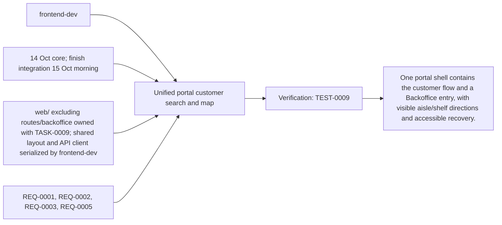
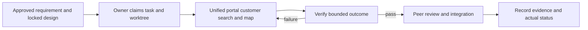

# Task: Unified portal customer search and map

## Outcome
One portal shell contains the customer flow and a Backoffice entry, with visible aisle/shelf directions and accessible recovery.

## 5W1H execution canvas
| Dimension | Answer |
|---|---|
| Who | Proposed lead frontend-dev; peer owner reviews; qa-agent verifies. Role assignment is a plan, not an acquired task lock. |
| What | One portal shell contains the customer flow and a Backoffice entry, with visible aisle/shelf directions and accessible recovery. |
| When | 14 Oct core; finish integration 15 Oct morning; start only after review/contract lock and prerequisites. |
| Where | web/ excluding routes/backoffice owned with TASK-0009; shared layout and API client serialized by frontend-dev |
| Why | Advances REQ-0001, REQ-0002, REQ-0003, REQ-0005 and protects the 16 October deployment. |
| How | Follow the steps below and record evidence in TEST-0009. |

## 5W1H graph

## Execution workflow

## Inputs and dependencies
- Requirements: REQ-0001, REQ-0002, REQ-0003, REQ-0005.
- Design: DES-0001, currently proposed and unsigned. No implementation is started by this document.
- Start prerequisites: TASK-0001.
- Due window: 14 Oct core; finish integration 15 Oct morning, Asia/Bangkok. Estimate: 6–9 engineering hours, provisional; not elapsed time or historical velocity.
- Shared code/schema/router changes are serialized through the owner identified by DES-0001. TASK-0005 can prepare infra while feature tasks run, but its completed evidence requires their real integrated flow.

## Implementation plan
1. Start a single SvelteKit static portal from selected source configuration and adapt brand-neutral card/microphone patterns.
2. Implement Live connecting/listening/thinking/speaking/interrupted/recoverable-error states, PCM capture/playback, visible transcripts, spoken or clicked selection, stop/mute and typed recovery against approved fixtures. Flush queued playback on interruption and release microphone on stop.
3. Render map, destination, path and equivalent text directions; start at explicit entrance and handle stale maps.
4. Add /backoffice navigation and shared fetch/error utilities without exposing write credentials; wire real APIs after TASK-0002/0003.

## Definition of done
- [ ] Desktop/tablet customer flow passes keyboard and responsive checks.
- [ ] No payment, booking or multi-tenant controls leak into the prototype UI.
- [ ] One hostname serves / and /backoffice; API calls are same-origin.
- [ ] Relevant test evidence and peer review are recorded; no claim of pass/completion is inferred from this plan.
- [ ] Documentation and integration handoff reflect the actual final behavior.

## Notes
The selected code snapshot in references/monti-jarvis is a reuse input. Imported source does not prove this task is implemented or its dependencies are satisfied. No feature branches, runtime app or deployment are created by this planning record.

## Interactive UI source mapping

Read [REFERENCE-STUDY.md](../../REFERENCE-STUDY.md) and the selected Monti panel/presentation/token excerpts. Build a desktop voice panel and responsive mobile drawer with visible state, countdown and transcripts; explicit Start/End and separate microphone/speaker mute remain available. Closing the mobile drawer ends the live session and restores launcher focus. Adapt the focus trap only while the mobile modal is open.

Current-session `candidates` events replace up to three product cards atomically. Validated `route` events highlight the selected product/shelf and update path/text together. Show route is the sole product action; omit cart, price and stock controls. Use sequence/session/turn identifiers to reject stale events after new requests, interruption or stop. Do not re-run search on caption completion. Escape content and render predefined Svelte components, never model-supplied HTML or executable UI. Preserve reduced-motion and keyboard alternatives; check transient speech updates do not steal focus.

## GPT / Grok assignment

**Builder: Grok. Reviewer: GPT.** Give one builder the customer UI, Monti adaptation, audio controls and event rendering. The existing `owner` remains the accountable SDLC role; this assignment selects the coding assistant. [The allocation plan](../../MODEL-ALLOCATION.md) defines file boundaries, shared-file handoffs and review evidence. The assignment is proposed and does not mark implementation started.
