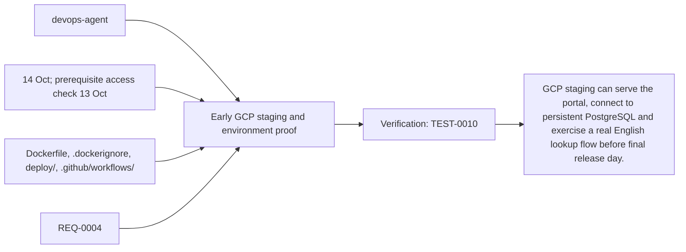
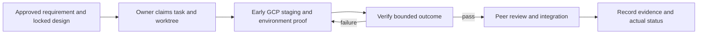

# Task: Early GCP staging and environment proof

## Outcome
GCP staging can serve the portal, connect to persistent PostgreSQL and exercise a real English lookup flow before final release day.

## 5W1H execution canvas
| Dimension | Answer |
|---|---|
| Who | Proposed lead devops-agent; peer owner reviews; qa-agent verifies. Role assignment is a plan, not an acquired task lock. |
| What | GCP staging can serve the portal, connect to persistent PostgreSQL and exercise a real English lookup flow before final release day. |
| When | 14 Oct; prerequisite access check 13 Oct; start only after review/contract lock and prerequisites. |
| Where | Dockerfile, .dockerignore, deploy/, .github/workflows/ |
| Why | Advances REQ-0004 and protects the 16 October deployment. |
| How | Follow the steps below and record evidence in TEST-0010. |

## 5W1H graph

## Execution workflow

## Inputs and dependencies
- Requirements: REQ-0004.
- Design: DES-0001, currently proposed and unsigned. No implementation is started by this document.
- Start prerequisites: TASK-0001.
- Due window: 14 Oct; prerequisite access check 13 Oct, Asia/Bangkok. Estimate: 5–8 engineering hours, provisional; not elapsed time or historical velocity.
- Shared code/schema/router changes are serialized through the owner identified by DES-0001. TASK-0005 can prepare infra while feature tasks run, but its completed evidence requires their real integrated flow.

## Implementation plan
1. Confirm project, billing, IAM, region, model access, audience and spend limit before provisioning.
2. Build the matched Go/static portal, Python ADK and Laya images; use Artifact Registry, Secret Manager and Cloud SQL with scoped identities.
3. Set limits, health/readiness and content-free logs; apply additive migrations and seed.
4. Deploy early; as TASK-0002/0003/0004/0010 land, verify real ADK-managed gemini-3.8-live voice-to-voice with Laya classification, DB and route path on HTTPS; capture evidence and unresolved issues.

## Definition of done
- [ ] Staging URL, image/revision and cloud dependency checks are recorded; hello-world alone is insufficient.
- [ ] No source Monti credentials or database/schema is reused.
- [ ] Secret inspection, persistence and actual Gemini Live 3.8 voice-to-voice smoke checks pass.
- [ ] Relevant test evidence and peer review are recorded; no claim of pass/completion is inferred from this plan.
- [ ] Documentation and integration handoff reflect the actual final behavior.

## Notes
The selected code snapshot in references/monti-jarvis is a reuse input. Imported source does not prove this task is implemented or its dependencies are satisfied. No feature branches, runtime app or deployment are created by this planning record.

Deployment packages three coordinated images: Go/static portal, Python ADK and Laya classifier. Pin Python dependencies and English checkpoint assets, configure private ports and readiness, and record all three digests for rollback. Follow DEP-0001; a single old Go image no longer fulfills the deployment design.

## GPT / Grok assignment

**Builder: GPT. Reviewer: Grok.** Keep build, private network, secrets and staging coordination with the integrator. The existing `owner` remains the accountable SDLC role; this assignment selects the coding assistant. [The allocation plan](../../MODEL-ALLOCATION.md) defines file boundaries, shared-file handoffs and review evidence. The assignment is proposed and does not mark implementation started.
