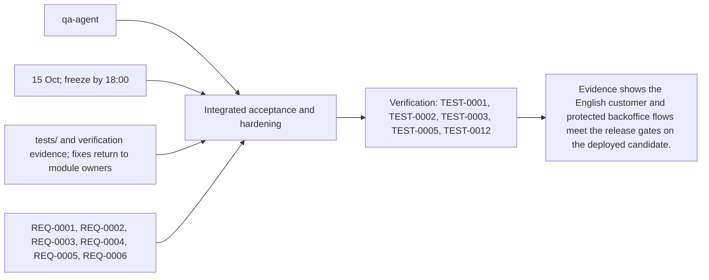
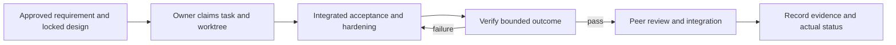

# Task: Integrated acceptance and hardening

## Outcome
Evidence shows the English customer and protected backoffice flows meet the release gates on the deployed candidate.

## 5W1H execution canvas
| Dimension | Answer |
|---|---|
| Who | Proposed lead qa-agent; peer owner reviews; qa-agent verifies. Role assignment is a plan, not an acquired task lock. |
| What | Evidence shows the English customer and protected backoffice flows meet the release gates on the deployed candidate. |
| When | 15 Oct; freeze by 18:00; start only after review/contract lock and prerequisites. |
| Where | tests/ and verification evidence; fixes return to module owners |
| Why | Advances REQ-0001, REQ-0002, REQ-0003, REQ-0004, REQ-0005, REQ-0006 and protects the 16 October deployment. |
| How | Follow the steps below and record evidence in TEST-0001, TEST-0002, TEST-0003, TEST-0005, TEST-0012. |

## 5W1H graph

## Execution workflow

## Inputs and dependencies
- Requirements: REQ-0001, REQ-0002, REQ-0003, REQ-0004, REQ-0005, REQ-0006.
- Design: DES-0001, currently proposed and unsigned. No implementation is started by this document.
- Start prerequisites: TASK-0002, TASK-0003, TASK-0004, TASK-0005, TASK-0009, TASK-0010.
- Due window: 15 Oct; freeze by 18:00, Asia/Bangkok. Estimate: 5–8 engineering hours, provisional; not elapsed time or historical velocity.
- Shared code/schema/router changes are serialized through the owner identified by DES-0001. TASK-0005 can prepare infra while feature tasks run, but its completed evidence requires their real integrated flow.

## Implementation plan
1. Freeze the thirty-query corpus before tuning; record expected products and run catalog, ADK native voice, actual Laya classification and route checks, including interactive card/map synchronization.
2. Measure warm and cold behavior separately; test actual browser permissions, provider outages, DB errors and resource bounds.
3. Verify backoffice auth, CSRF, expiry, conflict, publish/archive and shopper read consistency; verify import rollback.
4. Return fixes to their owners, retest changed behavior, and record a release recommendation with unresolved issues.

## Definition of done
- [ ] At least 27/30 supported queries match in top three; zero fabricated location and every seeded destination valid.
- [ ] Warm p95 first actionable native speech <=5s and verified card <=8s from last voiced input sample; typed/route <=2s on declared device/network, with failed trials reported.
- [ ] No core auth/data-integrity defect remains; feature freeze decision and test evidence are recorded.
- [ ] Relevant test evidence and peer review are recorded; no claim of pass/completion is inferred from this plan.
- [ ] Documentation and integration handoff reflect the actual final behavior.

## Notes
The selected code snapshot in references/monti-jarvis is a reuse input. Imported source does not prove this task is implemented or its dependencies are satisfied. No feature branches, runtime app or deployment are created by this planning record.

## GPT / Grok assignment

**Builder: Grok. Reviewer: GPT.** Separate evidence collection from release execution; GPT checks verdicts against the frozen acceptance criteria. The existing `owner` remains the accountable SDLC role; this assignment selects the coding assistant. [The allocation plan](../../MODEL-ALLOCATION.md) defines file boundaries, shared-file handoffs and review evidence. The assignment is proposed and does not mark implementation started.
