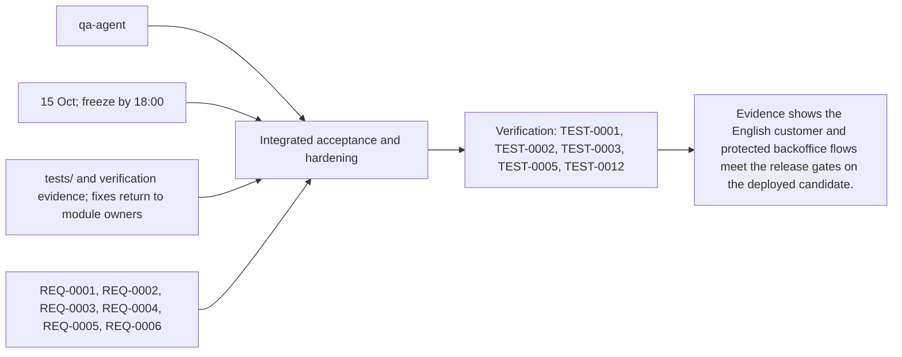
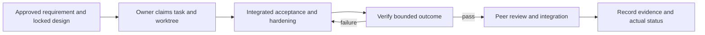

# Task: Integrated acceptance and hardening

## Outcome
Evidence shows the English customer and protected backoffice flows meet the release gates on the deployed candidate.

## 5W1H execution canvas
| Dimension | Answer |
|---|---|
| Who | Proposed lead qa-agent; peer owner reviews; qa-agent verifies. Role assignment is a plan, not an acquired task lock. |
| What | Evidence shows the English customer and protected backoffice flows meet the release gates on the deployed candidate. |
| When | 15 Oct; freeze by 18:00; start only after review/contract lock and prerequisites. |
| Where | tests/ and verification evidence; fixes return to module owners |
| Why | Advances REQ-0001, REQ-0002, REQ-0003, REQ-0004, REQ-0005, REQ-0006 and protects the 16 October deployment. |
| How | Follow the steps below and record evidence in TEST-0001, TEST-0002, TEST-0003, TEST-0005, TEST-0012. |

## 5W1H graph

## Execution workflow

## Inputs and dependencies
- Requirements: REQ-0001, REQ-0002, REQ-0003, REQ-0004, REQ-0005, REQ-0006.
- Design: DES-0001, currently proposed and unsigned. No implementation is started by this document.
- Start prerequisites: TASK-0002, TASK-0003, TASK-0004, TASK-0005, TASK-0009, TASK-0010.
- Due window: 15 Oct; freeze by 18:00, Asia/Bangkok. Estimate: 5–8 engineering hours, provisional; not elapsed time or historical velocity.
- Shared code/schema/router changes are serialized through the owner identified by DES-0001. TASK-0005 can prepare infra while feature tasks run, but its completed evidence requires their real integrated flow.

## Implementation plan
1. Freeze the thirty-query corpus before tuning; record expected products and run catalog, ADK native voice, actual Laya classification and route checks, including interactive card/map synchronization.
2. Measure warm and cold behavior separately; test actual browser permissions, provider outages, DB errors and resource bounds.
3. Verify backoffice auth, CSRF, expiry, conflict, publish/archive and shopper read consistency; verify import rollback.
4. Return fixes to their owners, retest changed behavior, and record a release recommendation with unresolved issues.

## Definition of done
- [ ] At least 27/30 supported queries match in top three; zero fabricated location and every seeded destination valid.
- [ ] Warm p95 first actionable native speech <=5s and verified card <=8s from last voiced input sample; typed/route <=2s on declared device/network, with failed trials reported.
- [ ] No core auth/data-integrity defect remains; feature freeze decision and test evidence are recorded.
- [ ] Relevant test evidence and peer review are recorded; no claim of pass/completion is inferred from this plan.
- [ ] Documentation and integration handoff reflect the actual final behavior.

## Notes
The selected code snapshot in references/monti-jarvis is a reuse input. Imported source does not prove this task is implemented or its dependencies are satisfied. No feature branches, runtime app or deployment are created by this planning record.

## GPT assignment

**Builder: GPT. Reviewer: GPT (separate review pass).** Separate evidence collection from release execution; GPT checks verdicts against the frozen acceptance criteria. The existing `owner` remains the accountable SDLC role; this assignment selects the coding assistant. [The allocation plan](../../MODEL-ALLOCATION.md) defines file boundaries, shared-file handoffs and review evidence. The assignment is proposed and does not mark implementation started.

## Allocation update — 2026-10-14

User assigned all tasks to GPT for implementation and a separate review pass. Current model fields supersede the earlier GPT/Grok split; existing task status, dependencies and recorded evidence remain their actual state. Reassignment alone does not start or complete this task.

## Execution claim — 2026-10-14

User resumed “build Task 6” after TASK-0009 local implementation. GPT/Codex claims qa-agent in feature/TASK-0006-acceptance. The previously created worktree was clean at c57cd6f with no implementation from the interrupted turn. User confirmed the candidate is not deployed. This claim authorizes the QA harness and isolated local checks, not a claim that missing dependencies, deployed voice/classification or release acceptance have passed. Module fixes remain with their task owners; only tests/evidence/QA documentation are changed here.

## Implementation and evidence — 2026-10-14

GPT/Codex built the standard-library acceptance CLI and fixtures in `tests/` on feature/TASK-0006-acceptance, based on origin/develop c57cd6f. Exact underlying model version is not exposed by this session; no version is fabricated. No product module code or other task worktree was modified. Coordination remains sync for integration; independent local checks use existing task snapshots only.

- Frozen thirty catalog prompts and forty balanced intent inputs, source commit and SHA-256 hashes; three distinct canonical product gaps remain explicitly unbound.
- Independent stored DTO/location authority, all-destination geometry/connectivity, public API/negative/route and twenty direct anonymous-denial probes; no credentials or raw shopper content saved.
- Fixed-denominator nearest-rank latency, native-audio/real-checkpoint provenance checks, intent confusion/coverage, strict typed failures, separate cold/fault observations and reviewed artifact qualification.
- Reusable CLI, empty observation template, full manual gate handoff and release report which blocks missing/local/stale evidence.
- Harness tests: **35 pass**. Actual local backoffice boundary: **20/20 pass**. Local catalog: **0/30, all HTTP404**; map HTTP404, no returned routes validated. Foundation real PostgreSQL import tests, ADK fixture tests (9 Python/8 Go, one Go DB skip), staging tooling (13) and portal unit tests (28) passed in their own snapshots. Backoffice/database/auth/config and static-host components passed; one invocation used a nonexistent package and its overall command correctly remains recorded as failed.

See [tests/README.md](../../../tests/README.md) for reproducible commands and observation formats; [QA findings](../../../tests/evidence/FINDINGS.md), [component results](../../../tests/evidence/component-checks.json), [source inventory](../../../tests/evidence/source-inventory.json), [HTTP records](../../../tests/evidence/local-http.json) and [release recommendation](../../../tests/evidence/release-report.json) for actual evidence. The task-owned isolated database/server were stopped after collection.

Outcome is **BLOCK_RELEASE**, and status is **blocked**, not done. TASK-0001 must supply the three expected canonical products; TASK-0002 must resolve its `undefined: hit` compile failure, implement routing and hand off real public API wiring. TASK-0010 must provide actual pinned Laya inference and its ADK adapter. Reviewed modules must integrate and deploy through TASK-0005 before the complete TEST-0001/0002/0003/0005/0012 suites can pass. Native model access, audible grounding, deployed timings, auth/data consistency, accessibility/recovery, peer/high-risk human review and feature freeze are still gates. Product fixes are returned to owners rather than silently patched in QA.

## Review — CHANGES_REQUESTED

Separate GPT/Codex review pass, 2026-10-14, against the staged Task 6 diff, REQ-0001 through REQ-0006, DES-0001/ADR-0001 and TEST-0001/0002/0003/0005/0012. All pre-implementation contract checkboxes are checked; proposed/unsigned design status is preserved rather than represented as a release approval. User-directed build work and frozen QA preparation are recorded separately from final acceptance.

Harness review: fixed original corpus/denominators and thresholds, nonfinite/duplicate/cold/missing-sample rejection, independent stored location/geometry, opaque/private credential handling, no redirect/remote TLS bypass, explicit local provenance and owner-reviewed evidence gates were checked. Review found and corrected boolean map-version acceptance, missing warm timing row-shape validation, and unchecked voice candidate IDs; the final 35 regression tests pass. No outstanding harness code defect was identified in this pass. Scope stays in tests/QA documentation plus the prior user-requested GPT allocation metadata.

Required changes before full TASK-0006 acceptance/merge:

- TASK-0001 owner: supply distinct skimmed milk/plain yogurt/canned chickpeas, then QA approves expected bindings, refreezes source/hashes and reruns the entire corpus. Do not substitute neighboring products or rewrite missed prompts.
- TASK-0002 owner/integration coordinator: repair `undefined: hit`, complete routing and wire the actual public handlers. Current real catalog/map HTTP404 cannot pass correctness or route acceptance.
- TASK-0010/0003 owners: qualify a real pinned Laya checkpoint and ADK adapter, then run the required native model through ADK with real classification/tool/audio/card/map evidence. Mocks and the skipped ticket case remain clearly identified.
- TASK-0005/QA owners: integrate reviewed branches, deploy the immutable candidate, capture complete frozen latency/grounding/browser/auth/import-read evidence and retest failures. Record feature freeze, peer/high-risk human review and release decision through the existing gates.

Review supports a **draft harness/evidence PR only**. Verdict for the complete task is CHANGES_REQUESTED and recommendation BLOCK_RELEASE; tests/artifact statuses remain blocked or not run as appropriate. No merge, deployment or task completion is authorized by this review.
