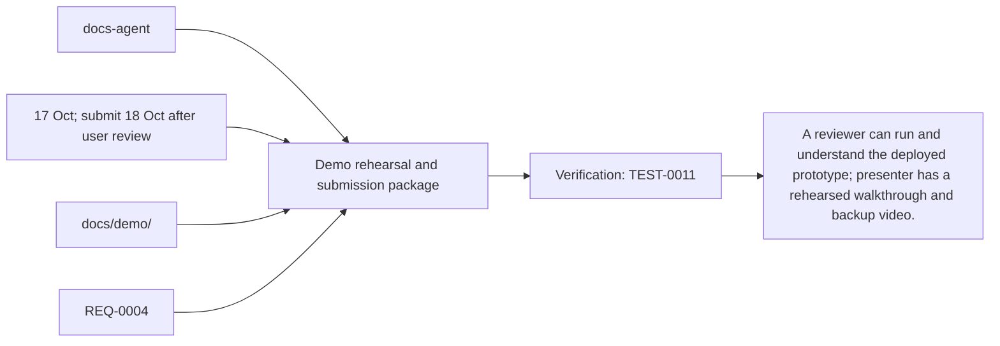
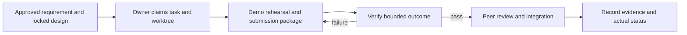

# Task: Demo rehearsal and submission package

## Outcome
A reviewer can run and understand the deployed prototype; presenter has a rehearsed walkthrough and backup video.

## 5W1H execution canvas
| Dimension | Answer |
|---|---|
| Who | Proposed lead docs-agent; peer owner reviews; qa-agent verifies. Role assignment is a plan, not an acquired task lock. |
| What | A reviewer can run and understand the deployed prototype; presenter has a rehearsed walkthrough and backup video. |
| When | 17 Oct; submit 18 Oct after user review; start only after review/contract lock and prerequisites. |
| Where | docs/demo/ |
| Why | Advances REQ-0004 and protects the 16 October deployment. |
| How | Follow the steps below and record evidence in TEST-0011. |

## 5W1H graph

## Execution workflow

## Inputs and dependencies
- Requirements: REQ-0004.
- Design: DES-0001, currently proposed and unsigned. No implementation is started by this document.
- Start prerequisites: TASK-0008.
- Due window: 17 Oct; submit 18 Oct after user review, Asia/Bangkok. Estimate: 2–3 engineering hours, provisional; not elapsed time or historical velocity.
- Shared code/schema/router changes are serialized through the owner identified by DES-0001. TASK-0005 can prepare infra while feature tasks run, but its completed evidence requires their real integrated flow.

## Implementation plan
1. Write short demo story: ask for an item, choose result, follow route; maintainer adds/publishes another product and shopper finds it.
2. Record a 2–3 minute walkthrough on the verified revision and keep screenshots/backup video.
3. Document sample-data limits, architecture/reuse provenance, setup URL and runbook; exclude credentials.
4. Prepare submission checklist and evidence links for user review; do not submit externally without instruction.

## Definition of done
- [ ] Demo and backup video cover real deployed English Gemini Live 3.8 voice-to-voice and one protected backoffice change.
- [ ] README/setup and revision information match the deployed artifact.
- [ ] Submission format and exact 18 October cutoff are confirmed with the user.
- [ ] Relevant test evidence and peer review are recorded; no claim of pass/completion is inferred from this plan.
- [ ] Documentation and integration handoff reflect the actual final behavior.

## Notes
The selected code snapshot in references/monti-jarvis is a reuse input. Imported source does not prove this task is implemented or its dependencies are satisfied. No feature branches, runtime app or deployment are created by this planning record.

Required release/demo evidence includes ADK managing the actual Gemini Live 3.8 session, Laya inference participating in the flow, and synchronized product highlighting/map updates. Record three-container revision/model provenance; no mocked or disabled component counts as required acceptance.

## GPT / Grok assignment

**Builder: Grok. Reviewer: GPT.** Turn accepted release evidence into the walkthrough and submission assets. The existing `owner` remains the accountable SDLC role; this assignment selects the coding assistant. [The allocation plan](../../MODEL-ALLOCATION.md) defines file boundaries, shared-file handoffs and review evidence. The assignment is proposed and does not mark implementation started.
