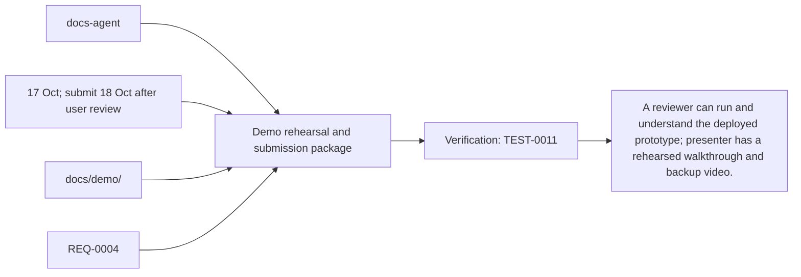
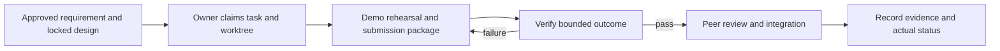

# Task: Demo rehearsal and submission package

## Outcome
A reviewer can run and understand the deployed prototype; presenter has a rehearsed walkthrough and backup video.

## 5W1H execution canvas
| Dimension | Answer |
|---|---|
| Who | Proposed lead docs-agent; peer owner reviews; qa-agent verifies. Role assignment is a plan, not an acquired task lock. |
| What | A reviewer can run and understand the deployed prototype; presenter has a rehearsed walkthrough and backup video. |
| When | 17 Oct; submit 18 Oct after user review; start only after review/contract lock and prerequisites. |
| Where | docs/demo/ |
| Why | Advances REQ-0004 and protects the 16 October deployment. |
| How | Follow the steps below and record evidence in TEST-0011. |

## 5W1H graph

## Execution workflow

## Inputs and dependencies
- Requirements: REQ-0004.
- Design: DES-0001, currently proposed and unsigned. No implementation is started by this document.
- Start prerequisites: TASK-0008.
- Due window: 17 Oct; submit 18 Oct after user review, Asia/Bangkok. Estimate: 2–3 engineering hours, provisional; not elapsed time or historical velocity.
- Shared code/schema/router changes are serialized through the owner identified by DES-0001. TASK-0005 can prepare infra while feature tasks run, but its completed evidence requires their real integrated flow.

## Implementation plan
1. Write short demo story: ask for an item, choose result, follow route; maintainer adds/publishes another product and shopper finds it.
2. Record a 2–3 minute walkthrough on the verified revision and keep screenshots/backup video.
3. Document sample-data limits, architecture/reuse provenance, setup URL and runbook; exclude credentials.
4. Prepare submission checklist and evidence links for user review; do not submit externally without instruction.

## Definition of done
- [ ] Demo and backup video cover real deployed English Gemini Live 3.8 voice-to-voice and one protected backoffice change.
- [ ] README/setup and revision information match the deployed artifact.
- [ ] Submission format and exact 18 October cutoff are confirmed with the user.
- [ ] Relevant test evidence and peer review are recorded; no claim of pass/completion is inferred from this plan.
- [ ] Documentation and integration handoff reflect the actual final behavior.

## Notes
The selected code snapshot in references/monti-jarvis is a reuse input. Imported source does not prove this task is implemented or its dependencies are satisfied. No feature branches, runtime app or deployment are created by this planning record.

Required release/demo evidence includes ADK managing the actual Gemini Live 3.8 session, Laya inference participating in the flow, and synchronized product highlighting/map updates. Record three-container revision/model provenance; no mocked or disabled component counts as required acceptance.

## GPT assignment

**Builder: GPT. Reviewer: GPT (separate review pass).** Turn accepted release evidence into the walkthrough and submission assets. The existing `owner` remains the accountable SDLC role; this assignment selects the coding assistant. [The allocation plan](../../MODEL-ALLOCATION.md) defines file boundaries, shared-file handoffs and review evidence. The assignment is proposed and does not mark implementation started.

## Allocation update — 2026-10-14

User assigned all tasks to GPT for implementation and a separate review pass. Current assignment supersedes the previous split; dated builder/reviewer execution evidence remains attributed to its original author. Task status and acceptance evidence are unchanged by this reassignment.

## Execution claim — 2026-10-14

User requested “build task 7”. GPT/Codex claims docs-agent in feature/TASK-0007-demo-and-submission based on origin/develop 36569ea939fc5991b556135150a169062a644445. Scope is docs/demo/ and this task's linked readiness record. One active builder; no other task implementation or deployment surface is modified. GPT is the selected assistant; the exact serving model revision is not exposed by this session.

TASK-0008 remains blocked in draft PR #10: no accepted deployment, configured GCP target or actual native voice/Laya release evidence. This work prepares walkthrough/setup/runbook/provenance/submission and rehearsal capture instructions; live rehearsal, real screenshots and the 2–3 minute backup recording require the accepted deployed revision. The v0.1.0 tag is a source checkpoint, not release acceptance. Submission destination/format and exact cutoff are pending user clarification; no external submission is authorized or attempted.

## Proposal template steering — 2026-10-14

User supplied `/Users/apaichon/Downloads/Copy of Submission Template _ AI Builder Cup.pdf` and instructed “prepare proposal follow”. The PDF has 16 landscape pages and requests a PowerPoint copy, public GitHub repository, three-minute demo link and final product link. It does not specify a submission destination or exact cutoff. Team name/leader clarification was requested; until answered, the project name is explicitly proposed and leader remains “To confirm”. Read-only GitHub inspection confirms the current repository is PRIVATE; no visibility change was made.

## Implementation and evidence — 2026-10-14

Built the 16-slide editable proposal and matching review PDF, preserving supplied branding/section order and adding release/rehearsal readiness to the spare template page. Text, process/architecture/wireframe diagrams and technology/benchmark tables remain editable. The source PDF's embedded Google Sans Flex is unavailable in the authoring runtime, so Arial is used for new text and this difference is documented. Local backoffice QA imagery is explicitly labelled as a fixture illustration; no generated scene or fixture is represented as deployed media. Benchmark cells say “Not measured”, and cloud cost remains pending approved inputs.

Prepared a three-minute walkthrough, reviewer setup/sample-data limits, presenter/operator runbook, recording/playback/privacy plan, architecture/reuse provenance, competition submission checklist and a blank not_run rehearsal/asset index. Rehearsal uses a current returned product choice and a separate backoffice item rather than promising ranking or modifying benchmark products. Supporting links reference real source and Task 8 PR #10, never an invented live URL. Media remains absent/ignored until actual accepted-release recording and owner review.

Executed preparation checks: all 16 PDF pages rendered/visually reviewed against the template, revised diagrams/screenshot rechecked, PowerPoint package and geometry/font checks passed with zero findings/warnings, native table slides 9/12 and diagram connectors verified, all 16 speaker-note parts preserved, first-party import passed, 28 relative document file links resolve, JSON templates parse while preserving not_run, all 20 preserved source copies match manifest hashes, and source data counts are verified (60 published plus draft/archived, eight aisles). Proposal/template/output hashes and exact scope are recorded in docs/demo/evidence/preparation.json. No application tests were rerun for this document-only scope. No actual rehearsal/video/playback/cloud/provider/submission acceptance ran; TEST-0011 last_run remains null.

Task remains blocked by the unaccepted Task 8 deployment and absent actual rehearsal/video/deployed screenshots/benchmarks. Team details, public repository access, final product/video links and submission destination/cutoff remain pending. The prepared proposal and docs are reviewable draft artifacts; no external submission or source tag rewrite occurred.

## Review — CHANGES_REQUESTED

Separate GPT/Codex review pass after authoring, against the staged documentation/artifacts, user-supplied competition template, REQ-0004 AC5, DES-0001/ADR-0001 and TEST-0011. The design's pre-implementation boxes are checked; proposed whole-prototype approvals remain unchanged. Checked section/order/branding coverage, native required tables/diagrams, source/reuse attribution, current UI control labels, sample/entrance/locale limits, actual-vs-planned evidence and submission/access boundaries. Visual review resolved reversed flow arrows, hidden architecture connections and screenshot proportions. Documentation review resolved an assumed milk ranking and made proposal Markdown tables readable.

Preparation checks pass as recorded. Full Task 7 verdict remains CHANGES_REQUESTED: obtain an accepted Task 8/TEST-0004 deployment, run the actual TEST-0011 native/ADK/Laya/backoffice rehearsal, record and verify the real three-minute walkthrough/backup and deployed screenshots, bind source/image/model/catalog/map provenance, resolve team and submission fields, and establish an explicitly authorized public repository path plus actual reviewer product/video access. Present the concrete final package for user review; no sending/upload is authorized by this request. Task/TEST-0011 stay blocked and unexecuted acceptance is not stamped passed/done.

## Proposal storage correction — 2026-10-14

User instructed “not commit and push pptx and pdf proposal file”. Both had already entered the sole unreviewed Task 7 feature commit. The owner rewrites only that feature commit and updates PR #11 to omit both binaries, preserving the existing local outputs and adding ignore rules. No main/develop/source tag history changes. Proposal source text, guides and scoped validation remain versioned; generated PDF/PowerPoint files stay local.
