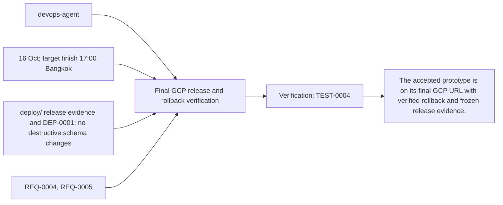
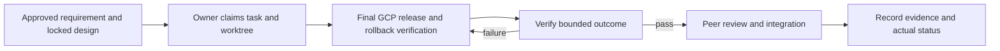

# Task: Final GCP release and rollback verification

## Outcome
The accepted prototype is on its final GCP URL with verified rollback and frozen release evidence.

## 5W1H execution canvas
| Dimension | Answer |
|---|---|
| Who | Proposed lead devops-agent; peer owner reviews; qa-agent verifies. Role assignment is a plan, not an acquired task lock. |
| What | The accepted prototype is on its final GCP URL with verified rollback and frozen release evidence. |
| When | 16 Oct; target finish 17:00 Bangkok; start only after review/contract lock and prerequisites. |
| Where | deploy/ release evidence and DEP-0001; no destructive schema changes |
| Why | Advances REQ-0004, REQ-0005 and protects the 16 October deployment. |
| How | Follow the steps below and record evidence in TEST-0004. |

## 5W1H graph

## Execution workflow

## Inputs and dependencies
- Requirements: REQ-0004, REQ-0005.
- Design: DES-0001, currently proposed and unsigned. No implementation is started by this document.
- Start prerequisites: TASK-0005, TASK-0006.
- Due window: 16 Oct; target finish 17:00 Bangkok, Asia/Bangkok. Estimate: 2–3 engineering hours, provisional; not elapsed time or historical velocity.
- Shared code/schema/router changes are serialized through the owner identified by DES-0001. TASK-0005 can prepare infra while feature tasks run, but its completed evidence requires their real integrated flow.

## Implementation plan
1. Build/release only the reviewed revision and immutable image; verify compatible additive schema/data versions.
2. Shift traffic to candidate and run full English + backoffice smoke from intended reviewer device/network.
3. Rehearse rollback to known-good revision and rerun smoke; ensure rollback does not pretend to revert DB writes.
4. Record URL, image digest, revision, migration/catalog versions, checks and budget/owner handoff.

## Definition of done
- [ ] Final deployed English and backoffice flow passes before proposed 17:00 cutoff.
- [ ] Known-good rollback is documented and demonstrated within 15-minute target.
- [ ] No secrets are in bundle/logs; cloud monitoring and responsible owner are confirmed.
- [ ] Relevant test evidence and peer review are recorded; no claim of pass/completion is inferred from this plan.
- [ ] Documentation and integration handoff reflect the actual final behavior.

## Notes
The selected code snapshot in references/monti-jarvis is a reuse input. Imported source does not prove this task is implemented or its dependencies are satisfied. No feature branches, runtime app or deployment are created by this planning record.

Required release/demo evidence includes ADK managing the actual Gemini Live 3.8 session, Laya inference participating in the flow, and synchronized product highlighting/map updates. Record three-container revision/model provenance; no mocked or disabled component counts as required acceptance.

## GPT assignment

**Builder: GPT. Reviewer: GPT (separate review pass).** One release operator coordinates all three images, migrations and rollback evidence. The existing `owner` remains the accountable SDLC role; this assignment selects the coding assistant. [The allocation plan](../../MODEL-ALLOCATION.md) defines file boundaries, shared-file handoffs and review evidence. The assignment is proposed and does not mark implementation started.

## Allocation update — 2026-10-14

User assigned all tasks to GPT for implementation and a separate review pass. Current assignment supersedes the previous split; dated builder/reviewer execution evidence remains attributed to its original author. Task status and acceptance evidence are unchanged by this reassignment.
