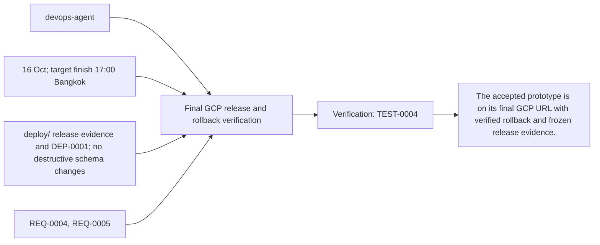
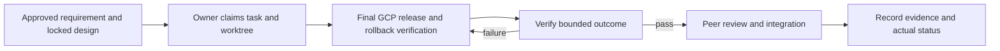

# Task: Final GCP release and rollback verification

## Outcome
The accepted prototype is on its final GCP URL with verified rollback and frozen release evidence.

## 5W1H execution canvas
| Dimension | Answer |
|---|---|
| Who | Proposed lead devops-agent; peer owner reviews; qa-agent verifies. Role assignment is a plan, not an acquired task lock. |
| What | The accepted prototype is on its final GCP URL with verified rollback and frozen release evidence. |
| When | 16 Oct; target finish 17:00 Bangkok; start only after review/contract lock and prerequisites. |
| Where | deploy/ release evidence and DEP-0001; no destructive schema changes |
| Why | Advances REQ-0004, REQ-0005 and protects the 16 October deployment. |
| How | Follow the steps below and record evidence in TEST-0004. |

## 5W1H graph

## Execution workflow

## Inputs and dependencies
- Requirements: REQ-0004, REQ-0005.
- Design: DES-0001, currently proposed and unsigned. No implementation is started by this document.
- Start prerequisites: TASK-0005, TASK-0006.
- Due window: 16 Oct; target finish 17:00 Bangkok, Asia/Bangkok. Estimate: 2–3 engineering hours, provisional; not elapsed time or historical velocity.
- Shared code/schema/router changes are serialized through the owner identified by DES-0001. TASK-0005 can prepare infra while feature tasks run, but its completed evidence requires their real integrated flow.

## Implementation plan
1. Build/release only the reviewed revision and immutable image; verify compatible additive schema/data versions.
2. Shift traffic to candidate and run full English + backoffice smoke from intended reviewer device/network.
3. Rehearse rollback to known-good revision and rerun smoke; ensure rollback does not pretend to revert DB writes.
4. Record URL, image digest, revision, migration/catalog versions, checks and budget/owner handoff.

## Definition of done
- [ ] Final deployed English and backoffice flow passes before proposed 17:00 cutoff.
- [ ] Known-good rollback is documented and demonstrated within 15-minute target.
- [ ] No secrets are in bundle/logs; cloud monitoring and responsible owner are confirmed.
- [ ] Relevant test evidence and peer review are recorded; no claim of pass/completion is inferred from this plan.
- [ ] Documentation and integration handoff reflect the actual final behavior.

## Notes
The selected code snapshot in references/monti-jarvis is a reuse input. Imported source does not prove this task is implemented or its dependencies are satisfied. No feature branches, runtime app or deployment are created by this planning record.

Required release/demo evidence includes ADK managing the actual Gemini Live 3.8 session, Laya inference participating in the flow, and synchronized product highlighting/map updates. Record three-container revision/model provenance; no mocked or disabled component counts as required acceptance.

## GPT assignment

**Builder: GPT. Reviewer: GPT (separate review pass).** One release operator coordinates all three images, migrations and rollback evidence. The existing `owner` remains the accountable SDLC role; this assignment selects the coding assistant. [The allocation plan](../../MODEL-ALLOCATION.md) defines file boundaries, shared-file handoffs and review evidence. The assignment is proposed and does not mark implementation started.

## Allocation update — 2026-10-14

User assigned all tasks to GPT for implementation and a separate review pass. Current assignment supersedes the previous split; dated builder/reviewer execution evidence remains attributed to its original author. Task status and acceptance evidence are unchanged by this reassignment.

## Execution claim — 2026-10-14

User requested “build task 8” after merging tasks 1/2/3/4/5/9/6 and publishing annotated v0.1.0 at main 50054b23cfe3336d019fee8da0db474da27940e0. GPT/Codex claims devops-agent in feature/TASK-0008-release-and-rollback, based on origin/develop 36569ea (same source tree). Work owns deploy/release tooling, release/QA records and DEP-0001 bookkeeping. No other task code or root main files are edited.

TASK-0005 actual cloud completion and TASK-0006 accepted deployed QA remain blocked. Local gcloud is unavailable, deploy/local has no configured JSON and no project configuration env name is set. User confirmed earlier the candidate is not deployed. This authorizes preparation and verification of release/rollback tooling; actual deployment requires the real missing setup and accepted evidence. The existing v0.1.0 tag is immutable and is not treated as a deployment pass.

## Implementation and evidence — 2026-10-14

Built standard-library release contracts, owner-reviewed evidence qualification, transient/sanitized SDK capture, offline plans, explicit named-revision traffic execution and full release/rollback finalization. The controller rechecks live service/revisions/IAM before one traffic mutation, persists intent first and keeps ambiguous failures unverified. Traffic success remains native-smoke-pending; final evidence needs candidate promotion, supervised isolated failing-revision capture/proof, full baseline rollback smoke within 900 seconds and final candidate promotion with operation-bound normal-origin model/ADK/Laya/backoffice smokes. Rollback can recover from a failed candidate without waiting for new candidate QA, but still requires the actual complete baseline and reviewed current DB/secret compatibility. No automatic destructive database/IAM/tag operation exists.

The [operator guide](../../../deploy/RELEASE.md) covers exact inputs/check artifacts, same-origin candidate access, known-good images/secret/checkpoint pins, image/model/provenance/security checks, persistence, privacy, separate five-user load, owner/change-freeze and optional-locale qualification. Templates are tracked as examples and copied to ignored mode-0600 deploy/local files for user configuration. No secret values were read/copied. Exact underlying serving model revision is not exposed; assistant is GPT/Codex.

Validation: 41 deploy unit cases and 35 unchanged QA unit cases pass. Source audit intentionally exits 1; unconfigured plan exits 2 before cloud access and writes no plan. The immutable v0.1.0 source lacks routing, the classifier adapter, real intent entrypoint/manifest/locks; gcloud and actual cloud config are unavailable. No provider/cloud/deployment/rollback acceptance was executed. Actual TEST-0004 last_run remains null; DEP-0001/source tag bookkeeping is blocked and no deployed_in status is stamped.

Task remains **blocked**, with completion dependent on actual TASK-0005 staging, accepted TASK-0006, finished catalog/voice/classifier wiring and real cloud/runtime provenance. The source merge/tag did not waive deployed acceptance. No incomplete feature package was edited during this task.

## Review — CHANGES_REQUESTED

Separate GPT/Codex review pass, 2026-10-14, against the staged diff, REQ-0004/0005, DES-0001/ADR-0001 and TEST-0004. The pre-implementation contract checkboxes are all checked; proposed/unsigned whole-prototype approval is preserved. Scope is release tooling/evidence/docs and existing source-tag bookkeeping.

Tooling findings resolved during review: final read-only verification now retains the candidate export instead of the recovery-only capture omitting it; operation/source/context hashes and actual native-smoke completion timestamps are bound together; finalization requires the supervised isolated failing-revision identity/capture/proof; source tag/build identity is rechecked at finalization; writes flush and fsync before mutation; unsupported entrypoints/mount/GPU/billing/scaling changes and public privileged IAM bindings are rejected. SDK metadata exports are validated/sanitized before persistence; no raw stderr/credential values are echoed. Final offline suite passes 41 deployment/controller/staging cases plus 35 unchanged QA cases. No outstanding tooling code defect was identified in this pass. The real SDK path remains unexecuted and must be qualified against actual exports/account before release.

Required changes for full task acceptance:

- Complete the catalog/routing/shared gateway wiring and actual Laya adapter/service/model/locks; immutable v0.1.0 lacks required build inputs. Qualify a new source/version without rewriting the published tag.
- Supply actual authorized cloud/project/region/service/access/budget/secret-version metadata, installed/authenticated SDK and complete immutable image/model/schema provenance. Current local templates are unfilled.
- Complete TASK-0005 staging and obtain accepted real TASK-0006 evidence on the exact final candidate. Resolve the single-origin candidate/reviewer path through actual native browser testing.
- Execute TEST-0004's real normal-origin native/backoffice/performance/persistence/privacy/load/monitoring checks and supervised failing-revision rollback, capture full restored smoke within 900 seconds, and repeat final promotion/smoke. Record real DEP evidence plus peer/high-risk owner approval.

Verdict for the full Task 8 outcome is CHANGES_REQUESTED; task/TEST-0004/DEP-0001 remain blocked, last_run for deployed acceptance remains null, and this work supports a draft tooling PR only. No cloud resource/traffic/IAM/secret operation, provider call, deployment pass, task completion or release-tag rewrite was performed.
