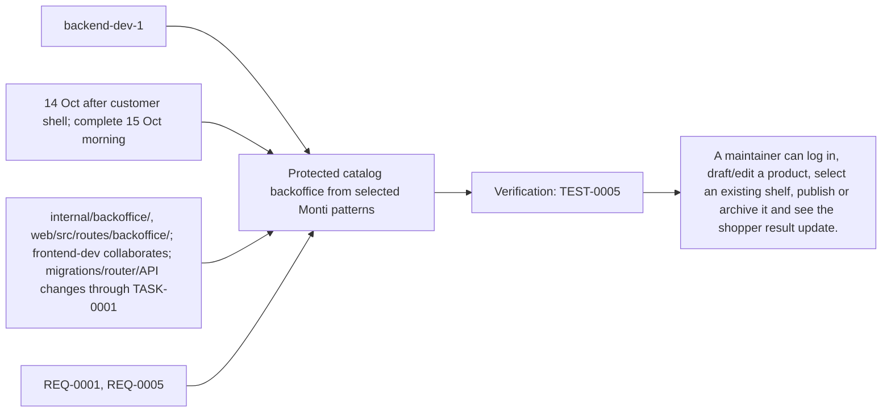
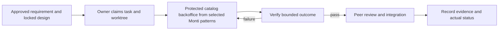

# Task: Protected catalog backoffice from selected Monti patterns

## Outcome
A maintainer can log in, draft/edit a product, select an existing shelf, publish or archive it and see the shopper result update.

## 5W1H execution canvas
| Dimension | Answer |
|---|---|
| Who | Proposed lead backend-dev-1; peer owner reviews; qa-agent verifies. Role assignment is a plan, not an acquired task lock. |
| What | A maintainer can log in, draft/edit a product, select an existing shelf, publish or archive it and see the shopper result update. |
| When | 14 Oct after customer shell; complete 15 Oct morning; start only after review/contract lock and prerequisites. |
| Where | internal/backoffice/, web/src/routes/backoffice/; frontend-dev collaborates; migrations/router/API changes through TASK-0001 |
| Why | Advances REQ-0001, REQ-0005 and protects the 16 October deployment. |
| How | Follow the steps below and record evidence in TEST-0005. |

## 5W1H graph

## Execution workflow

## Inputs and dependencies
- Requirements: REQ-0001, REQ-0005.
- Design: DES-0001, currently proposed and unsigned. No implementation is started by this document.
- Start prerequisites: TASK-0001, TASK-0004.
- Due window: 14 Oct after customer shell; complete 15 Oct morning, Asia/Bangkok. Estimate: 4–6 engineering hours, provisional; not elapsed time or historical velocity.
- Shared code/schema/router changes are serialized through the owner identified by DES-0001. TASK-0005 can prepare infra while feature tasks run, but its completed evidence requires their real integrated flow.

## Implementation plan
1. Adapt the cloned product edit/list/version patterns; discard payment/inventory/tenant coupling and point only at prompt-shop records.
2. Implement protected server session/login/logout and CSRF checks from DES-0001; UI visibility is never the auth boundary.
3. Implement draft/publish/archive and expected_version conflict handling for names, aliases and shelf assignment.
4. Build one minimal backoffice route and test create-to-publish-to-search, denied mutation, stale version and persistence.

## Definition of done
- [ ] REQ-0005 criteria pass including direct API denial and cookie/CSRF/session cases.
- [ ] Unpublished/archived records never appear in shopper search.
- [ ] Source snapshot/license attribution retained; no runtime dependency on original Monti app or infra.
- [ ] Relevant test evidence and peer review are recorded; no claim of pass/completion is inferred from this plan.
- [ ] Documentation and integration handoff reflect the actual final behavior.

## Notes
The selected code snapshot in references/monti-jarvis is a reuse input. Imported source does not prove this task is implemented or its dependencies are satisfied. No feature branches, runtime app or deployment are created by this planning record.

## GPT / Grok assignment

**Builder: GPT. Reviewer: Grok.** Keep authentication, CSRF, persistent writes and their UI in one task after the customer shell handoff. The existing `owner` remains the accountable SDLC role; this assignment selects the coding assistant. [The allocation plan](../../MODEL-ALLOCATION.md) defines file boundaries, shared-file handoffs and review evidence. The assignment is proposed and does not mark implementation started.
