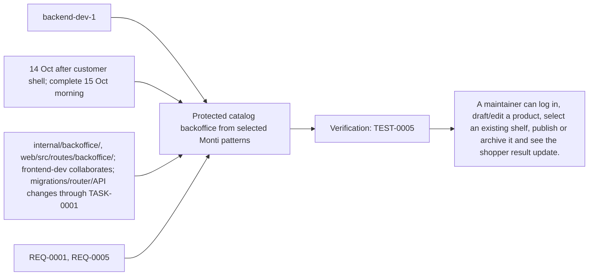
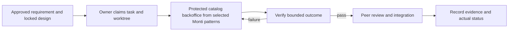

# Task: Protected catalog backoffice from selected Monti patterns

## Outcome
A maintainer can log in, draft/edit a product, select an existing shelf, publish or archive it and see the shopper result update.

## 5W1H execution canvas
| Dimension | Answer |
|---|---|
| Who | Proposed lead backend-dev-1; peer owner reviews; qa-agent verifies. Role assignment is a plan, not an acquired task lock. |
| What | A maintainer can log in, draft/edit a product, select an existing shelf, publish or archive it and see the shopper result update. |
| When | 14 Oct after customer shell; complete 15 Oct morning; start only after review/contract lock and prerequisites. |
| Where | internal/backoffice/, web/src/routes/backoffice/; frontend-dev collaborates; migrations/router/API changes through TASK-0001 |
| Why | Advances REQ-0001, REQ-0005 and protects the 16 October deployment. |
| How | Follow the steps below and record evidence in TEST-0005. |

## 5W1H graph

## Execution workflow

## Inputs and dependencies
- Requirements: REQ-0001, REQ-0005.
- Design: DES-0001, currently proposed and unsigned. No implementation is started by this document.
- Start prerequisites: TASK-0001, TASK-0004.
- Due window: 14 Oct after customer shell; complete 15 Oct morning, Asia/Bangkok. Estimate: 4–6 engineering hours, provisional; not elapsed time or historical velocity.
- Shared code/schema/router changes are serialized through the owner identified by DES-0001. TASK-0005 can prepare infra while feature tasks run, but its completed evidence requires their real integrated flow.

## Implementation plan
1. Adapt the cloned product edit/list/version patterns; discard payment/inventory/tenant coupling and point only at prompt-shop records.
2. Implement protected server session/login/logout and CSRF checks from DES-0001; UI visibility is never the auth boundary.
3. Implement draft/publish/archive and expected_version conflict handling for names, aliases and shelf assignment.
4. Build one minimal backoffice route and test create-to-publish-to-search, denied mutation, stale version and persistence.

## Definition of done
- [ ] REQ-0005 criteria pass including direct API denial and cookie/CSRF/session cases.
- [ ] Unpublished/archived records never appear in shopper search.
- [x] Source snapshot/license attribution retained; no runtime dependency on original Monti app or infra.
- [ ] Relevant test evidence and peer review are recorded; no claim of pass/completion is inferred from this plan.
- [x] Documentation and integration handoff reflect the actual final behavior.

## Notes
The selected code snapshot in references/monti-jarvis is a reuse input. Imported source does not prove this task is implemented or its dependencies are satisfied. No feature branches, runtime app or deployment are created by this planning record.

## GPT assignment

**Builder: GPT. Reviewer: GPT (separate review pass).** Keep authentication, CSRF, persistent writes and their UI in one task after the customer shell handoff. The existing `owner` remains the accountable SDLC role; this assignment selects the coding assistant. [The allocation plan](../../MODEL-ALLOCATION.md) defines file boundaries, shared-file handoffs and review evidence. The assignment is proposed and does not mark implementation started.

## Allocation update — 2026-10-14

User assigned all tasks to GPT for implementation and a separate review pass. Current model fields supersede the earlier GPT/Grok split; existing task status, dependencies and recorded evidence remain their actual state. Reassignment alone does not start or complete this task.

## Execution claim — 2026-10-14

User explicitly requested TASK-0009 after assigning all tasks to GPT. GPT/Codex claims backend-dev-1 and the serialized frontend handoff in feature/TASK-0009-backoffice. The local branch incorporates TASK-0001 a564571 and TASK-0004 edc8da9 as dependency inputs; their open PRs and formal acceptance remain pending. This local integration does not merge either PR into develop. Shared configuration/router/static wiring is serialized here by the GPT integration owner; source worktrees are unchanged. TASK-0006 preparation was interrupted before implementation and is not being continued under this claim.

## Implementation evidence — 2026-10-14

Implemented `internal/backoffice/` and `web/src/routes/backoffice/`: PostgreSQL-backed opaque sessions, bcrypt cost 12, exact Origin/constant-time CSRF, absolute eight-hour expiry, login rotation/logout, narrow DB role, strict bodies, bounded rate/DB work, paginated catalog, draft saves, optimistic conflicts, shelf validation and explicit publish/archive. Transactions share the import lock, increment catalog/product versions and audit changes. The editor retains unsaved content after expiry/conflict and clears it on explicit logout; published edits hide until republished. No source commerce/account/data dependencies are required.

The GPT integration owner serialized shared cmd/server/config/static wiring here. `PUBLIC_ORIGIN`, `ADMIN_PASSWORD_HASH`, `BACKOFFICE_DATABASE_URL` and `STATIC_DIR` match TASK-0005's proposed handoff. Static build serves shopper/backoffice on one origin with API/private routes excluded from HTML fallback. No schema/grant migration was needed. The inherited source branches remain unchanged and their PRs remain unmerged.

[Setup/handoff](../../../internal/backoffice/README.md), [TEST-0005](../07-tests/TEST-0005.md) and [verification evidence](../07-tests/evidence/TASK-0009/verification.md) record passing local checks. Actual results: Go race + PostgreSQL tests/vet, Svelte check/build, 28 unit tests, 9 customer browser tests and 5 real HTTPS backoffice browser tests. No reachable/imported-package vulnerability was found; the unused module-only OpenPGP advisory is recorded in evidence. Source excerpt/license hashes verified. Exact assistant model version was not exposed.

## Review — CHANGES_REQUESTED

GPT/Codex performed a distinct code-reviewer pass against DES-0001, ADR-0001, REQ-0001/0005, TEST-0005 and the staged implementation diff. All draft pre-implementation checklist boxes are checked. Fixed review findings include handler MIME validation, whole login budget, shared deployment configuration names, session-reset behavior and logout cleanup. No unresolved code defect remains in the implemented backoffice after final local checks. Full acceptance/merge remains pending:

- Integrate TASK-0002 and demonstrate actual shopper search/direct route/Live exclusion after draft/archive and refreshed location/alias after publish; SQL checks do not substitute for these endpoints.
- Record manual screen-reader behavior and durable database/container plus deployed revision persistence. Candidate is not deployed.
- Accept the dependency/design baseline and obtain the high-risk human approval required by GIT_WORKFLOW.md, then complete the separate GPT review/CI gates on the final integrated diff.

Task/test remain blocked for these acceptance gates; a draft PR preserves reviewable implementation and evidence. No merge or deployment is claimed.
