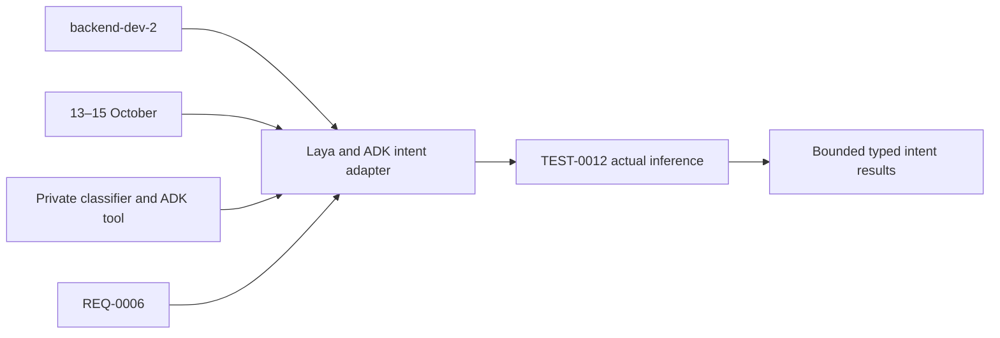

# Task: Laya classifier and ADK intent tool

## Outcome
A pinned English Laya checkpoint returns bounded typed intent results, and the ADK classifier tool calls it through the private contract. Actual inference is verified; full voice integration follows in TASK-0006.

## 5W1H execution canvas
| Dimension | Answer |
|---|---|
| Who | backend-dev-2, coordinated with TASK-0003; QA verifies; DevOps owns deployment manifests |
| What | Private classifier wrapper and narrow ADK tool adapter |
| When | Qualify 13 October; integrate 14 October and finish before 15 October freeze |
| Where | intent/ and agent/tools/intent.py; dependency edits serialized with TASK-0003 |
| Why | Implements required REQ-0006 without changing catalog authority or native audio |
| How | Pin, preload, measure, validate, expose bounded private inference and verify TEST-0012 |

## 5W1H graph

## Execution workflow

## Inputs and dependencies
- REQ-0006, DES-0001, ADR-0001 and the [reference study](../../REFERENCE-STUDY.md).
- TASK-0001 provides contract/schema foundations. The isolated gate can use an ADK bridge fixture; real deployed voice acceptance requires TASK-0003 as well, without creating a mutual task prerequisite.
- Estimate **4–7 engineering hours**, provisional. TASK-0003 (GPT) and TASK-0010 (Grok) share backend-dev-2 accountability but have separate builder sessions and exclusive surfaces. Parallel work requires the frozen adapter interface; do not assume extra sessions or a halved duration.

## Implementation plan
1. Resolve CPU-compatible Python/Laya dependencies in an isolated environment. Record exact package versions/hashes, model revision/files and licenses; install/version checking alone is not inference proof.
2. Load only the pinned English checkpoint, run a warm-up, and measure startup, resident memory and inference time on deployment-sized CPU. Bake/cache verified weights during image build; no first-request downloads.
3. Implement the fixed schema and labels from DES-0001 at the private endpoint. Freeze thresholds before held-out evaluation; validate shape, score range and text bound; never accept arbitrary checkpoint names, question schemas or URLs.
4. Implement one worker, bounded queue, timeout/abstention and late-result disposal. Do not release the worker capacity on client timeout while native inference is still running; prevent unbounded work accumulation.
5. Add the async ADK classify_intent adapter, passing server session/turn context and bounded recognized text. Keep inference outside the audio event loop and preserve prompt/tool privacy. Register completion/abstention with Go for the current epoch and wait for its ACK before any catalog callback.
6. Run TEST-0012 with real weights and controlled failure fixtures. Hand off actual classification/tool evidence to TASK-0003/0005/0006; coordinate intent/Dockerfile with DevOps.

## Definition of done
- [ ] Real English checkpoint inference and package/model provenance are recorded.
- [ ] Frozen 40-case target and latency/queue/privacy checks pass; no mocked inference counted as qualification.
- [ ] ADK tool adapter returns the fixed schema or explicit abstention; labels cannot authorize catalog writes or invent locations.
- [ ] CPU loading does not stall audio and rejected/late requests cannot update a newer turn.
- [ ] Peer review, TEST-0012 and integrated handoff evidence are recorded. This planning record does not claim implementation.

## GPT assignment

**Builder: GPT. Reviewer: GPT (separate review pass).** Isolated classifier package and narrow adapter can progress alongside GPT voice work. The existing `owner` remains the accountable SDLC role; this assignment selects the coding assistant. [The allocation plan](../../MODEL-ALLOCATION.md) defines file boundaries, shared-file handoffs and review evidence. The assignment is proposed and does not mark implementation started.

## Allocation update — 2026-10-14

User assigned all tasks to GPT for implementation and a separate review pass. Current assignment supersedes the previous split; dated builder/reviewer execution evidence remains attributed to its original author. Task status and acceptance evidence are unchanged by this reassignment.
