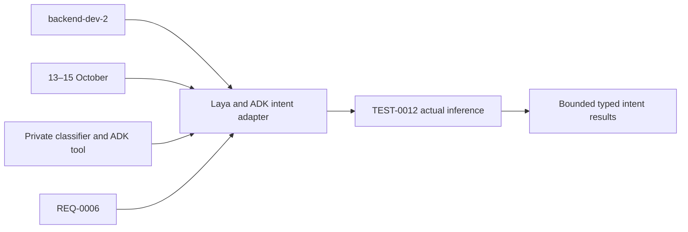

# Task: Laya classifier and ADK intent tool

## Outcome
A pinned English Laya checkpoint returns bounded typed intent results, and the ADK classifier tool calls it through the private contract. Actual inference is verified; full voice integration follows in TASK-0006.

## 5W1H execution canvas
| Dimension | Answer |
|---|---|
| Who | backend-dev-2, coordinated with TASK-0003; QA verifies; DevOps owns deployment manifests |
| What | Private classifier wrapper and narrow ADK tool adapter |
| When | Qualify 13 October; integrate 14 October and finish before 15 October freeze |
| Where | intent/ and agent/tools/intent.py; dependency edits serialized with TASK-0003 |
| Why | Implements required REQ-0006 without changing catalog authority or native audio |
| How | Pin, preload, measure, validate, expose bounded private inference and verify TEST-0012 |

## 5W1H graph

## Execution workflow

## Inputs and dependencies
- REQ-0006, DES-0001, ADR-0001 and the [reference study](../../REFERENCE-STUDY.md).
- TASK-0001 provides contract/schema foundations. The isolated gate can use an ADK bridge fixture; real deployed voice acceptance requires TASK-0003 as well, without creating a mutual task prerequisite.
- Estimate **4–7 engineering hours**, provisional. TASK-0003 (GPT) and TASK-0010 (Grok) share backend-dev-2 accountability but have separate builder sessions and exclusive surfaces. Parallel work requires the frozen adapter interface; do not assume extra sessions or a halved duration.

## Implementation plan
1. Resolve CPU-compatible Python/Laya dependencies in an isolated environment. Record exact package versions/hashes, model revision/files and licenses; install/version checking alone is not inference proof.
2. Load only the pinned English checkpoint, run a warm-up, and measure startup, resident memory and inference time on deployment-sized CPU. Bake/cache verified weights during image build; no first-request downloads.
3. Implement the fixed schema and labels from DES-0001 at the private endpoint. Freeze thresholds before held-out evaluation; validate shape, score range and text bound; never accept arbitrary checkpoint names, question schemas or URLs.
4. Implement one worker, bounded queue, timeout/abstention and late-result disposal. Do not release the worker capacity on client timeout while native inference is still running; prevent unbounded work accumulation.
5. Add the async ADK classify_intent adapter, passing server session/turn context and bounded recognized text. Keep inference outside the audio event loop and preserve prompt/tool privacy. Register completion/abstention with Go for the current epoch and wait for its ACK before any catalog callback.
6. Run TEST-0012 with real weights and controlled failure fixtures. Hand off actual classification/tool evidence to TASK-0003/0005/0006; coordinate intent/Dockerfile with DevOps.

## Definition of done
- [X] Real English checkpoint inference and package/model provenance are recorded.
- [ ] Frozen 40-case target and latency/queue/privacy checks pass; no mocked inference counted as qualification.
- [X] ADK tool adapter returns the fixed schema or explicit abstention; labels cannot authorize catalog writes or invent locations. (Isolated tool/ACK verification; full Go/native voice acceptance remains pending.)
- [ ] CPU loading does not stall audio and rejected/late requests cannot update a newer turn.
- [ ] Peer review, TEST-0012 and integrated handoff evidence are recorded. This planning record does not claim implementation.

## GPT assignment

**Builder: GPT. Reviewer: GPT (separate review pass).** Isolated classifier package and narrow adapter can progress alongside GPT voice work. The existing `owner` remains the accountable SDLC role; this assignment selects the coding assistant. [The allocation plan](../../MODEL-ALLOCATION.md) defines file boundaries, shared-file handoffs and review evidence. The assignment is proposed and does not mark implementation started.

## Allocation update — 2026-10-14

User assigned all tasks to GPT for implementation and a separate review pass. Current assignment supersedes the previous split; dated builder/reviewer execution evidence remains attributed to its original author. Task status and acceptance evidence are unchanged by this reassignment.

## Execution claim — 2026-10-14

User requested “build task 10”. GPT/Codex claims backend-dev-2 in feature/TASK-0010-laya-classifier, based on origin/develop 36569ea939fc5991b556135150a169062a644445. Scope is intent/ except deployment-owned Dockerfile, agent/tools/intent.py and task-owned verification/SDLC evidence. Task 1 foundations and Task 3 private classifier/ACK interfaces are present in the integrated source. All design pre-implementation boxes are checked; whole-prototype approval/deployed acceptance remains unasserted. Current GPT allocation supersedes the historical Grok builder mention above. No subagent or concurrent owner is involved.

Plan: resolve/pin the real English checkpoint and Python packages, implement the fixed private bounded service with one isolated worker and hard timeout recovery, implement the narrow async classifier adapter, freeze the existing 40-case corpus/threshold configuration before real evaluation, and record actual package/model/resource/accuracy/latency and fault evidence. The workstation is macOS arm64; deployment-sized Linux CPU qualification is a separate measured scope and cannot be inferred from host results. No provider key or GCP operation is needed for this isolated classifier build.

## Implementation and execution — 2026-10-14

Implemented the private ASGI service, a single spawned CPU inference worker, a four-job waiting queue, 200 ms queue expiry and 1,200 ms total deadlines. Active timeout/cancellation terminates and reaps the old native process before replacement; readiness stays false during preload/recovery. Authenticated fixed JSON rejects browser Origin, oversized/malformed/duplicate bodies and caller-defined model/schema/URL fields. The adapter calls only the fixed loopback endpoint, with no proxy/redirect/retry, validates the pinned typed response and propagates cancellation. Task 3's existing ToolHost supplies turn/attempt/ACK authority; no shared registry, Go router, ADK lock or Dockerfile was edited.

Real pin: English root convaiinnovations/laya at 7b928d828b7b0e022f929d9bd2e44165aa270148; weight SHA-256 891102d372688fc2a094dac56a384bc537b87c63f21f9f3dac0be2b7cbc8d86c (842,609,210 bytes). Laya 0.4.6, torch 2.14.1, transformers 4.57.3; full wheel pins/hashes in intent/uv.lock, full model inventory in intent/model/manifest.json. CPU eager backend, two native threads, offline loading, verified local weights. Model-card Apache-2.0 declaration and the package-source license notice are separately attributed in the bundle provenance. Weights, environments, private tokens and image build context are ignored local artifacts.

Frozen corpus is byte-identical to the existing 40-input balanced QA fixture. Confidence 0.70 and margin 0.15 were frozen before inference. Confidence means maximum choice probability, an uncalibrated score; the library's separate entropy-based confidence is not substituted. No question, threshold or held-out row was changed after observing misses.

Actual first evaluation: 19/40 correct, 21 low-confidence abstentions (all count as misses), coverage 47.5%; per-class find_item 50%, select_item 40%, repeat_directions 70%, out_of_scope 30%. Warm 30-probe p95 266.724 ms; cold service ready 8,242.046 ms; load-time peak worker RSS 2,064,007,168 bytes on macOS ARM with eight host CPUs. After review fixed incomplete-body disconnect handling, final-source re-evaluation again scored 19/40 with 21 abstentions, warm p95 283.820 ms. These host measurements do not prove native deployment quota performance.

Verification: 42 classifier contract/private-HTTP/worker fault tests, six real ADK SDK BlockingTool/ToolHost boundary tests with controlled classifier/Go fixtures, and nine existing Task 3 tests passed. Fault cases prove overflow/queue expiry, native-process capacity retention, timeout/cancellation reaping, crash/load/malformed fallback, event-loop heartbeat and stale-attempt/ACK rejection. Fixture results do not count as actual model accuracy, full Go authorization or native Gemini acceptance.

The unchanged Task 5 Dockerfile built with immutable Python/uv bases, the real bundle and the locked Linux CPU-only torch 2.14.1+cpu wheel. A local AMD64-on-ARM emulated container with measured 2 CPU/4 GiB limits never became model-ready within 180 seconds; it remained running and was not OOM-killed. No warm measurement was fabricated for it. The task container and temporary private token were cleaned up. This image predates the request-body cleanup; exact as-built source hashes and image identity are retained rather than claiming it contains later source. Native GCP 2 CPU/4 GiB qualification remains unrun.

Evidence: [module/startup/handoff instructions](../../../intent/README.md), [initial actual inference](../../../intent/evidence/host-evaluation.json), [final-source actual inference](../../../intent/evidence/host-evaluation-reviewed.json), [emulated resource probe](../../../intent/evidence/container-probe.json), [observed checks and source/image identities](../../../intent/evidence/checks.json), [frozen inputs/config](../../../intent/evaluation/freeze.json). No raw request/event/body or credentials are logged. Reports retain only synthetic case IDs, labels/scores, timing and runtime identities; the synthetic QA corpus remains an intentional versioned input fixture.

Status is **blocked**, not done: real accuracy is below 36/40, resource qualification failed in the limited emulation scope, native deployment is unmeasured, and full Task 6 acceptance is pending. TEST-0012 records an actual failed last_run. No release, source merge, image push or cloud deployment occurred.

## Review — CHANGES_REQUESTED

Separate GPT/Codex review pass inspected the final owned source, test fixtures/evidence, REQ-0006, DES-0001 and ADR-0001. All pre-implementation specification boxes are checked in the shared baseline; the unsigned whole-prototype release approval is preserved. Ownership and fixed private/tool contracts are respected. The request-body disconnect/partial-buffer cleanup finding was fixed and covered by two new tests, then final-source real inference was repeated without changing frozen model decisions. No classifier label supplies IDs, shelves, writes or authorization; matching current-epoch ACK remains required by the existing host.

Required before acceptance/merge:
- Achieve at least 36/40 real classifications under the required frozen gate. Current 19/40 fails. Any quality iteration must preserve this failed report and use an explicitly separated new holdout; do not silently replace misses or weaken the frozen threshold.
- Qualify the reviewed final image and actual native 2 CPU/4 GiB deployment environment for model load, memory and 30 warm calls. The initial image built, but the emulated container did not become ready in 180 seconds and the host is not that quota.
- Complete integration/private-network and native voice QA with Tasks 3/5/6. Existing module tests use a Go ACK/catalog fixture, not actual deployed authorization/UI or Gemini dialogue. Coordinate token/readiness/build inputs with the shared owners; no acceptance or high-risk human approval is inferred from local checks.

The implementation is reviewable as a draft feature PR. The failed model gate is an acceptance blocker, not a test to waive.
