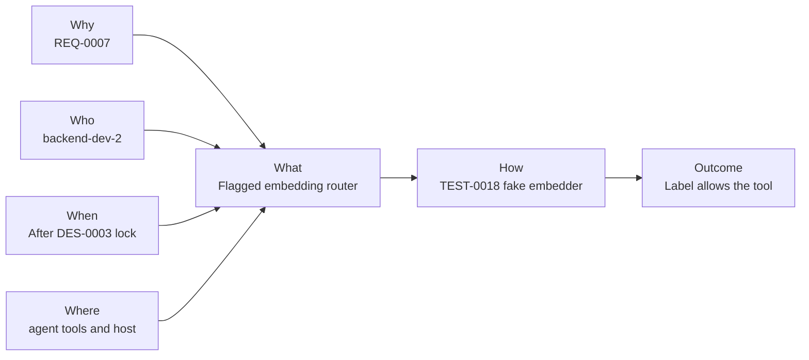
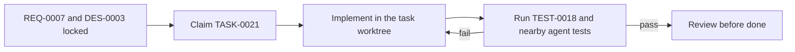

# Task: Route voice tools with Gemini Embedding 2

## Outcome

`INTENT_BACKEND=embedding` classifies a finished English sentence with a frozen prototype set and allows only the matching existing tool. The default process still calls Laya. Evidence is the passing TEST-0018 module suite, including a fake embedder and zero live Gemini calls.

## 5W1H execution canvas

| Dimension | Answer |
|---|---|
| Who | backend-dev-2 builds; qa-agent owns TEST-0018; architect-agent locked DES-0003 |
| What | Embedding router, prototype and eval files, label gate on the existing tools |
| When | Starts 17 October 2026 from the approved REQ-0007 design. Live 36-of-40 measurement is a later task |
| Where | `agent/tools/` and `agent/prompt_shop_live/` in the TASK-0021 worktree |
| Why | REQ-0007. The label, not the live model's first guess, allows the tool |
| How | Fake-embedder unit tests plus the existing shopper-tool tests on the Laya revision |

## 5W1H graph

## Execution workflow

## Inputs and dependencies

- **Requirement(s):** REQ-0007
- **Design(s):** DES-0003
- **Blocked by:** none
- **Required decisions/data/access:** ADR-0002. No live API key is required for this task.

## Implementation plan

1. Add the prototype file, the disjoint 40-sentence eval file, and `EmbeddingRouter` with an injectable embedder.
2. Dispatch `classify_intent` to that router only when `INTENT_BACKEND=embedding`. Leave the Laya function as the default.
3. Remember current results and the current route on the tool host. Enforce the label only for a `gemini-embedding-2` revision.
4. Prove the decision rule, the session gates, the tool refusal, the request shape, and the unchanged Laya checker with TEST-0018.

## Definition of done

- [ ] The router matches DES-0003 and REQ-0007.
- [ ] TEST-0018 is recorded in `verified_by` and its module tests passed without a live embedding call.
- [ ] Review is recorded before this task is marked done.
- [ ] Laya remains the default and REQ-0006 is not edited.

## Notes

Worktree: `.worktrees/TASK-0021`. Branch: `feature/TASK-0021-route-voice-tools-with-gemini-embedding-`.

This task does not commit, open a pull request, measure the 40-sentence set against the live model, or remove Laya. The 500 ms p95 target is not a measurement.

> note: On 17 October 2026 the agent suite passed 61 tests: test_embedding_router, test_shopper_tools, and test_runtime. The fake embedder made no live Gemini call. The intent adapter assertion that SCHEMAS has only three tools still fails because get_conversation_summary is already registered; that mismatch is on origin/develop and was not introduced here.
