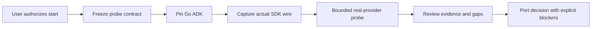

# Go ADK compatibility qualification

## Outcome and authorization

The user requested “start build roadmap 3” on 18 October 2026. GPT claims the
first bounded milestone in sync mode, one builder, `.worktrees/TASK-0023`.
Deliver a pinned Go ADK probe, executable wire-level SDK contract tests and a
capability report. The report must distinguish live evidence from fixtures and
identify any cutover blocker. Full runtime port and rollout follow the gate.
TASK-0021's lock and the running TASK-0022 Python app remain untouched.

## 5W1H execution canvas

| Dimension | Answer |
|---|---|
| Who | backend-dev-2 / GPT builder, distinct GPT read-only review, QA evidence |
| What | Reproducible native-streaming compatibility probe and capability report |
| When | User-authorized start, after DES-0004 probe contracts are locked |
| Where | agent-go isolated module and new task evidence; no main app changes |
| Why | ROADMAP-0003 requires model/audio/tool parity before a runtime port |
| How | Pin SDKs, inspect and capture setup wire, exercise real ADK tools/events, run bounded provider probe, review actual output |

## Inputs and implementation plan

REQ-0008, DES-0004, ADR-0003, ROADMAP-0003 and the v0.5.0 Python runtime are
inputs. Exclusive code surfaces: `agent-go/` and `.github/workflows/go-adk-compat.yml`; exclusive ledger: this task and its
new requirement/design/ADR/test/evidence. No root go.mod or shared runtime edits.

1. Create a separate module pinned to Go ADK v2.6.0 and GenAI v1.74.0.
2. Exercise Runner.RunLive against a local WebSocket fixture and inspect setup,
   input activity, PCM, transcripts, function tools, completion and cleanup.
3. Add an opt-in real-provider CLI using the configured server-owned model/voice.
   Report booleans/counts/status only, with bounded lifetime and no raw errors.
4. Record missing capabilities and whether milestone 1 permits a port. A failed
   required SDK contract blocks cutover, not permission to bypass ADK silently.
5. Perform a separate read-only review of source, executed tests and evidence.

## Definition of done

- [x] Pinned module compiles and characterization tests run on actual ADK APIs.
- [x] Native configured-model/tool/audio evidence or a precise failed gate is recorded.
- [x] Compatibility report states the port decision and unresolved SDK gaps.
- [x] Distinct review and verification evidence are recorded before integration.

## Review — PASS

A distinct GPT/Codex read-only review pass inspected the staged source, REQ-0008,
the locked DES-0004 compatibility amendment, ADR-0003, TEST-0020 and actual native
and fixture records. This review follows the builder pass and does not substitute
for a human approver on a later high-risk runtime cutover. Exact session model
revision is not exposed; the builder/reviewer family is GPT through Codex.

Scope is an isolated diagnostic module and credential-free CI. Root Go/Python
dependencies, application routes, browser state and running services are untouched.
Reviewed the three SDK patches against exact pinned sources, strict function-tool
arguments, opt-in before provider requests, report allowlisting, process bounds,
wire cases, race resolution and cleanup. Generated SDK copies and raw diagnostic
files are excluded. Whole-tree integrity checks reject mutated SDK copies.

The only formatting exception is the narrow .gitattributes rule for unified-diff
context markers in compat/*.patch; Go source still uses gofmt and cached diff
checks pass. Source/evidence hashes match. Stock and intermediate failures remain
visible. No blocking finding for merging this compatibility experiment. This
does not qualify stock SDKs, production transport bounds or the full Monti port.

## SDK compatibility amendment

DES-0004 records three observed upstream defects and permits versioned, explicit patches in ignored checksum-verified SDK copies. Both failing stock results remain evidence. Patched results identify the overlay. No module-cache mutation, app cutover or deployment is included.

## Completion evidence

Implementation and distinct review are complete. Both PR #39 checks passed on
950dcba5e612b741d20e9897040bd4b9211fa52e: Go ADK compatibility and Voice and map
regression. This ledger-only completion update changes no tested source.
ROADMAP-0003 remains in progress; private bridge/tool-host port, application
parity, load measurements and rollout remain separate milestones.
