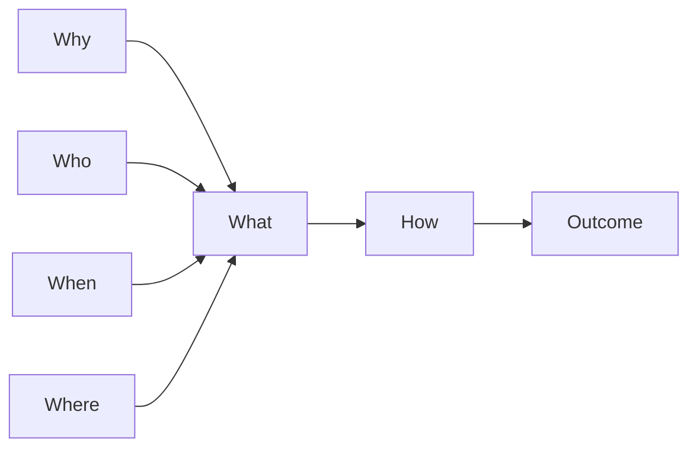
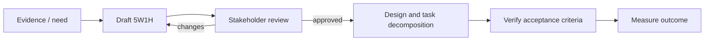

# Requirement: <title>

## Outcome

State the observable user or business result. Use a measurable form such as: **Increase/decrease `<metric>` from `<baseline>` to `<target>` by `<date>`**.

## 5W1H canvas

| Dimension | Question | Answer |
|---|---|---|
| **Who** | Who needs this, uses it, approves it, or is affected? | <actors and stakeholders> |
| **What** | What capability, behavior, or constraint is required? | <required result, not a solution> |
| **When** | When is it triggered, needed, or considered complete? | <trigger, frequency, deadline> |
| **Where** | Where does it apply in the journey, system, or environment? | <touchpoints and boundaries> |
| **Why** | Why does it matter, and what problem or opportunity does it address? | <value and evidence> |
| **How** | How will success be observed without prescribing implementation? | <measurement and acceptance approach> |

## 5W1H graph

Keep every node short and consistent with the canvas above.

## Requirement workflow

## Context and evidence

<problem evidence, current behavior, baseline, and relevant links>

## Acceptance criteria

- [ ] Given <starting context>, when <event or action>, then <observable result>.
- [ ] The outcome metric has an owner, baseline, target, and measurement date.
- [ ] Scope and non-goals are explicit.

## Scope

- **In scope:** <included behavior>
- **Out of scope:** <excluded behavior>
- **Dependencies:** <other artifacts, teams, systems, or decisions>

## Notes

<decisions, open questions, and follow-up links>
