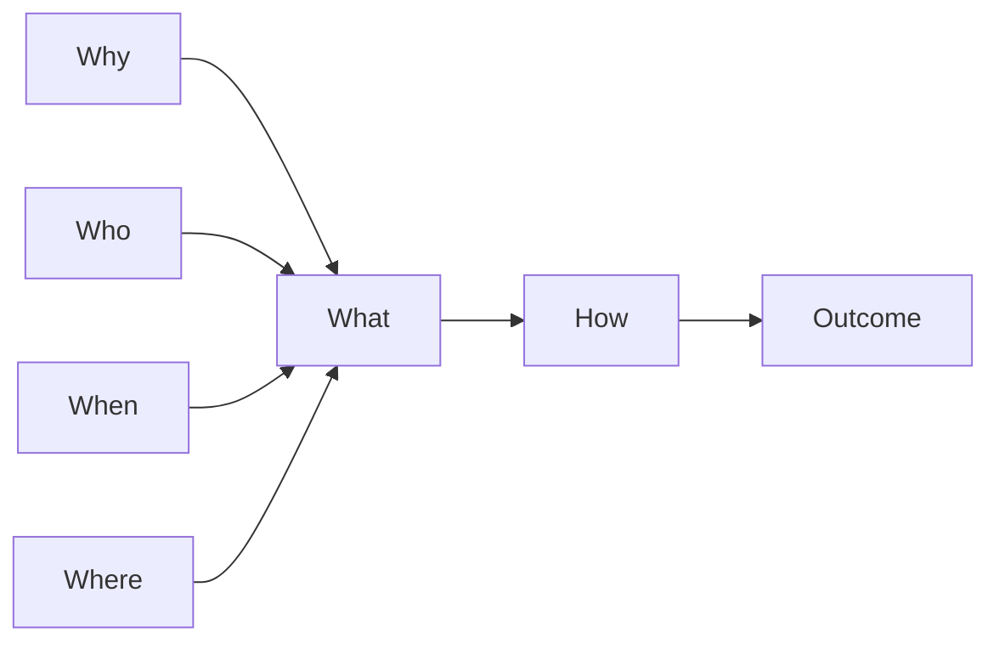
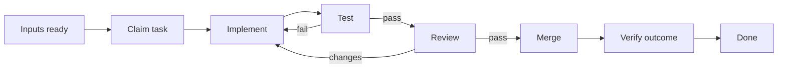

# Task: <title>

## Outcome

State the concrete, reviewable result this task produces and the evidence that will prove it is done.

## 5W1H execution canvas

| Dimension | Question | Answer |
|---|---|---|
| **Who** | Who owns, reviews, tests, or receives this work? | <owner, reviewers, consumers> |
| **What** | What exact deliverable or change will be produced? | <bounded deliverable> |
| **When** | When can work start and when must it finish? | <prerequisites, sprint, target> |
| **Where** | Where will the change be made and observed? | <repos, modules, environments, UI/API> |
| **Why** | Why is this task needed and which requirement outcome does it advance? | <REQ IDs and value> |
| **How** | How will the work be executed and verified? | <approach, tests, review evidence> |

## 5W1H graph

## Execution workflow

## Inputs and dependencies

- **Requirement(s):** <REQ-XXXX>
- **Design(s):** <DES-XXXX>
- **Blocked by:** <TASK-XXXX or none>
- **Required decisions/data/access:** <inputs needed before start>

## Implementation plan

1. <bounded implementation step and expected intermediate result>
2. <bounded implementation step and expected intermediate result>
3. <verification and handoff step>

## Definition of done

- [ ] Deliverable matches the linked requirement and approved design.
- [ ] Automated and/or manual verification is recorded in `verified_by:`.
- [ ] Review feedback is resolved and the observable outcome is demonstrated.
- [ ] Documentation, rollout, or operational follow-up is completed when applicable.

## Notes

<decisions, constraints, and implementation discoveries>
